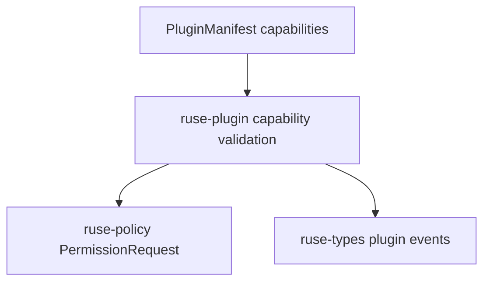

# M11-03 Plugin Capabilities Spec

## Purpose

Validate plugin capability declarations and map plugin tool access into the existing policy model without granting permissions from the manifest alone.

## Product Context

Plugins are useful only if they can declare what they need, but the runtime remains safe only if declarations are treated as requested capability, not authorization.

## Scope

This spec delivers:

- `PluginCapabilityManifest`
- `PluginCapabilityKind`
- `PluginPermission`
- `PluginCapabilitySet`
- `validate_plugin_capabilities`
- `permission_request_for_plugin_tool`
- capability validation runtime event payloads

Owned by other specs:

- manifest parsing shell: `M11-01-plugin-manifest`
- process execution: `M11-02-process-plugin-host`
- tool adapter: `M11-04-plugin-tools-hooks`

## Architecture

Capability validation lives in `ruse-plugin`. Policy decisions remain in `ruse-policy`.



## File Layout

```text
crates/
  ruse-plugin/
    src/
      capability.rs
    tests/
      capabilities.rs
crates/
  ruse-types/
    src/
      external.rs
```

## Public Contracts

```rust
#[serde(rename_all = "snake_case")]
pub enum PluginCapabilityKind {
    Tool,
    Hook,
    Filesystem,
    Command,
    Network,
    Mcp,
    Secret,
}

pub struct PluginPermission {
    pub resource: String,
    pub action: String,
}

pub struct PluginCapabilitySet {
    pub plugin_name: PluginName,
    pub capabilities: Vec<PluginCapabilityManifest>,
}

pub fn validate_plugin_capabilities(manifest: &PluginManifest) -> Result<PluginCapabilitySet, PluginManifestError>;

pub fn permission_request_for_plugin_tool(
    plugin_name: &PluginName,
    tool_name: &ruse_tool::ToolName,
    actor: ruse_types::ActorRef,
    correlation_id: ruse_types::CorrelationId,
) -> Result<ruse_policy::PermissionRequest, PluginManifestError>;
```

## State And Failure Handling

- Tool manifests without matching tool capabilities fail validation.
- Hook manifests without matching hook capabilities fail validation.
- Empty permission resource or action fails validation.
- Duplicate capabilities fail validation.
- Policy request creation errors are wrapped in plugin errors.

## Security And Privacy

- Capabilities do not grant permissions.
- Permission requests record plugin actor, tool resource, reason, and correlation id.
- Secret capability declarations use secret handles only.
- Capability validation events store summaries and counts, not secret values.

## Testing Strategy

- valid manifest builds a capability set
- missing tool capability fails
- missing hook capability fails
- duplicate capability fails
- invalid permission declaration fails
- plugin tool permission request maps to `CapabilityAction::Read` and `ResourceKind::Tool`
- capability event payload serializes stable shape

## Acceptance Criteria

- Plugin capabilities can be validated before activation.
- Plugin tool calls have a deterministic policy request path.
- Capability validation is represented in traceable runtime metadata.
- `cargo test -p ruse-plugin capabilities` passes.

## Completion Signal

M11-03 is complete when capability tests pass, workspace verification passes, and active implementation advances to `M11-04-plugin-tools-hooks`.
