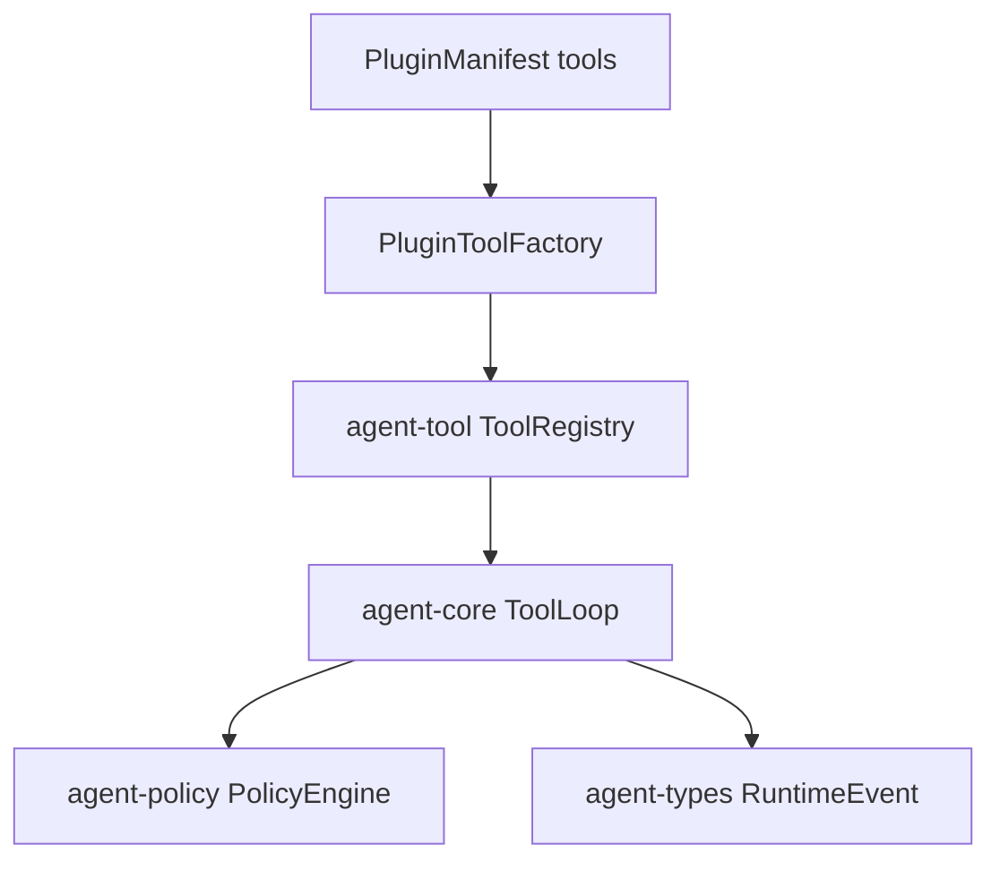

# M11-04 Plugin Tools And Hooks Spec

## Purpose

Register plugin-provided tools into the existing tool registry and add lifecycle hook contracts that are bounded, traceable, and unable to mutate core state directly.

## Product Context

This slice proves the main M11 acceptance criterion: a plugin can expose a tool that executes through the same policy, event, and audit path as a built-in tool.

## Scope

This spec delivers:

- `PluginTool`
- `PluginToolFactory`
- `register_plugin_tools`
- `PluginHook`
- `PluginHookEvent`
- `PluginHookOutcome`
- `PluginHookRunner`
- core integration test for plugin tool policy path

Owned by other specs:

- manifest parsing: `M11-01-plugin-manifest`
- process host: `M11-02-process-plugin-host`
- capability validation: `M11-03-plugin-capabilities`
- WASM host: `M11-05-wasm-prototype`

## Architecture

Plugin tools implement `agent_tool::Tool`. `agent-core::ToolLoop` remains the event and policy execution path.



## File Layout

```text
crates/
  agent-plugin/
    src/
      tool.rs
      hook.rs
    tests/
      plugin_tools_hooks.rs
crates/
  agent-core/
    tests/
      m11_plugin_runtime_integration.rs
```

## Public Contracts

```rust
pub struct PluginTool {
    pub plugin_name: PluginName,
    pub definition: agent_tool::ToolDefinition,
    pub host: Arc<dyn PluginToolHost>,
}

pub trait PluginToolHost: Send + Sync {
    fn invoke(&self, request: PluginToolInvocation) -> Result<agent_tool::ToolOutput, PluginProcessError>;
}

pub fn register_plugin_tools(
    registry: &mut agent_tool::ToolRegistry,
    manifest: &PluginManifest,
    host: Arc<dyn PluginToolHost>,
) -> Result<Vec<agent_tool::ToolName>, PluginManifestError>;
```

Hook contracts:

```rust
#[serde(rename_all = "snake_case")]
pub enum PluginHookEvent {
    TurnStarted,
    ToolCompleted,
    TurnCompleted,
    TaskFailed,
}

pub struct PluginHookOutcome {
    pub hook_name: String,
    pub emitted_messages: Vec<String>,
}
```

## State And Failure Handling

- Duplicate tool registration uses `ToolRegistryError::DuplicateTool`.
- Plugin host errors become `ToolError::Execution`.
- Hook failures are recorded as plugin hook errors but do not hide original runtime results.
- Hook loop prevention uses correlation id plus hook name.

## Security And Privacy

- Plugin tools receive only validated tool input JSON.
- Plugin tool output is untrusted and bounded by host configuration.
- Hooks receive redacted summaries, not raw tool input or secret-like fields.
- Plugin tool execution still requires policy allow/ask/deny.

## Testing Strategy

- plugin tool definitions match manifest declarations
- plugin tool registers in `ToolRegistry`
- duplicate plugin tool registration fails
- plugin tool invokes host and returns output
- plugin host error maps to `ToolError::Execution`
- hook runner records success and failure outcomes
- core integration proves plugin tool events include proposal, permission decision, execution, and observation

## Acceptance Criteria

- Plugin tools run through `ToolRegistry`.
- Plugin tool calls run through `ToolLoop` policy and runtime event path.
- Hook contracts are bounded and traceable.
- `cargo test -p agent-plugin plugin_tools_hooks` and `cargo test -p agent-core m11_plugin_runtime_integration` pass.

## Completion Signal

M11-04 is complete when plugin tool and hook tests pass, workspace verification passes, and active implementation advances to `M11-05-wasm-prototype`.
