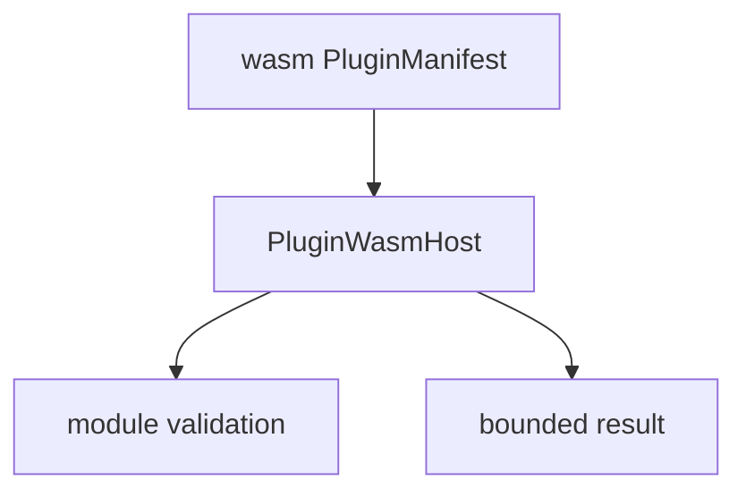

# M11-05 WASM Prototype Spec

## Purpose

Add a constrained WASM plugin host prototype that validates WASM plugin declarations and executes only an intentionally small, non-privileged interface.

## Product Context

WASM support gives future plugin authors a portable extension path. M11 keeps it deliberately narrow so process plugins remain the production path while the runtime proves isolation boundaries and compatibility shape.

## Scope

This spec delivers:

- `PluginWasmHost`
- `PluginWasmConfig`
- `PluginWasmModule`
- WASM manifest validation
- deterministic prototype invocation path

Owned by later milestones:

- production WASM host ABI
- WASI filesystem/network permissions
- plugin package signing
- plugin marketplace distribution

## Architecture

WASM contracts live in `agent-plugin::wasm`. The prototype does not bypass policy or register tools directly.



## File Layout

```text
crates/
  agent-plugin/
    src/
      wasm.rs
    tests/
      wasm_host.rs
```

## Public Contracts

```rust
pub struct PluginWasmConfig {
    pub entrypoint: String,
    pub max_module_bytes: usize,
}

pub struct PluginWasmModule {
    pub bytes: Vec<u8>,
}

pub struct PluginWasmHost;
```

M11 prototype behavior:

- validates WASM magic bytes and version
- enforces maximum module size
- rejects manifests that use WASM isolation without entrypoint
- exposes a deterministic `describe_module` result for tests
- does not expose filesystem, network, command, or secret host calls

## State And Failure Handling

- oversized module returns `PluginWasmError::ModuleTooLarge`
- invalid magic/version returns `PluginWasmError::InvalidModule`
- missing entrypoint returns `PluginWasmError::InvalidConfig`
- unsupported host function request returns `PluginWasmError::UnsupportedHostCall`

## Security And Privacy

- M11 WASM prototype has no host capabilities.
- No WASI filesystem or network access.
- No secret injection.
- No dynamic linking.

## Testing Strategy

- valid minimal module is accepted
- invalid magic bytes are rejected
- oversized module is rejected
- WASM manifest without entrypoint is rejected
- unsupported host call is rejected

## Acceptance Criteria

- WASM isolation mode has a typed host prototype.
- Prototype clearly rejects privileged behavior.
- M11 milestone acceptance criteria remain satisfied after workspace verification.
- `cargo test -p agent-plugin wasm_host` passes.

## Completion Signal

M11-05 and M11 are complete when WASM prototype tests pass, full workspace verification passes, M11 status is marked complete, and active focus advances to M12 planning.
