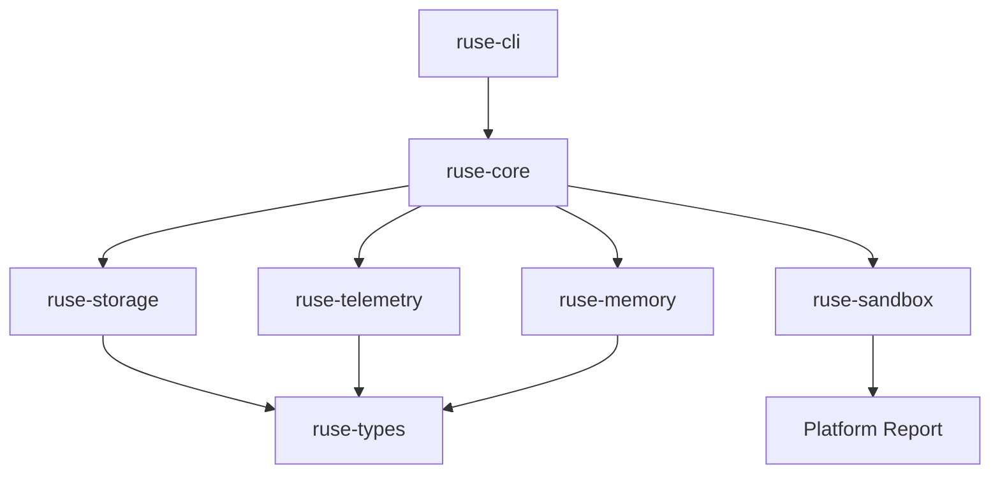

# M12-00 Production Hardening Technical Design Spec

## Purpose

Define the M12 production-hardening baseline so migrations, telemetry, audit export, memory portability, platform reports, and benchmarks evolve as one coherent reliability layer instead of isolated utilities.

## Product Context

M12 moves `agent` from feature-complete runtime slices toward daily-use readiness. The milestone must preserve local-first operation, event-sourced auditability, typed public contracts, and CLI/Desktop neutrality while adding upgrade, observability, portability, and repeatable performance evidence.

## Scope

This design governs:

- schema and config migration contracts
- telemetry span and metric contracts
- audit and trace export bundle contracts
- memory import/export archive contracts
- platform sandbox capability reports
- deterministic benchmark scenarios
- storage, privacy, testing, and compatibility rules

Owned by implementation slices:

- `M12-01-schema-migration`: migration registry, version ranges, reports, and fixtures
- `M12-02-telemetry`: telemetry crate, spans, metrics, trace context, and redaction
- `M12-03-audit-export`: exportable audit/trace bundles from runtime events
- `M12-04-memory-portability`: memory archive import/export with retention controls
- `M12-05-platform-capability-report`: sandbox/platform capability report
- `M12-06-benchmarks`: deterministic benchmark scenario contracts and smoke tests

## Architecture

M12 keeps production concerns behind focused crates. `ruse-storage` owns migration contracts because durable schema changes must stay near storage implementations. `ruse-telemetry` owns provider-neutral observability data. `ruse-core` orchestrates audit export and benchmark scenarios using existing runtime events. `ruse-memory` owns memory archive formats. `ruse-sandbox` owns platform capability reports. `ruse-cli` may expose user-facing commands only after the lower-level contracts are stable.



Dependency rules:

- `ruse-storage` must not depend on `ruse-core`, UI crates, model crates, MCP, or plugins.
- `ruse-telemetry` may depend on `ruse-types`, `serde`, `serde_json`, and `thiserror`.
- `ruse-core` may depend on `ruse-telemetry` for orchestration and integration tests.
- `ruse-memory` owns archive validation and must not call storage or UI directly.
- `ruse-sandbox` owns platform reporting and must not depend on `ruse-core`.
- `ruse-cli` exposes commands by calling typed lower-level APIs only.

## File Layout

```text
crates/
  ruse-storage/
    src/migration.rs
    tests/schema_migration.rs
  ruse-telemetry/
    Cargo.toml
    src/lib.rs
    src/span.rs
    src/metric.rs
    src/sink.rs
    tests/telemetry.rs
  ruse-core/
    src/audit_export.rs
    src/benchmark.rs
    tests/audit_export.rs
    tests/benchmarks.rs
  ruse-memory/
    src/archive.rs
    tests/memory_archive.rs
  ruse-sandbox/
    src/platform.rs
    tests/platform_report.rs
docs/
  specs/M12-*.spec.md
  plans/M12-*.plan.md
```

## Migration Model

Migration contracts are explicit and deterministic:

- every durable domain has a named schema family
- every migration has a `from_version`, `to_version`, and stable id
- migrations apply in ascending version order
- migration reports record applied steps, skipped steps, warnings, and blocked changes
- config migrations must never silently broaden permissions
- fixture tests cover every version transition introduced in M12

## Telemetry Model

Telemetry is provider-neutral data, not a dependency on one tracing backend. M12 defines spans, metrics, trace context, and in-memory sinks. Future OpenTelemetry exporters can map these contracts without changing runtime events.

Telemetry data must:

- carry workspace/conversation/turn/task correlation when available
- redact secret-like attributes before storage or export
- keep metric units explicit
- remain serializable for CLI/Desktop bridge snapshots and audit bundles

## Audit Export Model

Audit export converts existing runtime events into bounded bundles. It does not invent new facts. Exported records contain event ids, sequence, actor, correlation, resource, action, decision, summary, and redacted payload metadata. Large artifacts are referenced by hash or path rather than embedded.

## Memory Portability Model

Memory archives are versioned, scoped, and privacy-aware. Exported memory records include scope, sensitivity, source, created timestamp, and content. Import validates archive version, rejects malformed records, preserves sensitivity, and can apply a retention policy before writing records.

## Platform Capability Model

Platform reports describe what the current runtime can safely do on the host. They include filesystem sandbox behavior, symlink handling, process execution availability, shell timeout support, network default, secret provider availability, and plugin isolation support.

## Benchmark Model

Benchmarks are deterministic smoke scenarios in M12, not statistical performance claims. Each scenario records name, inputs, iteration count, elapsed time, operation count, and environment summary. Future milestones can add Criterion or external benchmark dashboards.

## Security And Privacy

- migration reports never contain secret values
- telemetry attributes are redacted before leaving the runtime boundary
- audit exports include decisions and summaries, not raw secret-like payloads
- memory archives preserve sensitivity and allow scoped retention
- platform reports reveal capabilities, not local secret paths
- benchmark scenarios use deterministic fake providers and local fixtures

## Testing Strategy

Required verification:

- focused tests for each M12 slice
- schema fixture tests for migration paths
- serialization shape tests for telemetry, audit, memory archive, platform report, and benchmark data
- redaction tests for telemetry and audit export
- import/export round-trip tests for memory archives
- standard workspace gates:

```bash
cargo fmt --all -- --check
cargo clippy --workspace --all-targets -- -D warnings
cargo test --workspace
```

## Acceptance Criteria

- M12 slices provide typed contracts with deterministic tests.
- Users can upgrade durable data through explicit migration reports.
- Runtime behavior can be inspected through telemetry and audit export data.
- Memory can be exported and imported without losing scope or sensitivity.
- Platform reports explain sandbox capability differences.
- Benchmark smoke scenarios run repeatably without live model, network, or secrets.

## Completion Signal

M12 is complete when all slice plans are checked off, all focused tests and workspace gates pass, M12 status is marked complete, and active focus advances beyond production hardening.
