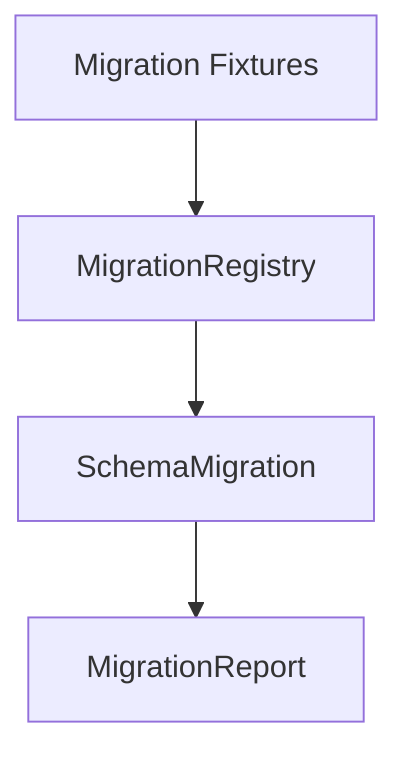

# M12-01 Schema Migration Spec

## Purpose

Add typed migration contracts for durable runtime data so storage, config, memory, and plugin schemas can evolve without silent behavior changes.

## Product Context

Production use requires safe upgrades. This slice gives later M12 work one migration vocabulary for schema families, version ranges, reports, skipped steps, warnings, and blocked changes.

## Scope

This spec delivers:

- `SchemaFamily`
- `SchemaVersion`
- `SchemaMigration`
- `MigrationRegistry`
- `MigrationReport`
- `MigrationDiagnostic`
- migration fixture tests

Owned by other specs:

- telemetry fields: `M12-02-telemetry`
- audit bundle format: `M12-03-audit-export`
- memory archive format: `M12-04-memory-portability`

## Architecture

Migration contracts live in `ruse-storage`. They are pure Rust contracts and fixture helpers in M12; individual storage backends can adopt them incrementally.



## File Layout

```text
crates/
  ruse-storage/
    src/
      lib.rs
      migration.rs
    tests/
      schema_migration.rs
```

## Public Contracts

```rust
pub enum SchemaFamily {
    Event,
    Checkpoint,
    Config,
    Memory,
    Plugin,
}

pub struct SchemaVersion(pub u32);

pub trait SchemaMigration {
    fn family(&self) -> SchemaFamily;
    fn from_version(&self) -> SchemaVersion;
    fn to_version(&self) -> SchemaVersion;
    fn id(&self) -> &str;
    fn apply(&self, input: serde_json::Value) -> Result<serde_json::Value, MigrationError>;
}

pub struct MigrationReport {
    pub family: SchemaFamily,
    pub from_version: SchemaVersion,
    pub to_version: SchemaVersion,
    pub applied_migrations: Vec<String>,
    pub diagnostics: Vec<MigrationDiagnostic>,
}
```

## State And Failure Handling

- migrations run in ascending contiguous version order
- missing migration steps produce a blocked report
- invalid fixture JSON produces a recoverable migration error
- a migration that broadens permissions without an explicit diagnostic is rejected by tests

## Security And Privacy

- migration diagnostics store keys and summaries, not secret values
- config migration tests prove permission broadening is explicit
- fixture files contain deterministic sample data only

## Testing Strategy

- registry orders migrations by version
- registry rejects gaps and duplicate version pairs
- migration report serializes stable shape
- config migration reports permission broadening
- fixture migration upgrades sample event/config JSON

## Acceptance Criteria

- `ruse-storage` exposes typed migration contracts.
- Missing, duplicate, and invalid migration paths fail deterministically.
- Migration reports are serializable and auditable.
- `cargo test -p ruse-storage schema_migration` passes.

## Completion Signal

M12-01 is complete when migration tests pass, workspace verification passes, and active implementation advances to `M12-02-telemetry`.
