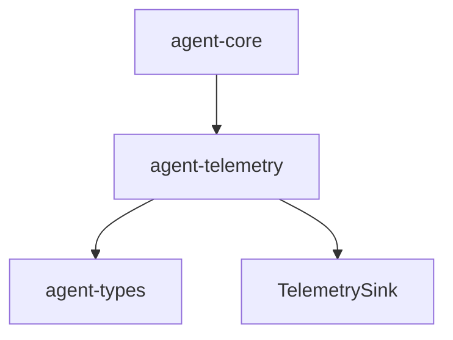

# M12-02 Telemetry Spec

## Purpose

Add provider-neutral telemetry contracts for spans, metrics, trace context, and redacted in-memory collection.

## Product Context

Users and developers need runtime behavior to be observable without binding the core runtime to one telemetry vendor. This slice defines stable telemetry data that later exporters can map to OpenTelemetry.

## Scope

This spec delivers:

- `agent-telemetry` crate
- `TelemetrySpan`
- `TelemetryMetric`
- `TraceContext`
- `TelemetryAttribute`
- `InMemoryTelemetrySink`
- redaction rules for secret-like attributes

Owned by other specs:

- audit export bundles: `M12-03-audit-export`
- benchmark scenarios: `M12-06-benchmarks`

## Architecture

`agent-telemetry` is a low-level crate. It may depend on `agent-types` for ids and correlation data, but it must not depend on `agent-core`, storage, UI, models, MCP, or plugins.



## File Layout

```text
crates/
  agent-telemetry/
    Cargo.toml
    src/
      lib.rs
      span.rs
      metric.rs
      sink.rs
    tests/
      telemetry.rs
Cargo.toml
Cargo.lock
```

## Public Contracts

```rust
pub struct TraceContext {
    pub trace_id: String,
    pub span_id: String,
    pub parent_span_id: Option<String>,
}

pub struct TelemetrySpan {
    pub name: String,
    pub context: TraceContext,
    pub attributes: Vec<TelemetryAttribute>,
}

pub struct TelemetryMetric {
    pub name: String,
    pub unit: String,
    pub value: f64,
    pub attributes: Vec<TelemetryAttribute>,
}

pub trait TelemetrySink {
    fn record_span(&mut self, span: TelemetrySpan);
    fn record_metric(&mut self, metric: TelemetryMetric);
}
```

## State And Failure Handling

- empty span names, metric names, units, trace ids, or span ids are rejected
- non-finite metric values are rejected
- redaction happens before data enters a sink
- in-memory sink preserves insertion order

## Security And Privacy

- attribute keys containing `secret`, `token`, `password`, or `key` are redacted
- values that look like environment secrets are redacted in tests
- telemetry data stores ids and summaries, not raw prompts or secret values

## Testing Strategy

- telemetry spans serialize stable shape
- metric validation rejects non-finite values
- in-memory sink records spans and metrics in order
- redaction removes secret-like attributes before sink storage
- trace context rejects empty identifiers

## Acceptance Criteria

- `agent-telemetry` is a workspace crate.
- Telemetry spans and metrics are typed, serializable, validated, and redacted.
- `cargo test -p agent-telemetry telemetry` passes.

## Completion Signal

M12-02 is complete when telemetry tests pass, workspace verification passes, and active implementation advances to `M12-03-audit-export`.
