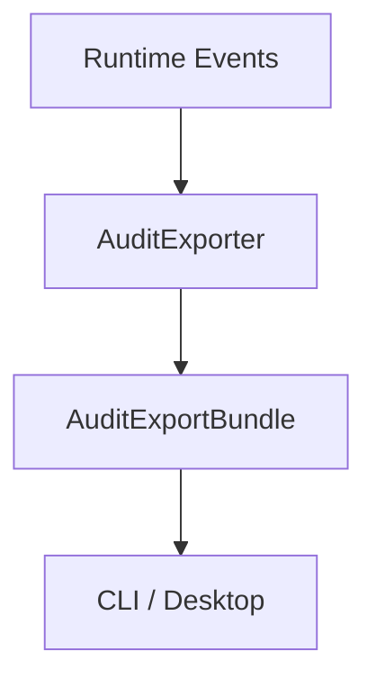

# M12-03 Audit Export Spec

## Purpose

Add exportable audit and trace bundles derived from runtime events without inventing new facts or exposing raw secrets.

## Product Context

Operators need to inspect what happened during agent work, share trace bundles for debugging, and preserve audit evidence. This slice makes runtime events portable as bounded, redacted audit exports.

## Scope

This spec delivers:

- `AuditExportBundle`
- `AuditExportRecord`
- `TraceExportSummary`
- `AuditExportOptions`
- runtime-event-to-audit-record conversion
- redaction tests

Owned by other specs:

- telemetry spans and metrics: `M12-02-telemetry`
- memory archive export: `M12-04-memory-portability`

## Architecture

Audit export lives in `agent-core` because it composes runtime events from multiple lower-level crates. It consumes `agent-types` events and produces serializable export bundles. Storage remains responsible for reading events; this slice uses in-memory event vectors for deterministic tests.



## File Layout

```text
crates/
  agent-core/
    src/
      lib.rs
      audit_export.rs
    tests/
      audit_export.rs
```

## Public Contracts

```rust
pub struct AuditExportOptions {
    pub include_diagnostics: bool,
    pub max_payload_bytes: usize,
}

pub struct AuditExportBundle {
    pub schema_version: u32,
    pub generated_at: agent_types::Timestamp,
    pub records: Vec<AuditExportRecord>,
    pub summary: TraceExportSummary,
}
```

## State And Failure Handling

- empty exports are valid and produce zero-count summaries
- oversized payload summaries are truncated with a diagnostic marker
- unknown event payloads are exported as typed summaries when possible
- invalid options return typed errors before export starts

## Security And Privacy

- secret-like keys and values are redacted
- raw tool inputs are summarized, not copied wholesale
- export records include actor, event id, sequence, correlation id, and summary
- generated bundles are deterministic except for `generated_at`

## Testing Strategy

- audit export serializes stable bundle shape
- permission and tool events map to audit records
- secret-like payload fields are redacted
- empty event lists produce empty bundles
- invalid options are rejected

## Acceptance Criteria

- Runtime events can be converted into redacted audit bundles.
- Export summaries include counts by event category.
- `cargo test -p agent-core audit_export` passes.

## Completion Signal

M12-03 is complete when audit export tests pass, workspace verification passes, and active implementation advances to `M12-04-memory-portability`.
