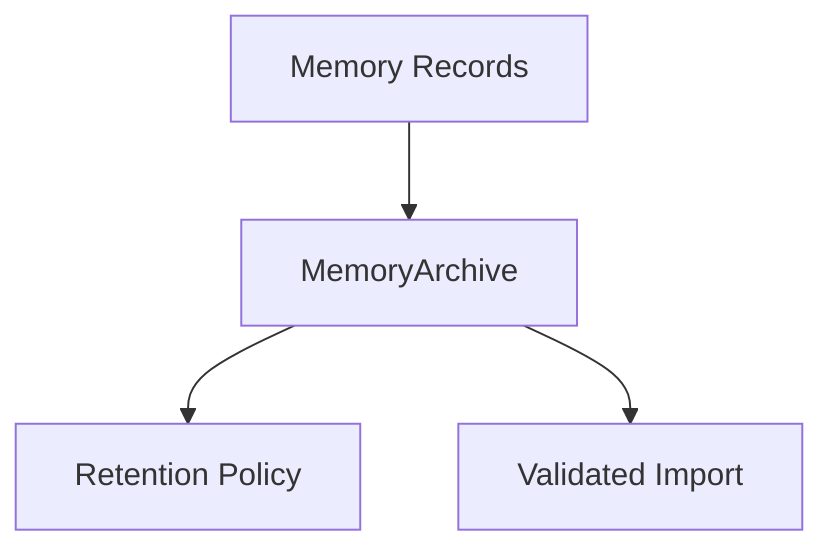

# M12-04 Memory Portability Spec

## Purpose

Add versioned memory archive import/export contracts so conversation and project memories can be moved, reviewed, retained, or deleted without losing scope and sensitivity metadata.

## Product Context

Memory is valuable only if users can understand and control it. This slice provides a portable archive format that supports backup, migration, and privacy workflows.

## Scope

This spec delivers:

- `MemoryArchive`
- `MemoryArchiveRecord`
- `MemoryArchiveManifest`
- `MemoryRetentionPolicy`
- export and import validation helpers
- archive round-trip tests

Owned by other specs:

- schema migration registry: `M12-01-schema-migration`
- audit export bundles: `M12-03-audit-export`

## Architecture

Memory portability lives in `ruse-memory`. Archive contracts use existing memory record concepts and remain independent from storage backends and UI crates.



## File Layout

```text
crates/
  ruse-memory/
    src/
      lib.rs
      archive.rs
    tests/
      memory_archive.rs
```

## Public Contracts

```rust
pub struct MemoryArchive {
    pub schema_version: u32,
    pub manifest: MemoryArchiveManifest,
    pub records: Vec<MemoryArchiveRecord>,
}

pub struct MemoryRetentionPolicy {
    pub include_sensitive: bool,
    pub max_records: Option<usize>,
}
```

## State And Failure Handling

- unsupported archive schema versions are rejected
- duplicate record ids are rejected
- retention policies can exclude sensitive records
- import reports accepted, skipped, and rejected counts

## Security And Privacy

- sensitivity is preserved during export and import
- archives can be generated without sensitive records
- archive tests contain deterministic fake memory only
- import never silently downgrades sensitivity

## Testing Strategy

- archive serializes stable shape
- export applies retention policy
- import rejects duplicate ids
- import preserves scope and sensitivity
- archive round trip returns expected records

## Acceptance Criteria

- Memory records can be exported and imported through a versioned archive.
- Retention policies are explicit and test-covered.
- `cargo test -p ruse-memory memory_archive` passes.

## Completion Signal

M12-04 is complete when memory archive tests pass, workspace verification passes, and active implementation advances to `M12-05-platform-capability-report`.
