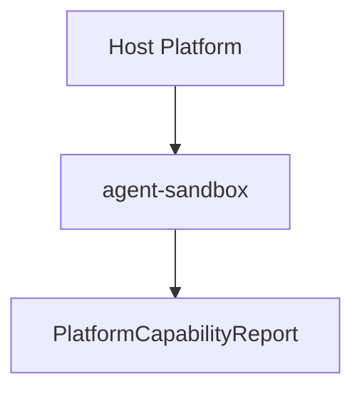

# M12-05 Platform Capability Report Spec

## Purpose

Add a typed report describing sandbox and host capabilities for the current platform.

## Product Context

CLI and Desktop users need to know which security and execution guarantees are available on their machine. Platform reports make sandbox differences explicit and auditable.

## Scope

This spec delivers:

- `PlatformCapabilityReport`
- `SandboxCapability`
- `PluginIsolationCapability`
- `SecretProviderCapability`
- deterministic report builder
- platform report serialization tests

Owned by other specs:

- telemetry export of reports: later milestone
- Desktop rendering: later milestone

## Architecture

Platform reporting lives in `agent-sandbox` because sandbox behavior owns filesystem, process, symlink, and platform capability knowledge.



## File Layout

```text
crates/
  agent-sandbox/
    src/
      lib.rs
      platform.rs
    tests/
      platform_report.rs
```

## Public Contracts

```rust
pub struct PlatformCapabilityReport {
    pub os: String,
    pub filesystem_sandbox: SandboxCapability,
    pub symlink_protection: SandboxCapability,
    pub process_execution: SandboxCapability,
    pub network_default: SandboxCapability,
    pub plugin_isolation: PluginIsolationCapability,
    pub secret_provider: SecretProviderCapability,
}
```

## State And Failure Handling

- unknown capabilities are represented explicitly
- report builders reject empty OS names
- unsupported features are reported, not treated as panics
- deterministic builders support tests independent of host OS

## Security And Privacy

- reports describe capability categories, not secret values
- local filesystem paths are omitted unless explicitly requested by future UI specs
- network default is conservative when uncertain

## Testing Strategy

- report serializes stable shape
- deterministic builder rejects empty OS names
- default report includes current OS name
- unsupported capabilities are represented explicitly
- plugin isolation capability reports process and wasm availability

## Acceptance Criteria

- `agent-sandbox` can produce a typed platform report.
- Report fields are serializable and deterministic in tests.
- `cargo test -p agent-sandbox platform_report` passes.

## Completion Signal

M12-05 is complete when platform report tests pass, workspace verification passes, and active implementation advances to `M12-06-benchmarks`.
