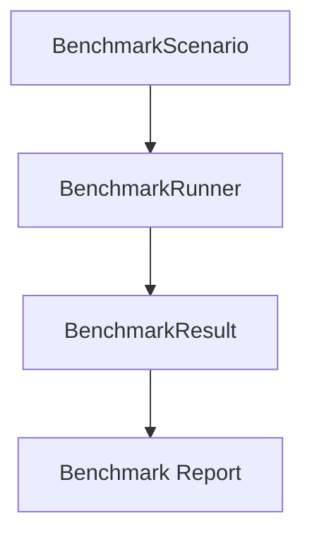

# M12-06 Benchmarks Spec

## Purpose

Add deterministic benchmark scenario contracts and smoke tests for core runtime operations.

## Product Context

Production hardening needs repeatable performance evidence. M12 introduces benchmark data structures and smoke scenarios without claiming statistically rigorous performance numbers.

## Scope

This spec delivers:

- `BenchmarkScenario`
- `BenchmarkResult`
- `BenchmarkEnvironment`
- deterministic benchmark runner
- smoke scenarios for turn replay, tool dispatch, event append, and context compaction

Owned by later milestones:

- Criterion benchmark harness
- historical benchmark dashboards
- CI performance thresholds

## Architecture

Benchmark contracts live in `agent-core` because scenarios combine runtime, storage, tools, context, and model-free fake data. M12 benchmarks use deterministic iteration counts and local in-memory fixtures.



## File Layout

```text
crates/
  agent-core/
    src/
      lib.rs
      benchmark.rs
    tests/
      benchmarks.rs
```

## Public Contracts

```rust
pub struct BenchmarkScenario {
    pub name: String,
    pub iterations: u32,
    pub operation_count: u64,
}

pub struct BenchmarkResult {
    pub scenario_name: String,
    pub iterations: u32,
    pub operation_count: u64,
    pub elapsed_micros: u128,
}
```

## State And Failure Handling

- empty scenario names are rejected
- zero iterations are rejected
- benchmark functions return typed errors rather than panicking
- results carry environment summaries for reproducibility

## Security And Privacy

- benchmark fixtures contain no real prompts, secrets, network calls, or repository data
- results store counts and durations only
- benchmark smoke tests use fake providers and in-memory stores

## Testing Strategy

- benchmark scenario serializes stable shape
- runner rejects invalid scenarios
- deterministic runner records operation counts
- benchmark results include environment summary
- smoke scenarios execute without live model, network, or shell access

## Acceptance Criteria

- Core benchmark scenarios are typed and repeatable.
- Smoke benchmark tests run in the normal workspace test suite.
- `cargo test -p agent-core benchmarks` passes.

## Completion Signal

M12-06 and M12 are complete when benchmark tests pass, full workspace verification passes, M12 status is marked complete, and the milestone plan has no unchecked implementation tasks.
