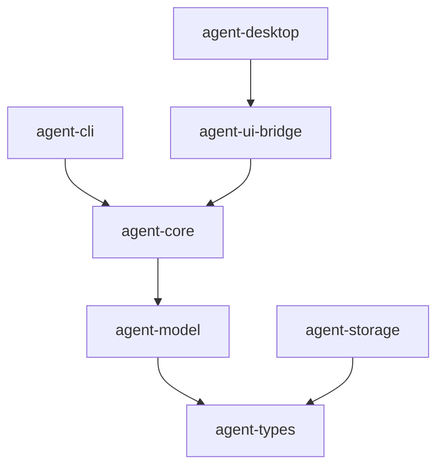

# M13-00 Real Model Providers And Runtime Configuration Technical Design Spec

## Purpose

Define the M13 provider/configuration baseline so real model adapters can be added without weakening runtime safety, leaking secrets, or coupling CLI/Desktop to provider-specific protocols.

## Product Context

M13 moves `agent` from deterministic fake-provider execution toward usable live model integration. The design keeps tests deterministic by isolating transport behind fixtures and keeps user trust intact by treating model configuration, authentication, retry, and fallback as explicit runtime contracts.

## Scope

This design governs:

- provider configuration and validation
- secret reference representation
- provider registry and capability negotiation
- model invocation timeout, retry, and fallback policy
- OpenAI-compatible HTTP adapter boundaries
- CLI/Desktop model selection boundaries
- telemetry, audit, and test rules for provider integration

Owned by implementation slices:

- `M13-01-provider-config`: provider config, catalog, and secret references
- `M13-02-provider-registry-capabilities`: provider registry and capability negotiation
- `M13-03-invocation-policy`: timeout, retry, and fallback contracts
- `M13-04-openai-compatible-adapter`: fixture-backed OpenAI-compatible request and stream mapping
- `M13-05-cli-model-selection`: CLI model selection and settings integration

## Architecture

`agent-model` owns provider-neutral configuration, registry, capabilities, invocation policy, and provider-specific adapters. `agent-core` consumes those contracts through `ModelProvider` and registry interfaces. `agent-cli` and `agent-desktop` expose model choices as typed settings and commands. Storage migration support remains in `agent-storage` when M13 introduces durable config schema versions.



Dependency rules:

- `agent-model` must not depend on `agent-core`, CLI, Desktop, storage, MCP, plugins, or tools.
- Provider-specific request/response structs stay inside provider adapter modules.
- `agent-core` may depend on provider registry traits but must not parse provider HTTP payloads.
- UI crates send model selection commands/settings through bridge contracts only.
- Secret resolution is represented by `SecretRef`; secret value retrieval belongs to a later secret-provider boundary.

## Provider Configuration Model

Provider configuration is layered by the existing configuration order:

1. built-in defaults
2. user config
3. workspace config
4. project config
5. session overrides
6. task overrides
7. explicit CLI flags or Desktop settings

M13-01 implements the typed shape and validation, not full file loading. Every provider entry has an id, kind, default model, enabled flag, endpoint settings, and optional secret reference. OpenAI-compatible providers require a secret reference unless the endpoint is explicitly marked as local test-only.

## Secret Model

`SecretRef` stores:

- provider namespace such as `env`, `keychain`, or `agent-secret`
- secret name

It never stores a value. Serde output must not contain fields named `value`, `token`, `api_key_value`, or equivalent raw secret payloads.

## Registry And Capability Model

Provider registration is explicit. A registry entry contains provider id, capabilities, and an implementation handle. Capability negotiation checks whether the selected provider supports streaming, tool calls, structured outputs, max context tokens, and supported request modes.

## Invocation Policy Model

Invocation policy separates provider behavior from runtime behavior:

- timeout is configured per provider or request
- retry classifies failures as retryable or terminal
- fallback uses an ordered chain of provider ids
- fallback requires capability compatibility
- every retry and fallback decision is traceable

## OpenAI-Compatible Adapter Model

The OpenAI-compatible adapter targets the current Responses API shape documented by OpenAI: create a response with `POST /v1/responses`, request streaming with `stream=true`, and consume server-sent events. M13 tests use fixture transports and synthetic event streams. Live network calls, real credentials, and provider SDK dependencies are out of scope.

Adapter boundaries:

- build request JSON from `ModelRequest`
- attach authentication through a secret handle supplied by the caller
- parse fixture SSE chunks into `ModelStreamEvent`
- map provider errors into stable `ModelError` variants
- keep provider-specific JSON structs private to the adapter module

## CLI And Desktop Model Selection

CLI and Desktop expose provider id and model id as user choices. They do not store secret values or adapter payloads. CLI flags override lower-priority settings for the current invocation only. Desktop settings remain UI-safe snapshots.

## Security And Privacy

- no raw provider secrets in config, events, traces, memory, fixtures, or tests
- synthetic prompts only in provider fixtures
- provider ids and model ids may appear in telemetry and audit logs
- provider error bodies are redacted before becoming user-facing diagnostics
- network calls are disabled in test harnesses

## Testing Strategy

Required verification:

- config serialization and validation tests
- secret reference redaction tests
- registry duplicate/provider-not-found tests
- capability negotiation tests
- retry/fallback table tests
- fixture SSE parser tests
- CLI flag parsing and JSON output tests
- standard workspace gates:

```bash
cargo fmt --all -- --check
cargo clippy --workspace --all-targets -- -D warnings
cargo test --workspace
```

## Acceptance Criteria

- M13 has a stable provider configuration baseline.
- Provider-specific transport is isolated behind adapter modules.
- Real-provider work remains testable without live network or real secrets.
- CLI/Desktop integration depends on shared contracts, not provider protocol details.

## Completion Signal

M13 technical design is complete when the milestone and slice specs/plans reference this baseline, all scope boundaries are explicit, and M13-01 can start with no unresolved architectural decisions.
