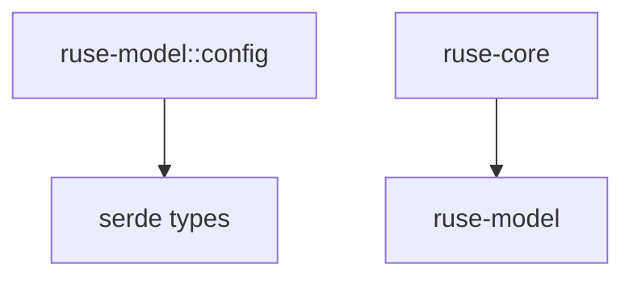

# M13-01 Provider Config Spec

## Purpose

Add typed model provider configuration, catalog validation, and secret-reference contracts to `ruse-model`.

## Product Context

This slice starts M13 by creating the durable shape that future provider registry, retry, fallback, and OpenAI-compatible adapter work will consume. It supports the PRD goals for provider-agnostic model integration and secret-safe configuration.

## Scope

This spec delivers:

- `SecretRef`
- `ModelProviderKind`
- `ModelEndpointConfig`
- `ModelProviderConfig`
- `ModelProviderCatalog`
- `ModelConfigError`
- validation helpers and serde shape tests

Owned by later specs:

- provider implementation registry
- capability negotiation
- retry/fallback policy
- OpenAI-compatible HTTP transport
- CLI config file loading

## Architecture

Provider config lives in `ruse-model` because it is model-domain data and must not depend on runtime orchestration or UI crates.



## File Layout

```text
crates/
  ruse-model/
    src/
      lib.rs
      config.rs
    tests/
      provider_config.rs
```

## Public Contracts

```rust
pub struct SecretRef {
    pub provider: String,
    pub name: String,
}

pub enum ModelProviderKind {
    Fake,
    OpenAiCompatible,
}

pub struct ModelEndpointConfig {
    pub base_url: Option<String>,
    pub timeout_ms: u64,
}

pub struct ModelProviderConfig {
    pub id: String,
    pub kind: ModelProviderKind,
    pub default_model: String,
    pub endpoint: ModelEndpointConfig,
    pub api_key: Option<SecretRef>,
    pub enabled: bool,
}

pub struct ModelProviderCatalog {
    pub providers: Vec<ModelProviderConfig>,
}
```

## State And Failure Handling

- empty provider ids are rejected
- provider ids must be lowercase log-safe identifiers
- empty model ids are rejected
- timeout must be greater than zero
- OpenAI-compatible providers require an API key secret reference
- endpoint URLs must begin with `https://`, `http://localhost`, or `http://127.0.0.1`
- catalog validation rejects duplicate provider ids
- catalog validation rejects catalogs with no enabled providers

## Security And Privacy

- `SecretRef` stores provider/name handles only
- serialized config must not include raw secret value fields
- validation errors mention field names, not secret values
- test fixtures use synthetic provider and secret names

## Testing Strategy

- config serializes to a stable shape
- OpenAI-compatible providers require secret references
- invalid provider ids and model ids are rejected
- unsafe endpoint URLs are rejected
- duplicate provider ids are rejected
- catalogs require at least one enabled provider
- secret references serialize without raw secret values

## Acceptance Criteria

- `cargo test -p ruse-model --test provider_config` passes.
- `ruse-model` exports provider config contracts.
- No config contract can store a raw API key value.

## Completion Signal

M13-01 is complete when tests pass, docs status points to M13-02, and the slice is committed with source and tests.
