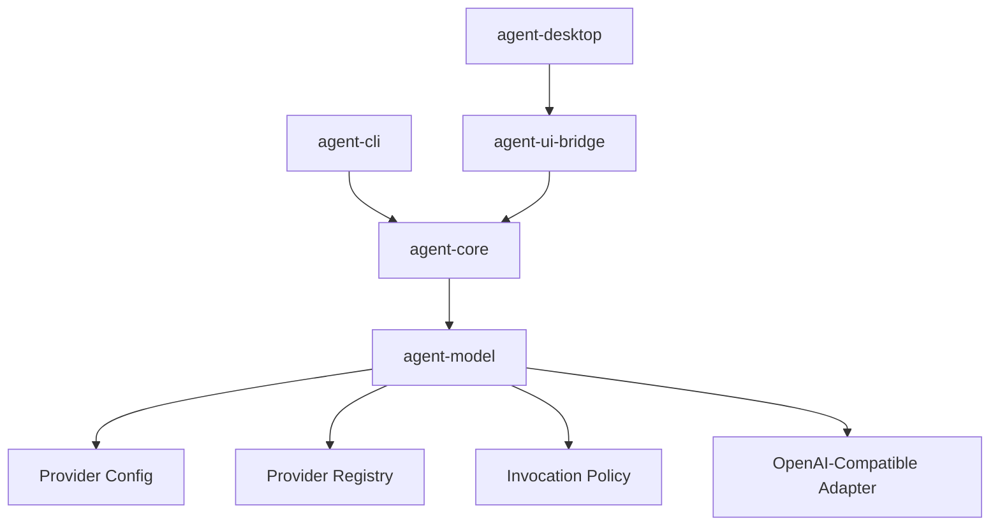

# M13 Real Model Providers And Runtime Configuration Spec

## Purpose

Add the provider configuration, registry, invocation policy, and first real-provider adapter contracts needed to move beyond fake model execution while preserving local-first safety, auditability, and deterministic tests.

## Product Context

This milestone closes the MVP gap called out in the PRD: at least one real model provider adapter. It also turns the existing model abstraction into a configurable runtime surface that CLI and Desktop can share without leaking secrets into prompts, events, traces, or fixtures.

## Scope

This milestone delivers:

- model provider configuration contracts
- secret-reference-only model authentication settings
- provider registry and capability negotiation
- retry, timeout, and fallback invocation policy contracts
- OpenAI-compatible HTTP adapter with fixture-backed transport tests
- CLI model selection wiring through typed runtime settings

Implementation primarily touches:

- `agent-model`
- `agent-core`
- `agent-cli`
- `agent-desktop`
- `agent-storage`
- `docs/milestones/README.md`

## Dependencies

- M01 through M12 milestone deliverables
- `docs/architecture/configuration.md`
- `docs/architecture/security-policy.md`
- `docs/architecture/async-runtime.md`
- `docs/architecture/error-model.md`

## Architecture

M13 keeps provider-specific behavior inside `agent-model`. Runtime orchestration in `agent-core` selects providers through typed registries and invocation policies. CLI and Desktop expose model selection through existing command/settings surfaces, but do not know provider transport details. Secret values remain behind named secret references.



## Key Contracts

- `ModelProviderConfig`
- `SecretRef`
- `ModelProviderCatalog`
- `ModelProviderRegistry`
- `ModelCapabilities`
- `ModelInvocationPolicy`
- `ModelFallbackChain`
- `OpenAiCompatibleProvider`
- CLI model selection contract

Contract rules:

- public data crossing crate or storage boundaries uses explicit serde types
- provider ids are stable, lowercase, and safe for logs
- model ids are non-empty but provider-specific
- secret values are never represented in config contracts
- provider-specific HTTP payloads stay inside adapter modules

## State And Failure Handling

- invalid configuration fails before provider registration
- missing secret references produce recoverable configuration errors
- unsupported capability requests produce typed provider errors
- retryable transport failures follow invocation policy
- fallback only moves to a configured provider with compatible capabilities
- terminal provider failures become stable model error codes

## Security And Privacy

- configuration stores secret handles, never secret values
- telemetry and audit records include provider id, model id, capability class, and redacted error summaries
- live network calls are never required for unit or workspace tests
- provider payload fixtures contain synthetic prompts, ids, and tool schemas only

## Testing Strategy

Required coverage:

- provider config validation and serialization tests
- secret reference redaction tests
- registry duplicate and capability tests
- retry/fallback decision tests
- OpenAI-compatible request/stream parser fixture tests
- CLI model selection tests
- workspace gates:

```bash
cargo fmt --all -- --check
cargo clippy --workspace --all-targets -- -D warnings
cargo test --workspace
```

## Acceptance Criteria

- Users can configure model providers without storing raw secrets.
- Runtime code can select providers through typed registry contracts.
- Provider invocation policy explains retry, timeout, and fallback decisions.
- An OpenAI-compatible adapter can translate local model requests to provider payloads and parse fixture stream events.
- CLI can select model provider and model id through typed settings.

## Completion Signal

M13 is complete when all slice plans are checked off, focused and workspace verification pass, M13 status is marked complete, and the next milestone focus is recorded.
