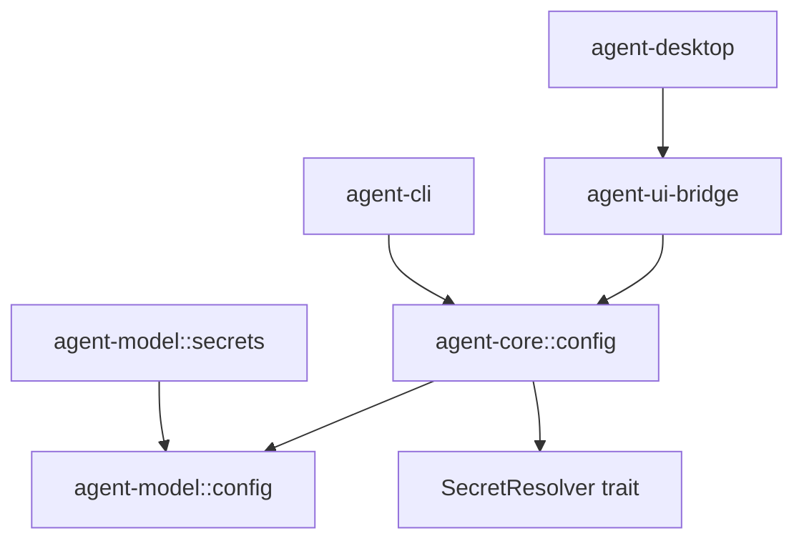

# M14-00 Runtime Configuration And Secrets Technical Design Spec

## Purpose

Define the M14 configuration and secret-handling baseline so runtime settings can become durable and inspectable without leaking credentials or coupling UI clients to model-provider internals.

## Product Context

M14 follows M13. Provider configs, registries, and invocation policies exist, but they are not yet loaded from user/workspace files or exposed as safe runtime settings. This design creates the bridge between static provider contracts and later live invocation.

## Scope

This design governs:

- secret resolver boundaries
- redacted secret value handling
- runtime config schema version 1
- TOML parse and validation behavior
- config source layering and override precedence
- CLI config diagnostics
- UI-safe config snapshots

Owned by implementation slices:

- `M14-01-secret-resolver`
- `M14-02-config-file-loader`
- `M14-03-config-layering`
- `M14-04-cli-config-diagnostics`
- `M14-05-ui-config-snapshot`

## Architecture

`agent-model` adds a `secrets` module with provider-neutral secret reference resolution. It does not read config files and does not emit runtime events. `agent-core` adds a `config` module that parses TOML, validates model settings, layers sources, and emits diagnostics. `agent-cli`, `agent-ui-bridge`, and `agent-desktop` render or transport summaries only.



Dependency rules:

- `agent-model` must not depend on `agent-core`, CLI, Desktop, storage, or UI bridge.
- `agent-core::config` may depend on `agent-model` and `agent-storage` schema-version types.
- UI crates must not parse TOML or resolve secrets directly.
- config layer merging must be deterministic and testable in memory.

## Secret Model

`SecretValue` wraps raw secret text. It may expose the raw string only through an explicit method intended for future transports, such as `expose_secret()`. `Debug` and `Display` must render a redacted marker. `SecretValue` must not derive `Serialize`.

`SecretResolver` resolves a `SecretRef` into a `SecretValue`:

```rust
pub trait SecretResolver: Send + Sync {
    fn resolve(&self, secret_ref: &SecretRef) -> Result<SecretValue, SecretResolutionError>;
}
```

M14 provides:

- `InMemorySecretResolver` for tests and fixture wiring
- `EnvSecretResolver` for environment variable references
- strict missing-secret diagnostics

## Runtime Config Schema

M14 uses schema version 1 and TOML for local config:

```toml
schema_version = 1

[model]
default_provider = "openai"

[model.invocation]
timeout_ms = 30000
max_attempts = 2
retryable_failures = ["timeout", "transport", "rate_limited"]
fallback_provider_ids = ["fake"]

[[model.providers]]
id = "openai"
kind = "open_ai_compatible"
default_model = "gpt-4.1-mini"
enabled = true
base_url = "https://api.openai.com/v1"
api_key_provider = "env"
api_key_name = "OPENAI_API_KEY"
```

The loader maps this into M13 contracts:

- `ModelProviderCatalog`
- `ModelProviderConfig`
- `ModelEndpointConfig`
- `SecretRef`
- `ModelInvocationPolicy`

## Layering Model

Layers merge in this order:

1. built-in defaults
2. user config
3. workspace config
4. project config
5. session overrides
6. task overrides
7. explicit CLI/Desktop overrides

M14 implements the model-domain subset. Later milestones can extend the same layer model to tools, memory, MCP, scheduler, and plugins.

Merge rules:

- absent fields inherit from lower-priority layers
- provider entries merge by `id`
- explicit disabled providers remain present but cannot be selected
- explicit provider/model overrides affect the current effective config only
- merging never creates raw secret values

## Diagnostics

Diagnostics are structured:

```rust
pub struct ConfigDiagnostic {
    pub severity: ConfigDiagnosticSeverity,
    pub code: String,
    pub message: String,
    pub field_path: Option<String>,
    pub source: Option<String>,
}
```

Diagnostics can be serialized to CLI JSON and UI bridge snapshots. Messages may mention provider ids and secret reference names, but never secret values.

## Security And Privacy

- Raw secret values stay inside `SecretValue`.
- `SecretValue` debug/display output is redacted.
- TOML fixtures use synthetic provider ids and secret names.
- CLI JSON tests include values such as `sk-test-secret` and assert absence from output.
- Config validation does not perform network calls.

## Testing Strategy

Required verification:

- secret resolver unit tests
- config TOML parser tests
- config layering tests
- CLI JSON diagnostics tests
- UI snapshot tests
- redaction tests for every serialized public output
- standard workspace gates

## Acceptance Criteria

- M14 has a stable config/secrets architecture baseline.
- Slice specs/plans reference this design.
- M14-01 can begin without unresolved ownership or privacy decisions.

## Completion Signal

M14 technical design is complete when this document and the slice plans define exact contracts, files, tests, and commit boundaries for the milestone.
