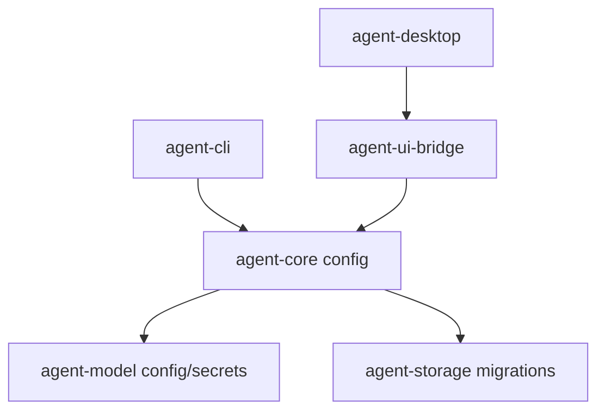

# M14 Runtime Configuration And Secrets Spec

## Purpose

Add durable runtime configuration loading, secret resolution contracts, config layering, and UI-safe diagnostics so provider settings from M13 can be used by CLI/Desktop without storing or printing raw credentials.

## Product Context

M13 created provider configuration and adapter contracts. M14 makes those contracts operational as runtime settings: users can load config files, override model choices from CLI/Desktop, validate secret references, and inspect the effective configuration safely before later milestones wire live model invocation into full turns.

## Scope

This milestone delivers:

- secret resolver contracts with redacted secret values
- TOML runtime config schema for model catalog and invocation policy
- config layering for built-in, user, workspace, session, and explicit overrides
- CLI config flags and JSON diagnostics
- UI bridge config snapshot that Desktop can consume without secrets

Owned by later specs:

- live HTTP model invocation
- OS keychain and encrypted local secret stores
- interactive secret prompts
- native Desktop settings screens
- full config migration beyond schema version 1

Implementation primarily touches:

- `agent-model`
- `agent-core`
- `agent-cli`
- `agent-ui-bridge`
- `agent-desktop`
- `docs/milestones/README.md`

## Dependencies

- M13 provider config, registry, and invocation policy contracts
- `docs/architecture/configuration.md`
- `docs/architecture/security-policy.md`
- `docs/architecture/crate-boundaries.md`
- `docs/architecture/testing-strategy.md`

## Architecture

`agent-model` owns secret reference resolution contracts because they validate model-provider authentication without knowing runtime or UI behavior. `agent-core` owns runtime configuration loading and layering because it composes model config with runtime policy. CLI and Desktop expose only safe summaries through typed command/output and UI bridge contracts.



## Key Contracts

- `SecretResolver`
- `SecretValue`
- `InMemorySecretResolver`
- `EnvSecretResolver`
- `AgentRuntimeConfig`
- `RuntimeModelConfig`
- `ConfigLayer`
- `ConfigOverride`
- `EffectiveRuntimeConfig`
- `ConfigDiagnostic`
- `UiConfigSnapshot`

Contract rules:

- raw secret values never implement normal `Debug`, `Display`, `Serialize`, or UI conversion
- config files may contain `SecretRef` handles but never raw secret values
- config diagnostics use field paths and provider ids, not credential contents
- explicit CLI/Desktop overrides have the highest precedence
- unknown config keys are rejected with typed diagnostics

## State And Failure Handling

- missing config files fail before runtime execution unless a caller explicitly uses defaults
- invalid TOML fails with `AgentConfigError::Parse`
- invalid provider catalogs fail with model config errors wrapped in config diagnostics
- missing secret references are recoverable diagnostics until a caller requires strict validation
- explicit overrides can replace provider/model selection without mutating lower-priority layers
- every effective config has a schema version and source layer summary

## Security And Privacy

- tests must include secret-like fixture values and prove they are absent from diagnostics, JSON frames, and snapshots
- environment variable resolver reads by name only and returns redacted wrappers
- config snapshots expose secret provider/name only when needed to explain missing handles; they never expose values
- config loading does not broaden permissions or enable tools/plugins by default

## Testing Strategy

Required coverage:

- secret value redaction and non-serialization tests
- in-memory and environment resolver tests
- TOML config parse, validation, unknown-key, and error-path tests
- layering precedence tests
- CLI `--config` and `--config-check --json` tests
- UI snapshot serialization tests
- workspace gates:

```bash
cargo fmt --all -- --check
cargo clippy --workspace --all-targets -- -D warnings
cargo test --workspace
```

## Acceptance Criteria

- Users can load a model-provider config file without raw secrets.
- Runtime code can produce an effective config from layered sources and overrides.
- CLI can validate config and print UI-safe JSON diagnostics.
- Desktop-facing contracts can display model/config status without accessing secret values.
- M15 can consume the effective config for runtime model invocation without redesigning configuration.

## Completion Signal

M14 is complete when all slice plans are checked off, focused and workspace verification pass, M14 status is marked complete, and active focus advances to the next milestone.
