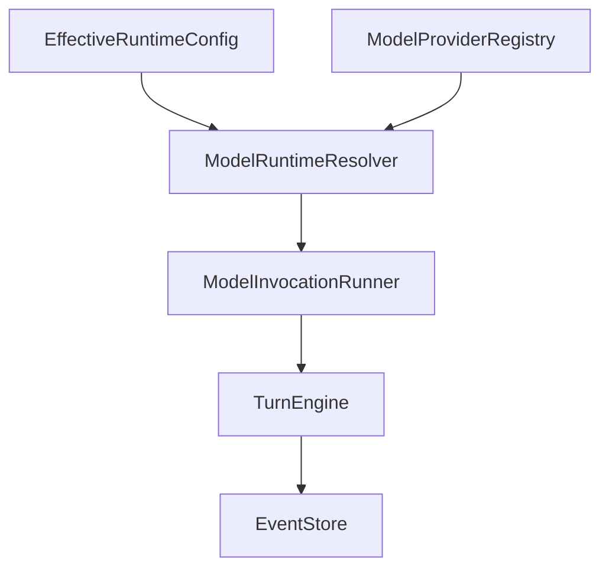

# M15-00 Config-Driven Turn Execution Technical Design Spec

## Purpose

Define the M15 runtime execution baseline so effective model config can drive a complete turn without coupling CLI/Desktop code to provider internals.

## Product Context

M15 follows M14. Config files can now be loaded, layered, inspected, and rendered safely, but configured prompt execution still stops at diagnostics. This design bridges config and turn execution while keeping live HTTP transport outside M15.

## Scope

This design governs:

- configured provider resolution
- provider registry capability checks
- invocation retry and fallback behavior
- configured turn runner ownership
- CLI prompt execution boundaries
- JSON event rendering for prompt turns
- event-store persistence fixture

Owned by implementation slices:

- `M15-01-model-runtime-resolver`
- `M15-02-invocation-policy-runner`
- `M15-03-configured-turn-runner`
- `M15-04-cli-prompt-runtime`
- `M15-05-persisted-turn-events`

## Architecture

`agent-core::model_runtime` is the new orchestration module. It depends on `agent-model`, `agent-storage`, `agent-types`, and existing `agent-core::config`/`turn` contracts. It does not parse CLI flags and does not format UI output. `agent-cli` loads configuration and renders output, but it delegates provider selection and turn execution to core.

Dependency rules:

- `agent-core::model_runtime` may depend on `agent-model`, `agent-storage`, and `agent-types`.
- `agent-model` must not depend on `agent-core`.
- `agent-cli` must not call provider transports directly.
- `agent-ui-bridge` remains a wire-contract crate and does not depend on `agent-core`.

## Runtime Contracts

`ConfiguredModelRuntime` stores the selected provider id, selected model id, provider handle, capabilities, and invocation policy. Resolver output is immutable for one turn.

`ModelInvocationRunner` accepts a request-building closure and applies:

1. selected provider attempt
2. retry attempts while failures match configured retryable kinds
3. fallback providers from `fallback_provider_ids`
4. terminal typed error with attempt history

M15 records attempt history in memory. Durable retry traces can be added later as runtime event payloads.

## CLI Boundary

CLI prompt execution uses:

- built-in fake config when no config file is supplied
- loaded/layered config when `--config` is supplied
- explicit provider/model overrides from flags
- a local fake-provider registry for providers of kind `fake`

OpenAI-compatible providers can be selected by core only if a caller registers a transport-backed provider. M15 CLI returns a typed unsupported-provider error for selected providers that are not registered.

## Persistence Boundary

`ConfiguredTurnRunner` can run without storage or with an `EventStore`. When persistence is requested, it appends each emitted event once in order. Existing storage replay remains the source of truth.

## Security And Privacy

- no raw secret values are accepted by M15 APIs
- provider ids and model ids may appear in diagnostics
- transport-backed providers are injected through registry handles, not constructed from raw secrets by CLI
- tests assert JSON prompt output excludes `sk-test-secret`, `api_key`, `token`, `password`, and raw TOML bodies

## Testing Strategy

Required verification:

- resolver unit tests
- invocation policy unit tests
- configured turn integration tests
- CLI text and JSON tests
- storage replay integration test
- standard workspace gates

## Acceptance Criteria

- M15 has a stable config-to-turn architecture baseline.
- Slice specs/plans reference this design.
- M15-01 can begin without unresolved ownership, privacy, or dependency decisions.

## Completion Signal

M15 technical design is complete when this document and the slice plans define exact contracts, files, tests, and commit boundaries for the milestone.
