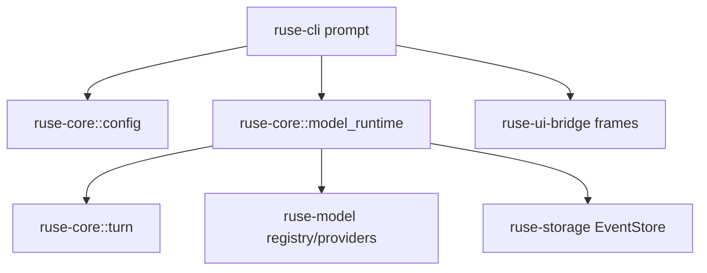

# M15 Config-Driven Turn Execution Spec

## Purpose

Make the effective runtime configuration from M14 actually drive model-backed turns. M15 connects model selection, provider registry resolution, invocation policy, turn execution, CLI prompt behavior, JSON event output, and persisted turn events without adding live network transport yet.

## Product Context

M13 added provider contracts and an OpenAI-compatible adapter boundary. M14 added durable config, layering, CLI diagnostics, and UI-safe snapshots. The next product gap is that `ruse-cli --prompt` still does not run a configured runtime turn. M15 turns configuration into execution while preserving deterministic tests and keeping live HTTP transport as a later milestone.

## Scope

This milestone delivers:

- configured model runtime resolution from `EffectiveRuntimeConfig`
- provider registry capability checks before turn execution
- invocation policy execution with retry/fallback contracts
- config-driven `TurnEngine` runner in `ruse-core`
- CLI `--prompt` execution through the configured runtime path
- JSON prompt output as UI bridge event frames
- persisted turn event fixture coverage

Owned by later specs:

- real HTTP transport and OS secret store integration
- streaming stdout while the model is still producing tokens
- interactive approvals during model/tool loops
- multi-tool recursive agent loop over real model tool calls
- Desktop prompt execution UI

Implementation primarily touches:

- `ruse-core`
- `ruse-cli`
- `ruse-model`
- `ruse-storage`
- `ruse-ui-bridge`
- `docs/milestones/README.md`

## Dependencies

- M13 provider config, registry, OpenAI-compatible adapter, and invocation policy
- M14 runtime config loading, layering, diagnostics, and UI config snapshot
- `docs/architecture/crate-boundaries.md`
- `docs/architecture/configuration.md`
- `docs/architecture/event-sourcing.md`
- `docs/architecture/testing-strategy.md`

## Architecture

`ruse-core` owns configured turn orchestration. It receives an `EffectiveRuntimeConfig`, a model provider registry, and runtime IDs, then resolves the selected provider, checks capabilities, runs invocation policy, calls `TurnEngine`, and optionally persists emitted events. `ruse-cli` remains presentation code: it loads config, builds a small default fake-provider registry for local execution, delegates execution to core, and renders text or UI bridge JSON frames.



## Key Contracts

- `ModelRuntimeResolver`
- `ConfiguredModelRuntime`
- `ModelRuntimeError`
- `ModelInvocationRunner`
- `ConfiguredTurnInput`
- `ConfiguredTurnRunner`
- `ConfiguredTurnOutcome`
- CLI prompt execution using `--config`, `--provider`, `--model`, `--json`, and `--prompt`

Contract rules:

- provider resolution uses `EffectiveRuntimeConfig.selected_provider`
- selected model uses `EffectiveRuntimeConfig.selected_model`
- missing, disabled, or unregistered providers return typed runtime errors
- provider capability failures happen before model invocation
- retries and fallback attempts are deterministic and traceable in tests
- CLI does not resolve raw secrets or create live HTTP transports in M15

## State And Failure Handling

- invalid config fails before prompt execution with status 2
- unregistered selected provider fails with a model-runtime diagnostic
- non-retryable model errors fail the turn once and return failed events
- retryable model errors use the configured retry budget
- fallback providers are tried in configured order when compatible and registered
- successful turns emit normal turn/model/final-response events
- persisted turn execution writes the emitted event sequence once

## Security And Privacy

- CLI prompt JSON must not include raw secret values
- provider registry errors may include provider ids, not credential contents
- OpenAI-compatible config remains a contract unless a caller registers a safe transport-backed provider
- tests use fixture providers and synthetic secret-looking strings to prove redaction

## Testing Strategy

Required coverage:

- model runtime resolver tests for selected provider, missing provider, disabled provider, and capability mismatch
- invocation policy tests for retry, fallback, and non-retryable failure
- configured turn runner tests proving selected provider/model reach `TurnEngine`
- CLI prompt text mode executes a configured fake turn
- CLI prompt JSON emits parseable event frames and excludes secret-like values
- persisted configured turn fixture can replay final state from event store
- workspace gates:

```bash
cargo fmt --all -- --check
cargo clippy --workspace --all-targets -- -D warnings
cargo test --workspace
```

## Acceptance Criteria

- Users can run a local config-driven prompt turn through CLI with the fake provider.
- Core runtime can execute any registered provider selected by effective config.
- Invocation retry/fallback behavior is testable without live network access.
- JSON output carries the same runtime events Desktop can later consume.
- Successful configured turns can be persisted and replayed.

## Completion Signal

M15 is complete when all slice plans are checked off, focused and workspace verification pass, M15 status is marked complete, and active focus advances to the next milestone.
