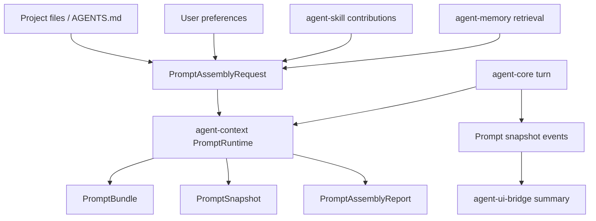

# M16-00 Prompt Runtime Technical Design Spec

## Purpose

Define the architecture baseline for dynamic prompt management before M16 implementation begins. This design turns prompt assembly into a versioned runtime subsystem with explicit profiles, ordered layers, overlays, diagnostics, snapshots, and UI-safe inspection.

## Product Context

M05 created prompt layers, budget planning, pinning, and simple compaction. M15 can execute a configured turn, but it still assembles context through a narrow helper. Product-grade CLI, TUI, and Desktop experiences need prompt composition that can explain which system, project, skill, memory, tool, team, and session instructions affected a turn.

## Scope

This design governs:

- prompt profile and prompt layer data model
- layer source, sensitivity, visibility, and version metadata
- overlay precedence and replacement rules
- prompt diagnostics and conflict reporting
- prompt snapshot hashing and persistence
- CLI and UI bridge prompt inspection boundaries
- compatibility with M17 streaming and M18 tool loops

Owned by implementation slices:

- `M16-01-prompt-profile-contracts`
- `M16-02-prompt-overlays-diagnostics`
- `M16-03-prompt-snapshot-persistence`
- `M16-04-cli-prompt-inspection`
- `M16-05-ui-prompt-summary`

## Architecture

`agent-context` owns prompt runtime contracts and pure assembly behavior. It may depend on `agent-types` for ids and timestamps, but it must not depend on `agent-core`, model providers, storage, CLI, TUI, or Desktop. `agent-core` calls `agent-context` during turn preparation, records prompt snapshot metadata, and emits runtime events. UI crates consume summaries from `agent-ui-bridge`.



Dependency rules:

- `agent-context` defines prompt structures and pure assembly algorithms.
- `agent-core` owns persistence, event emission, and failure mapping.
- `agent-skill` may convert discovered skills into prompt contributions, but does not assemble the final prompt.
- `agent-memory` returns candidate memory records; `agent-context` decides which prompt layer shape they become.
- `agent-cli`, `agent-tui`, and `agent-desktop` only render UI-safe summaries.

## Runtime Model

Prompt assembly starts with a `PromptAssemblyRequest` containing:

- workspace, conversation, turn, agent, and optional team ids
- selected `PromptProfileId`
- runtime mode: batch, plain repl, tui, desktop, background, or subagent
- model capabilities and token budget hints
- ordered prompt layer candidates from built-in, config, project, user, skill, memory, tool, team, and session sources
- overlay list from config, session commands, task policy, and role policy

`PromptRuntime` validates the request, applies overlays, sorts layers, allocates budget, emits diagnostics, and returns:

- `PromptBundle` for model invocation
- `PromptAssemblyReport` for audit and UI summaries
- `PromptSnapshot` for replay and recovery

The model-facing bundle is immutable after turn preparation. Later tool observations in M18 create new prompt assembly requests linked to the original snapshot.

## Public Contracts

Core contracts live in `agent-context`:

```rust
pub struct PromptProfile {
    pub id: PromptProfileId,
    pub version: u32,
    pub display_name: String,
    pub required_layers: Vec<PromptLayerId>,
    pub default_budget: PromptBudget,
}

pub enum PromptLayerSource {
    BuiltIn,
    RuntimeConfig { source: String },
    ProjectFile { path: String, content_hash: String },
    UserPreference { key: String },
    Skill { skill_id: String, source: String },
    Tool { tool_name: String },
    Memory { memory_id: String },
    TeamRole { role_id: String },
    SessionOverlay { command_id: String },
}

pub enum PromptLayerVisibility {
    Hidden,
    SummaryOnly,
    Full,
}

pub enum PromptLayerSensitivity {
    Public,
    Workspace,
    UserPrivate,
    SecretLike,
}

pub struct PromptSnapshot {
    pub profile_id: PromptProfileId,
    pub profile_version: u32,
    pub layer_hashes: Vec<PromptLayerHash>,
    pub bundle_hash: String,
    pub diagnostics: Vec<PromptDiagnostic>,
}
```

Names may be refined during M16-01, but the ownership and information boundaries are fixed by this design.

## Overlay Rules

Overlay behavior is deterministic:

1. Built-in safety and runtime integrity layers are required.
2. Higher-priority overlays can append or replace named non-required layers.
3. Lower-priority project or skill layers cannot remove hidden runtime layers.
4. Duplicate ids at the same precedence are diagnostics, not nondeterministic merges.
5. Omitted optional layers must record omission reasons.
6. Required layer budget overflow is a terminal prompt assembly error.

Profiles should prefer additive overlays. Replacement is allowed only for named layers with compatible kind and visibility.

## Persistence and Replay

`agent-core` persists prompt snapshot metadata before model invocation. The event payload should include hashes and UI-safe metadata, not full hidden prompt text. If later replay requires exact hidden content, storage must reference an encrypted or local-only artifact outside UI bridge payloads.

Replay validates:

- profile id and version
- layer ids and source hashes
- bundle hash
- diagnostics list
- model-facing message count and token estimate

If current project files changed, replay can still explain the original prompt from stored hashes while reporting source drift.

## CLI and UI Boundaries

CLI adds prompt inspection commands after core contracts exist:

- `agent prompt inspect`
- `agent prompt inspect --json`
- `agent prompt profiles`

TUI and Desktop consume `UiPromptSummary` frames:

- profile id and display name
- layer list with source labels, priority, token estimate, visibility, and sensitivity
- diagnostics
- bundle hash

Hidden layers show labels and hashes only. Secret-like layer content is never rendered.

## Failure Handling

- Empty profile id fails validation.
- Missing required profile or layer fails before model invocation.
- Duplicate layer ids produce diagnostics; duplicate required ids fail if ambiguity affects model output.
- Unreadable optional project files produce warnings; unreadable required files fail batch runs and ask/diagnose in interactive modes.
- Secret-like content detected in full-visible layers is downgraded or rejected according to policy.

## Security and Privacy

Repository prompt files, skills, MCP-provided prompts, memory records, and tool observations are untrusted input. They must be source-labeled and cannot override hidden runtime safety layers. Prompt diagnostics must redact secret-like values and never reveal hidden instructions through UI summaries.

Prompt snapshots are audit artifacts. They must not store raw API keys, environment values, or model provider secrets. Memory-derived layers keep memory sensitivity metadata.

## Testing Strategy

Required coverage:

- profile validation tests
- layer ordering and overlay precedence tests
- duplicate and missing required layer diagnostics
- budget overflow and omission tests
- snapshot hash stability tests
- UI summary redaction tests
- configured turn integration test proving snapshot metadata is emitted before model invocation

Workspace gates use:

```bash
cargo xtask check
```

## Acceptance Criteria

- M16 slice specs can reference one prompt runtime ownership model.
- Prompt assembly can be tested without live model providers.
- Prompt snapshots are replayable and UI-safe.
- CLI, TUI, and Desktop share the same prompt summary contract.

## Completion Signal

M16 technical design is complete when this document and its plan exist, M16 milestone planning marks the design slice complete, and M16-01 can start without unresolved prompt ownership or privacy decisions.
