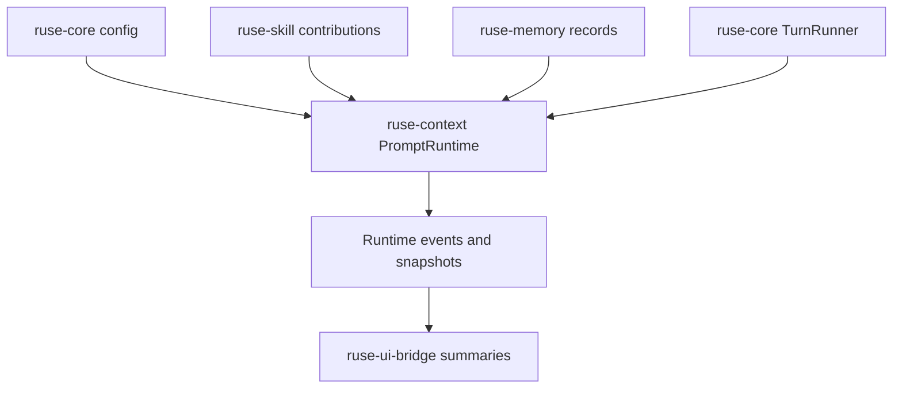

# M16 Prompt Runtime and Dynamic Prompt Management Spec

## Purpose

Make prompt construction a versioned, inspectable, configurable runtime capability instead of a fixed context helper. M16 turns system, product, project, user, skill, tool, memory, team, and session instructions into layered prompt profiles that can be selected, overlaid, snapshotted, audited, and replayed.

## Product Context

M05 introduced prompt layers and basic budget planning. M15 can run a configured prompt turn, but the prompt path is still too static for a real Claude Code or Codex-style product. Users need dynamic prompt profiles, project-level guidance, skill contributions, model-specific overlays, and per-turn reproducibility.

## Scope

This milestone delivers:

- versioned `PromptProfile` contracts in `ruse-context`
- prompt layer sources for built-in runtime, project files, user preferences, skills, tools, memory, team roles, and session overrides
- deterministic prompt assembly with source metadata, ordering, and conflict diagnostics
- per-turn `PromptSnapshot` persistence through runtime events or checkpoint payloads
- CLI diagnostics for inspecting the effective prompt without exposing secrets or hidden chain-of-thought
- UI bridge summaries for Desktop and TUI prompt inspection

Owned by later milestones:

- live model streaming transport
- full tool-calling loop
- TUI and Desktop visual prompt editors
- advanced prompt A/B evaluation

## Architecture

`ruse-context` owns prompt profile data, layer ordering, budget allocation, and prompt snapshots. `ruse-core` asks `ruse-context` for an immutable prompt bundle during turn preparation and emits UI-safe prompt diagnostics. `ruse-cli`, future `ruse-tui`, and Desktop render summaries only; they do not construct runtime prompts.

## Key Contracts

- `PromptProfileId`
- `PromptProfile`
- `PromptLayerSource`
- `PromptLayerPolicy`
- `PromptOverlay`
- `PromptAssemblyRequest`
- `PromptAssemblyReport`
- `PromptSnapshot`
- `PromptDiagnostic`

Contract rules:

- each prompt layer has an id, kind, source, priority, visibility, sensitivity, and version
- system and safety layers are required and cannot be removed by lower-priority overlays
- project, user, skill, and session layers are additive unless a policy explicitly replaces a named layer
- the runtime stores prompt snapshots by content hash and source metadata
- UI summaries include source names, priorities, token estimates, and diagnostics, not hidden or sensitive layer content by default

## State and Failure Handling

- missing required prompt profile fails before model invocation
- duplicate layer ids produce deterministic diagnostics
- budget overflow triggers configured omission or compaction behavior
- unreadable project prompt files create recoverable diagnostics in interactive modes and terminal errors in batch modes when marked required
- snapshots are persisted before model invocation so failed turns remain explainable

## Security and Privacy

- raw secrets are forbidden in prompt layers and snapshots
- hidden runtime instructions are never exposed through UI bridge text fields
- repository prompt files are untrusted input and must be source-labeled
- memory-derived prompt layers retain sensitivity and retention metadata
- audit records capture which prompt profile and layer hashes affected a turn

## Testing Strategy

- unit tests for profile validation, layer ordering, overlay precedence, and duplicate detection
- snapshot tests for UI-safe prompt summaries
- integration tests proving configured turns persist prompt snapshots
- redaction tests for secret-like strings in prompt diagnostics
- replay tests proving prompt snapshot hashes remain stable

## Acceptance Criteria

- Core can assemble a deterministic effective prompt from layered sources.
- Users can inspect prompt composition through CLI diagnostics without seeing hidden or sensitive content.
- Every configured turn records the prompt profile id and prompt snapshot hash.
- Prompt assembly errors fail before model invocation and produce typed diagnostics.

## Completion Signal

M16 is complete when all slice specs and plans are executed, prompt snapshots are covered by replay tests, workspace checks pass, and active implementation moves to M17 live model runtime.
