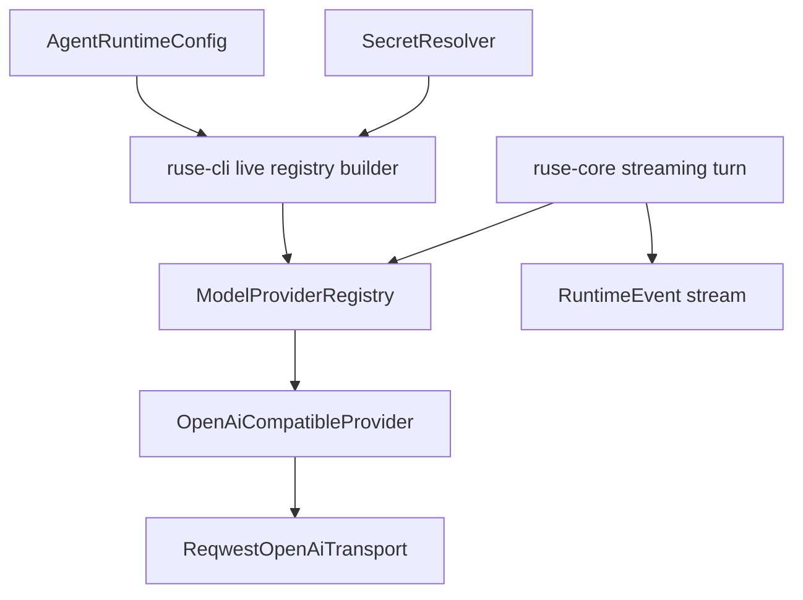

# M17-00 Live Model Runtime Technical Design Spec

## Purpose

Define the architecture for real model HTTP execution and true streaming before M17 implementation begins. M17 must replace collected fixture responses with incremental model events while preserving provider abstraction, retry/fallback policy, event sourcing, and deterministic tests.

## Product Context

M13 created provider config and OpenAI-compatible request/SSE fixture contracts. M14 added config loading and secret references. M15 executes configured fake turns. The next product gap is live provider execution and low-latency streaming in CLI and future TUI/Desktop surfaces.

## Scope

This design governs:

- migration from `ModelStreamResult = Vec<ModelStreamEvent>` to a true async stream contract
- OpenAI-compatible HTTP transport using `reqwest`
- secret resolver and transport header injection
- SSE parsing and provider error classification
- retry, fallback, timeout, and cancellation over streams
- CLI live provider registration and streaming output
- no-live-network verification strategy

Owned by implementation slices:

- `M17-01-model-stream-trait`
- `M17-02-openai-reqwest-transport`
- `M17-03-live-provider-registration`
- `M17-04-cli-streaming-output`
- `M17-05-streaming-retry-cancel-replay`

## Architecture

`ruse-model` owns all provider-specific request, response, SSE, transport, and error mapping behavior. `ruse-core` consumes provider-neutral `ModelStreamEvent` values and emits runtime events as they arrive. `ruse-cli` loads config, resolves secrets through `ruse-model`, registers executable providers, and renders streamed text or JSON.



Dependency rules:

- `ruse-model` may depend on async stream utilities and HTTP client crates.
- `ruse-core` must not import `reqwest` or provider-specific request types.
- `ruse-cli` may construct provider registries but must not parse SSE frames directly.
- `ruse-ui-bridge` remains a serializable event/command boundary.

## Stream Contract

M17 introduces a stream alias or trait shape equivalent to:

```rust
pub type ModelEventStream =
    Pin<Box<dyn Stream<Item = Result<ModelStreamEvent, ModelError>> + Send>>;

#[async_trait]
pub trait ModelProvider: Send + Sync {
    async fn stream(&self, request: ModelRequest) -> Result<ModelEventStream, ModelError>;
}
```

If exact lifetimes require a wrapper struct, the public behavior remains the same: providers yield incremental provider-neutral events.

`ModelStreamEvent` remains the core event vocabulary:

- `Started`
- `Delta`
- `ToolCall`
- `Completed`

M18 may extend tool-call streaming with partial assembly. M17 should preserve full tool-call events for compatibility.

## OpenAI-Compatible Transport

`OpenAiCompatibleReqwestTransport` sends HTTP POST requests to `{base_url}/responses`. It resolves a `SecretRef` to a `SecretValue` immediately before request execution and injects it into the Authorization header. The secret value never enters request debug output, runtime events, or error messages.

Transport responsibilities:

- validate endpoint URL from existing config
- set timeout and cancellation-aware request future
- classify HTTP response status
- stream response bytes or lines
- parse SSE frames into provider-local stream events
- map provider-local events to `ModelStreamEvent`

Testing should use fixture byte streams or a local in-process HTTP server. Workspace tests must not call external services.

## Retry, Fallback, and Cancellation

`ruse-core::model_runtime` owns retry/fallback orchestration. The runner attempts the selected provider, retries before emitting terminal failure when failure kind matches policy, and then tries configured fallback providers.

Rules:

- connection, timeout, 429, and 5xx failures are retryable when policy allows
- auth, invalid request, unsupported model, and unsafe endpoint failures are terminal
- malformed SSE before any tool call may be retryable
- malformed SSE after accepted side-effecting actions must not silently retry the whole turn
- cancellation closes the stream and emits cancelled runtime state

M17 cancellation covers model stream cancellation only. Tool cancellation is governed by M18/M19.

## CLI Behavior

CLI continues to support deterministic fake providers. For OpenAI-compatible config:

- `--config-check` validates config without resolving secrets or performing network calls
- `--prompt` resolves required secrets and registers live providers
- missing secret fails before network calls
- `--json --prompt` emits NDJSON frames incrementally
- text mode prints deltas as they arrive and final newline on completion

Future `agent` binary renaming in M20 must preserve these flags.

## Security and Privacy

- Authorization headers are never logged.
- Request body traces redact secret-like values.
- Provider error bodies are summarized and size-limited.
- Raw SSE frames are not persisted by default.
- Endpoint URLs can appear in diagnostics only after redaction of credentials and query secrets.
- Environment secret provider reads only named secret refs.

## Testing Strategy

Required coverage:

- model stream trait fixture provider tests
- OpenAI-compatible request builder and SSE parser tests
- reqwest transport fixture stream tests
- secret resolution success and failure tests
- retry/fallback tests over streaming failures
- CLI JSON streaming frame tests
- replay tests proving streamed deltas reconstruct final response

Workspace gates use:

```bash
cargo xtask check
```

## Acceptance Criteria

- A live OpenAI-compatible provider can be registered from config and secret refs.
- Model deltas reach CLI/JSON output incrementally.
- Streaming failures are classified and policy-controlled.
- Workspace verification uses fixtures and does not require real network credentials.

## Completion Signal

M17 technical design is complete when this document and its plan exist, M17 milestone planning marks the design slice complete, and M17-01 can start without unresolved stream, transport, or secret-boundary decisions.
