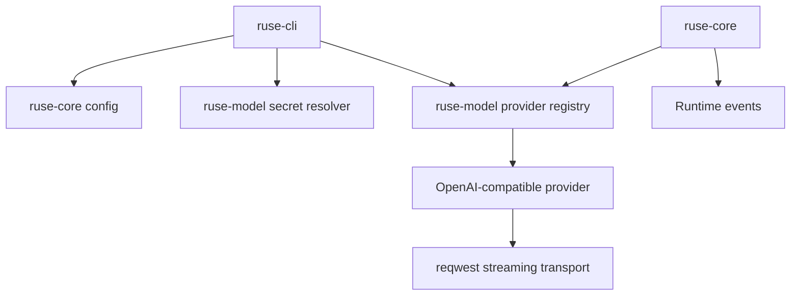

# M17 Live Model Runtime and Streaming Spec

## Purpose

Replace fixture-only model execution with real provider-backed HTTP streaming while keeping the runtime provider-agnostic, event-sourced, and replayable. M17 turns OpenAI-compatible provider contracts into executable live transports and changes model output from collected vectors into true async streams.

## Product Context

M13 and M14 created provider config, registry, secret references, and config loading. M15 executes configured turns, but only with registered fake providers. A usable agent needs real model calls, low-latency streaming, safe secret injection, retry/fallback behavior, and provider-neutral events.

## Scope

This milestone delivers:

- `ModelProvider` streaming API based on an async stream type
- OpenAI-compatible HTTP transport using `reqwest`
- SSE parsing for model deltas, completed events, and tool call proposals
- environment secret resolver integration for CLI live runs
- streaming CLI text and JSON event output
- provider timeout, retry, cancellation, and fallback behavior over live transports
- deterministic fixture tests that do not require network access

Owned by later milestones:

- full recursive tool loop
- interactive approval during model/tool turns
- provider-specific advanced features outside the OpenAI-compatible surface
- Desktop and TUI streaming renderers

## Architecture

`ruse-model` owns live transport traits, OpenAI-compatible request mapping, SSE parsing, and provider errors. `ruse-core` consumes model streams and emits runtime events as chunks arrive. `ruse-cli` wires config, secret resolver, and provider registration, then renders text or JSON without handling provider-specific transport details.

## Key Contracts

- `ModelEventStream`
- `StreamingModelProvider`
- `OpenAiCompatibleReqwestTransport`
- `ModelTransportConfig`
- `ModelStreamError`
- `ModelStreamCancellation`
- `LiveProviderRegistration`

Contract rules:

- provider adapters return events incrementally
- provider errors classify retryability without exposing secrets
- transport-backed providers are registered by callers, not created implicitly by core
- request bodies are provider-specific inside `ruse-model`
- core state machines consume only `ModelStreamEvent`

## State and Failure Handling

- transport connection failure is retryable when policy allows
- HTTP 429 and 5xx responses are retryable; 4xx configuration/auth failures are terminal
- malformed SSE is retryable only before any side-effecting tool call is accepted
- cancellation emits a cancelled turn state and closes the HTTP stream
- fallback providers start a new model stream with a new request id and linked trace metadata

## Security and Privacy

- secret values are injected into HTTP headers only inside transport code
- request and response traces redact Authorization headers and secret-like body values
- config validation rejects unsafe endpoint URLs except explicit localhost test endpoints
- provider response errors store body summaries, not full raw responses

## Testing Strategy

- unit tests for SSE parser variants and malformed frames
- transport tests with local fixture server or mocked HTTP body stream
- CLI tests proving OpenAI-compatible config registers only when secret resolution succeeds
- cancellation and timeout tests using controlled streams
- replay tests proving streamed events reconstruct final output

## Acceptance Criteria

- `ruse-cli --config path/to/config.yaml --prompt "..."` and the default `~/.config/agent/config.yaml` path can run against a real OpenAI-compatible provider when `apiKey` is configured or an advanced secret reference resolves.
- `--json` emits model delta frames as the stream arrives.
- No live-network test is required for workspace verification.
- Provider retry/fallback behavior works with streaming transports.

## Completion Signal

M17 is complete when live provider execution works behind config, streaming events are persisted and replayable, and workspace verification passes without external services.
