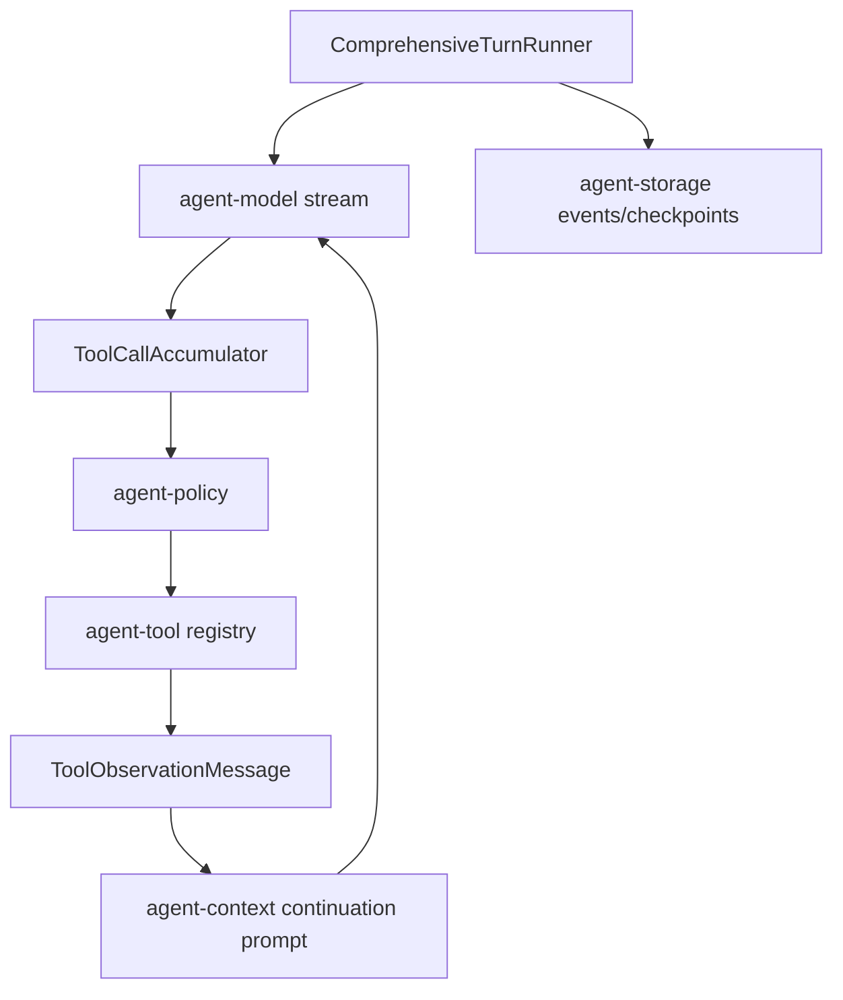

# M18-00 Agent Tool Loop Technical Design Spec

## Purpose

Define the full model-tool-observation loop architecture before M18 implementation begins. M18 upgrades the runtime from prompt-to-response execution into a comprehensive agent turn that can accept model tool calls, evaluate policy, execute tools, feed observations back to the model, and finish safely.

## Product Context

M02 implemented a deterministic single tool-call loop. M03 added local file, shell, and Git tools. M17 will provide true model streaming. M18 composes those capabilities into a real coding-agent loop while preserving event sourcing, idempotency, policy, sandboxing, and replay.

## Scope

This design governs:

- comprehensive turn runner state machine
- streaming tool-call accumulation
- policy and sandbox integration
- tool observation prompt messages
- loop guards and budgets
- idempotency and crash recovery behavior
- local coding end-to-end test shape

Owned by implementation slices:

- `M18-01-comprehensive-turn-runner`
- `M18-02-streaming-tool-call-accumulator`
- `M18-03-tool-observation-context`
- `M18-04-loop-guards-idempotency`
- `M18-05-local-coding-real-loop-e2e`

## Architecture

`agent-core` owns loop orchestration. The runner consumes `ModelStreamEvent` from `agent-model`, validates tool calls against `agent-tool`, evaluates capabilities through `agent-policy`, executes tools through existing tool contracts and sandbox profiles, and records all meaningful state changes as `RuntimeEvent`s. `agent-context` is used to assemble continuation prompts that include observations.



Dependency rules:

- `agent-core` may depend on `agent-model`, `agent-tool`, `agent-policy`, `agent-context`, `agent-storage`, and `agent-types`.
- `agent-tool` does not depend on policy or core.
- `agent-policy` does not execute tools.
- UI crates do not run tools directly.

## Runtime State Machine

M18 uses the existing turn states and adds loop-level states inside core:

1. `Accepted`
2. `ContextBuilt`
3. `ModelStreaming`
4. `ToolProposed`
5. `PermissionEvaluating`
6. `WaitingApproval`
7. `ToolExecuting`
8. `Observed`
9. repeat `ContextBuilt -> ModelStreaming` for continuation
10. `Finalizing`
11. `Done`, `Failed`, or `Cancelled`

`WaitingApproval` is supported as a durable pause point but full interactive approval is completed in M19. M18 can return a suspended outcome when policy says ask.

## Public Contracts

Primary contracts live in `agent-core`:

```rust
pub struct ComprehensiveTurnInput {
    pub ids: RuntimeIds,
    pub user_message: String,
    pub effective_config: EffectiveRuntimeConfig,
    pub loop_budget: AgentLoopBudget,
}

pub struct AgentLoopBudget {
    pub model_turn_checkpoint_interval: u32,
    pub max_tool_calls: u32,
    pub max_wall_time_ms: u64,
    pub max_observation_bytes: u64,
}

pub enum AgentLoopTerminalState {
    Done,
    WaitingApproval,
    Failed,
    Cancelled,
}

pub struct ToolObservationMessage {
    pub call_id: String,
    pub tool_name: String,
    pub observation: String,
    pub content_hash: String,
    pub truncated: bool,
}
```

Exact names may change in slice specs, but the contract boundaries are fixed.

## Tool Call Accumulation

M17 emits full `ToolCall` events. M18 should support an accumulator abstraction so later providers can emit partial tool-call deltas without changing loop orchestration.

Accumulator rules:

- call ids must be stable within a turn
- duplicate completed call ids are rejected unless they are identical replay observations
- unknown tool names become recoverable model-visible observations
- invalid JSON input becomes a recoverable observation and diagnostic
- executable tool calls receive idempotency keys before side effects

## Observation and Continuation

Tool outputs are untrusted. Before re-entering model context:

- tool output is normalized into `ToolObservationMessage`
- oversized output is summarized or truncated by `agent-context`
- source metadata identifies tool, policy decision, sandbox profile, and artifact ids
- secret-like values are redacted
- prompt injection warning metadata is attached for file, shell, MCP, browser, plugin, and memory sources

Continuation requests retain original pinned instructions and prior relevant conversation state, then append typed assistant tool-call and tool-result messages. They do not synthesize a new user message from the latest observation. When one model response proposes multiple tool calls, the runner drains the complete response, preserves proposal order, executes every queued call before the next model invocation, and carries any unprocessed calls across approval suspension.

## Guards, Idempotency, and Recovery

Loop controls are mandatory:

- soft model-turn progress checkpoints that do not interrupt long tasks
- max tool calls
- max wall-clock time
- max observation bytes
- max consecutive invalid tool proposals

Completed side-effecting tools record idempotency keys. Crash recovery replays event logs, identifies completed effects, and skips re-execution. Pending tool calls after a checkpoint can resume only if their approval and idempotency state are valid.

## Security and Privacy

Every tool call routes through policy and sandboxing. Model output is untrusted and cannot bypass tool schemas. Tool output is untrusted before being given back to the model. Denied tool calls are not executed. Observations and traces redact secrets and enforce size limits.

## Testing Strategy

Required coverage:

- fake model multi-step tool loop tests, including multiple tool calls in one model response
- invalid tool call and unknown tool tests
- allow, deny, and ask policy paths
- loop guard terminal state tests
- idempotent replay tests for completed tool effects
- observation compaction and redaction tests
- local coding end-to-end fixture using read, edit, shell, Git, and final answer

Workspace gates use:

```bash
cargo xtask check
```

## Acceptance Criteria

- A configured fake model can drive multiple tool calls and produce a final response.
- Every tool event is auditable and replayable.
- Loop guards prevent runaway behavior.
- Suspended approval state is durable enough for M19 to resume.

## Completion Signal

M18 technical design is complete when this document and its plan exist, M18 milestone planning marks the design slice complete, and M18-01 can start without unresolved loop, observation, or idempotency decisions.
