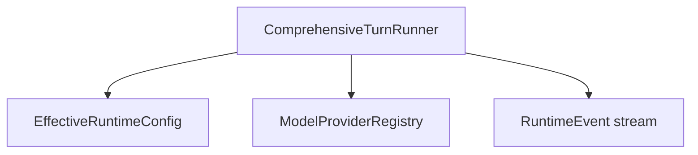

# M18-01 Comprehensive Turn Runner Spec

## Purpose

Introduce the `ComprehensiveTurnRunner` API in `agent-core` as the orchestration entrypoint for full model-tool-observation turns.

## Product Context

M17 can stream model events and M02/M03 can execute one controlled tool call. This slice creates the runtime structure that can coordinate multiple model turns and tool phases without yet implementing every continuation feature.

## Scope

This slice delivers:

- `ComprehensiveTurnInput`, `AgentLoopBudget`, `AgentLoopOutcome`, and terminal state contracts
- initial runner that streams a model turn, records model deltas, records tool proposals, and finalizes cleanly
- deterministic tests for final-response and tool-proposal paths

Owned by later M18 slices:

- partial tool-call accumulation
- observation continuation prompts
- idempotency, loop guards, and local coding E2E

## Architecture

`agent-core` owns the runner. It receives an effective runtime config and a model provider registry, reuses the M17 streaming model runtime, and emits typed `RuntimeEvent` records. It does not execute tools in this first slice.



## Public Contracts

```rust
pub struct ComprehensiveTurnInput {
    pub ids: RuntimeIds,
    pub user_message: String,
    pub effective_config: EffectiveRuntimeConfig,
    pub requirements: ModelRequestRequirements,
    pub loop_budget: AgentLoopBudget,
}

pub struct AgentLoopBudget {
    pub max_model_turns: u32,
    pub max_tool_calls: u32,
    pub max_observation_bytes: u64,
}

pub enum AgentLoopTerminalState {
    Done,
    WaitingApproval,
    Failed,
    Cancelled,
}

pub struct AgentLoopOutcome {
    pub terminal_state: AgentLoopTerminalState,
    pub final_message: Option<String>,
    pub events: Vec<RuntimeEvent>,
}
```

## State and Failure Handling

- Empty user messages fail before model invocation.
- Final model deltas produce `FinalResponseProduced` and terminal `Done`.
- Tool calls produce `ToolCallProposed` and terminal `WaitingApproval` until execution slices are added.
- Runtime resolution failures remain `ConfiguredTurnError`-compatible where practical.

## Security and Privacy

The runner only records tool proposals in this slice. No side effects execute. Tool call inputs are retained as existing typed runtime events and must stay serializable for audit.

## Testing Strategy

- fake model final-response test
- fake model tool-call proposal test
- invalid input test
- event order test proving prompt snapshot precedes model/tool events

## Acceptance Criteria

- `agent-core` exposes comprehensive turn contracts.
- A fake model can produce either a final response or a suspended tool proposal outcome.
- Existing configured turn tests stay green.

## Completion Signal

M18-01 is complete when comprehensive runner tests pass and `cargo xtask check` is green.
