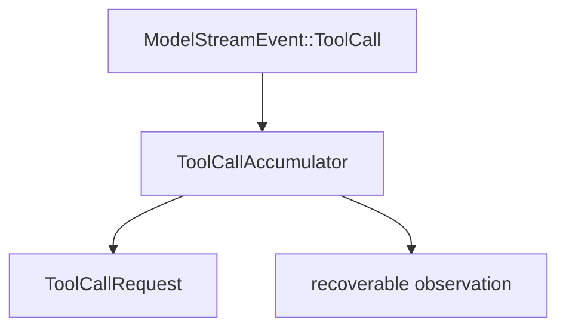

# M18-02 Streaming Tool Call Accumulator Spec

## Purpose

Normalize model tool-call stream events into executable tool call requests with duplicate and invalid-input diagnostics.

## Product Context

Providers currently emit complete `ModelStreamEvent::ToolCall` values. Future providers may emit partial tool-call deltas. M18 needs an accumulator boundary so loop orchestration is independent from provider stream shape.

## Scope

This slice delivers:

- `ToolCallAccumulator` in `ruse-core`
- conversion from complete model tool-call events into `ToolCallRequest`
- duplicate call id detection
- invalid tool names and invalid JSON object input converted into model-visible observations

Owned by later slices:

- executing accumulated tool calls
- observation compaction
- idempotent effect replay

## Architecture

The accumulator lives in `ruse-core` because it translates model stream events into core tool-loop requests. It depends on `ruse-model`, `ruse-tool`, and `ruse-types` contracts but does not execute tools.



## Public Contracts

```rust
pub struct ToolCallAccumulator;

pub enum AccumulatedToolCall {
    Ready(ToolCallRequest),
    Observation(ToolObservationMessage),
}

pub struct ToolObservationMessage {
    pub call_id: String,
    pub tool_name: String,
    pub observation: String,
    pub truncated: bool,
}
```

## State and Failure Handling

- First complete call id wins.
- Duplicate identical call ids produce a recoverable observation.
- Invalid tool names produce a recoverable observation and no execution request.
- Non-object JSON input is preserved as JSON but labeled invalid for the model.

## Security and Privacy

Tool inputs are model-generated and untrusted. The accumulator validates names and records diagnostics without executing or granting permissions.

## Testing Strategy

- accepts a complete valid tool call
- rejects duplicate call ids
- rejects invalid tool names
- reports invalid JSON shape as observation

## Acceptance Criteria

- Comprehensive runner can use the accumulator to decide whether a tool call is executable or should be returned as an observation.
- Tests prove duplicate and invalid calls do not execute.

## Completion Signal

M18-02 is complete when accumulator tests and comprehensive runner proposal tests pass.
