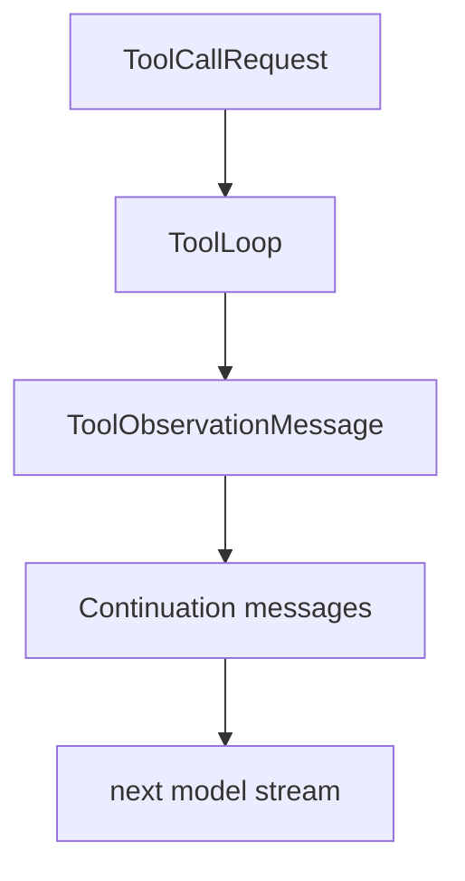

# M18-03 Tool Observation Context Spec

## Purpose

Execute allowed tool calls and feed safe, bounded observations back into the next model turn.

## Product Context

An agent loop becomes useful when model-proposed tool calls can affect subsequent model reasoning. This slice connects `ToolLoop` outcomes to continuation context.

## Scope

This slice delivers:

- execution of ready tool calls through existing `ToolLoop`
- `ToolObservationMessage` creation from completed, denied, failed, unknown, and invalid tool calls
- continuation model request that includes observation messages
- redaction and size bounding for observations

Owned by later slices:

- idempotency and replay-safe effect skipping
- full local coding E2E
- interactive approval resume UX

## Architecture

`ComprehensiveTurnRunner` executes tools through `ToolLoop`, converts outcomes into observation messages, appends observations to continuation messages, and invokes the model again. Tool outputs remain untrusted and are bounded before model re-entry.



## Public Contracts

```rust
pub struct ComprehensiveTurnResources<'a, P> {
    pub tools: &'a ToolRegistry,
    pub policy: &'a P,
}

pub struct ToolResultCompactionPolicy {
    pub max_observation_bytes: u64,
}
```

## State and Failure Handling

- Allowed completed tools produce `Observed` and continue the model loop.
- Denied tools produce a denial observation and continue unless budget is exhausted.
- Ask decisions return `WaitingApproval`.
- Tool execution failures produce recoverable observations unless the tool loop marks them terminal.
- Oversized outputs are truncated with `truncated = true`.

## Security and Privacy

Tool output is untrusted input. Observations redact secret-like values, enforce byte limits, and include source labels so later prompt-injection defenses can attach warnings.

## Testing Strategy

- model proposes read tool, observation is passed to second model turn
- denied tool returns model-visible denial observation
- ask decision suspends without execution
- oversized tool output is truncated and marked

## Acceptance Criteria

- A fake model can call a tool, receive the observation, and produce a final response in a single comprehensive run.
- Tool outputs do not exceed observation budget before model continuation.

## Completion Signal

M18-03 is complete when observation continuation tests pass and old single tool-loop tests remain green.
