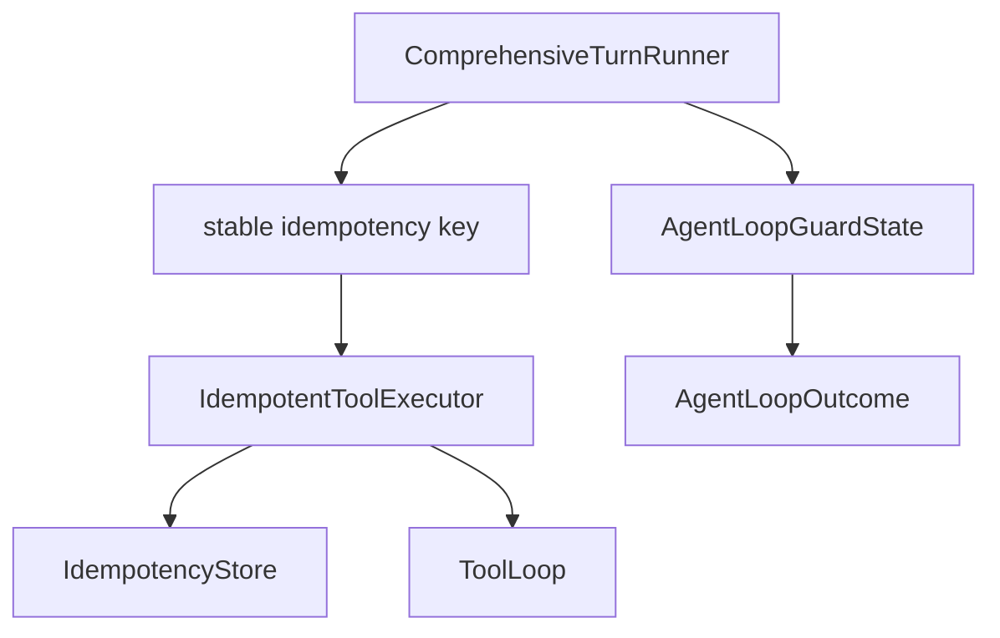

# M18-04 Loop Guards and Idempotency Spec

## Purpose

Enforce comprehensive turn safety limits and make completed tool effects replay-safe before the loop is used for real local coding workflows.

## Product Context

M18-03 gives the comprehensive runner the ability to execute tools and continue with observations. Without guardrails, a model can loop forever, emit too many invalid tool calls, exceed output budgets, or repeat side effects after a crash. This slice makes the loop bounded and idempotent.

## Scope

This slice delivers:

- guard enforcement for model turns, tool calls, wall-clock time, observation bytes, and consecutive invalid tool calls
- terminal failure reasons for guard exhaustion
- idempotency key assignment for executable tool calls
- integration with the existing `IdempotentToolExecutor`
- replay behavior that returns completed tool observations without executing side effects again

Owned by later slices:

- local coding end-to-end fixture across read, edit, shell, Git, and final response
- interactive approval resume UX

## Architecture

`ComprehensiveTurnRunner` owns guard accounting and calls the idempotent executor at the side-effect boundary. The runner records guard failures as runtime errors and returns a controlled failed terminal state. Idempotency state stays in `agent-storage`; the runner only derives stable keys and passes them through the existing executor.



## Public Contracts

```rust
pub struct AgentLoopBudget {
    pub max_model_turns: u32,
    pub max_tool_calls: u32,
    pub max_wall_time_ms: u64,
    pub max_observation_bytes: u64,
    pub max_consecutive_invalid_tool_calls: u32,
}

pub enum AgentLoopFailureReason {
    MaxModelTurnsExceeded,
    MaxToolCallsExceeded,
    MaxWallTimeExceeded,
    MaxObservationBytesExceeded,
    MaxConsecutiveInvalidToolCallsExceeded,
    Runtime(String),
}

pub struct AgentLoopOutcome {
    pub terminal_state: AgentLoopTerminalState,
    pub final_message: Option<String>,
    pub failure_reason: Option<AgentLoopFailureReason>,
    pub events: Vec<RuntimeEvent>,
}
```

Exact Rust layout may be adjusted during implementation, but the runner must expose a typed failure reason rather than relying on string parsing.

## Guard Rules

- `max_model_turns` counts each model stream invocation.
- `max_tool_calls` counts executable tool call attempts before execution.
- `max_wall_time_ms` is evaluated before each model call and before each tool execution.
- `max_observation_bytes` counts all normalized observation text added to continuation context.
- `max_consecutive_invalid_tool_calls` counts invalid, unknown, duplicate, or malformed tool proposals that do not execute.
- Guard failures emit a runtime error event and return `AgentLoopTerminalState::Failed`.

Budgets are required to be non-zero. Invalid budget configuration fails before model invocation.

## Idempotency Rules

Each executable tool call receives a deterministic idempotency key derived from:

- workspace id
- conversation id
- turn id
- model turn index
- tool call id
- tool name
- canonicalized JSON input hash

Completed side-effecting tools are recorded through `IdempotentToolExecutor`. During replay or retry, a matching completed effect returns a replayed observation event and does not execute the tool again. Denied, failed, invalid, and waiting-approval calls are not recorded as completed effects.

## Failure Handling

- Guard failures are controlled terminal failures, not panics.
- Idempotency store failures produce a failed terminal state and a runtime error event.
- A replayed completed effect is treated as an observed tool result and can continue the model loop.
- Duplicate call ids with different inputs remain invalid proposals and do not hit idempotency.

## Security and Privacy

Idempotency keys use hashes for tool input and do not store raw secrets. Guard diagnostics include counts and reason codes but do not include raw tool input or raw observations.

## Testing Strategy

- max model turns failure
- max tool calls failure before extra execution
- invalid proposal streak failure
- invalid zero budget failure before model invocation
- completed idempotent tool call is replayed without re-execution
- failed tool calls are not recorded as completed idempotent effects

## Acceptance Criteria

- Comprehensive turns cannot exceed configured loop budgets.
- Guard failures are auditable and typed.
- Completed side-effecting tool effects are not duplicated on replay.
- Existing M18-01 through M18-03 tests remain green.

## Completion Signal

M18-04 is complete when guard/idempotency tests pass and `cargo xtask check` is green.
