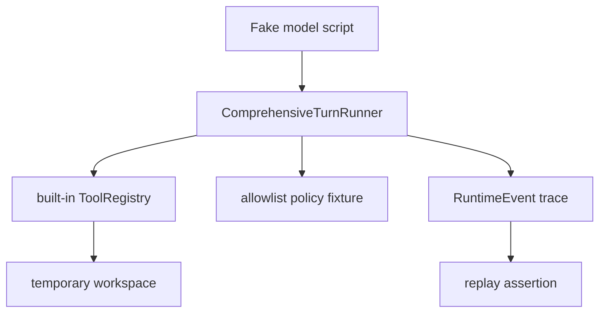

# M18-05 Local Coding Real Loop E2E Spec

## Purpose

Prove that the comprehensive agent loop can complete a deterministic local coding workflow using real built-in tools and replayable runtime events.

## Product Context

M03 created local coding tools and a scripted local coding path. M18 replaces single-purpose orchestration with a comprehensive model-tool-observation loop. This slice verifies that the new loop can drive read, edit, shell, Git inspection, and final response behavior through the same core runtime path that CLI, TUI, Desktop, and background agents will later use.

## Scope

This slice delivers:

- deterministic fake-model script for a local coding workflow
- built-in tool registry fixture covering read, edit, shell, and Git status/diff inspection
- comprehensive turn end-to-end test using real tool execution in a temporary workspace
- event assertions for proposal, decision, execution, observation, and final response ordering
- replay check proving final state can be reconstructed from emitted events

Owned by later milestones:

- interactive approval prompts for side-effecting actions
- TUI/Desktop rendering for diffs and tool timelines
- background task wrapping for long-running coding work

## Workflow

The canonical M18-05 fixture performs:

1. model asks to read a workspace file
2. runner executes read tool and returns observation
3. model asks to edit the file
4. runner executes edit tool and returns diff/output observation
5. model asks to run a shell verification command
6. runner executes shell tool and returns captured output
7. model asks for Git status or diff
8. runner executes Git inspection tool and returns observation
9. model produces final response

All steps run through `ComprehensiveTurnRunner`; test code must not call `ToolLoop` directly.

## Architecture

The E2E test is an integration fixture inside `agent-core` that wires existing crates through public contracts. It uses a temporary workspace and deterministic fake model scripts. The fixture should be small enough to diagnose failures without requiring a live provider.

## State and Failure Handling

- Tool failures fail the test unless the scenario explicitly expects a recoverable observation.
- Policy denials are covered by earlier slices; this fixture uses explicit allowlist policy.
- Temporary workspace cleanup happens after the test process exits.
- Replay assertion validates event-derived final response and tool trace order.

## Security and Privacy

The fixture uses a temporary directory and a deterministic allowlist. Shell commands are constrained to the fixture workspace and short timeouts. The test must not read or write outside the temporary workspace.

## Testing Strategy

- one full local coding loop test with read, edit, shell, Git, and final response
- event order assertion for tool proposal through observation
- file content assertion after edit
- replay or trace assertion using emitted events only
- focused command plus full workspace gate

## Acceptance Criteria

- `ComprehensiveTurnRunner` can complete the canonical local coding workflow.
- The edited file content matches the fake model request.
- The emitted event trace includes each tool proposal, decision, execution, observation, and final response.
- The workflow passes under `cargo xtask check`.

## Completion Signal

M18-05 is complete when the local coding E2E test passes, M18 milestone docs mark implementation complete, and workspace verification is green.
