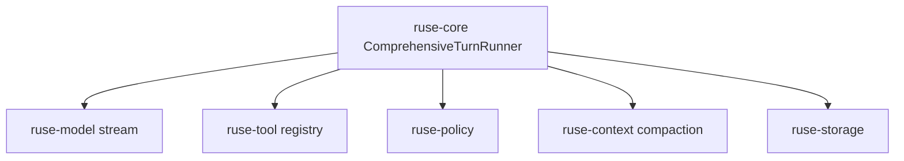

# M18 Agent Tool Loop Runtime Spec

## Purpose

Build the full agent loop that lets a live or fake model propose tool calls, route them through policy and sandboxing, return observations to the model, and continue until a final response or controlled terminal state is reached.

## Product Context

M02 introduced a deterministic single tool-loop path. M15 can run a model turn, and M17 adds live streaming. A coding agent becomes useful only when model output, tool proposals, permission checks, tool execution, observations, compaction, and retry logic are integrated into one comprehensive turn.

## Scope

This milestone delivers:

- `ComprehensiveTurnRunner` in `ruse-core`
- recursive model/tool/observation loop with max iteration and budget guards
- tool call accumulation from streaming model events
- tool input validation and idempotency integration
- observation messages added back into prompt context
- tool result compression before model continuation
- event sequence covering proposed, approved, executed, observed, failed, retried, and final states

Owned by later milestones:

- interactive approval UI for pending asks
- TUI/Desktop rendering of tool calls and diffs
- background task orchestration over long-running turns

## Architecture

`ruse-core` owns loop orchestration and remains provider-neutral. It consumes `ruse-model` stream events, uses `ruse-tool` registry entries, delegates permission checks to `ruse-policy`, invokes sandboxed tools, and persists events through `ruse-storage`. `ruse-context` compresses observations when budgets require it.

## Key Contracts

- `ComprehensiveTurnInput`
- `ComprehensiveTurnRunner`
- `AgentLoopState`
- `AgentLoopBudget`
- `ToolObservationMessage`
- `ToolResultCompactionPolicy`
- `AgentLoopOutcome`

Contract rules:

- every tool call has a stable call id and idempotency key
- tool observations are source-labeled and budgeted before re-entering the model
- max iterations, max tool calls, max wall time, and max output bytes are enforced
- final response is accepted only after all accepted tool calls are resolved

## State and Failure Handling

- unknown tools create model-visible observations and runtime diagnostics
- denied tools return denial observations and can continue when policy allows
- failed tools return recoverable observations unless the tool marks failure terminal
- repeated invalid tool calls can trip loop guard and terminate with a controlled failure
- crash recovery resumes from the latest checkpoint and skips completed idempotent effects

## Security and Privacy

- all tool execution goes through policy and sandbox profiles
- tool outputs are treated as untrusted input before re-entering the prompt
- observations redact secret-like output and obey max-size limits
- prompt injection warnings attach to observations from files, shells, MCP, browser, and plugins

## Testing Strategy

- fake-model tests for multi-tool sequences and final response
- property tests for loop guard transitions
- idempotency replay tests for completed tool calls
- policy tests for allow, deny, and ask decisions
- compaction tests for oversized tool outputs

## Acceptance Criteria

- A fake model can drive a multi-step coding turn using read, edit, shell, and Git tools.
- Tool calls, decisions, outputs, observations, and final response are replayable from events.
- Loop guards prevent infinite or runaway tool execution.
- Core can pause on approval without losing turn state.

## Completion Signal

M18 is complete when comprehensive turn execution replaces the old single-pass path for configured runs and workspace verification passes.
