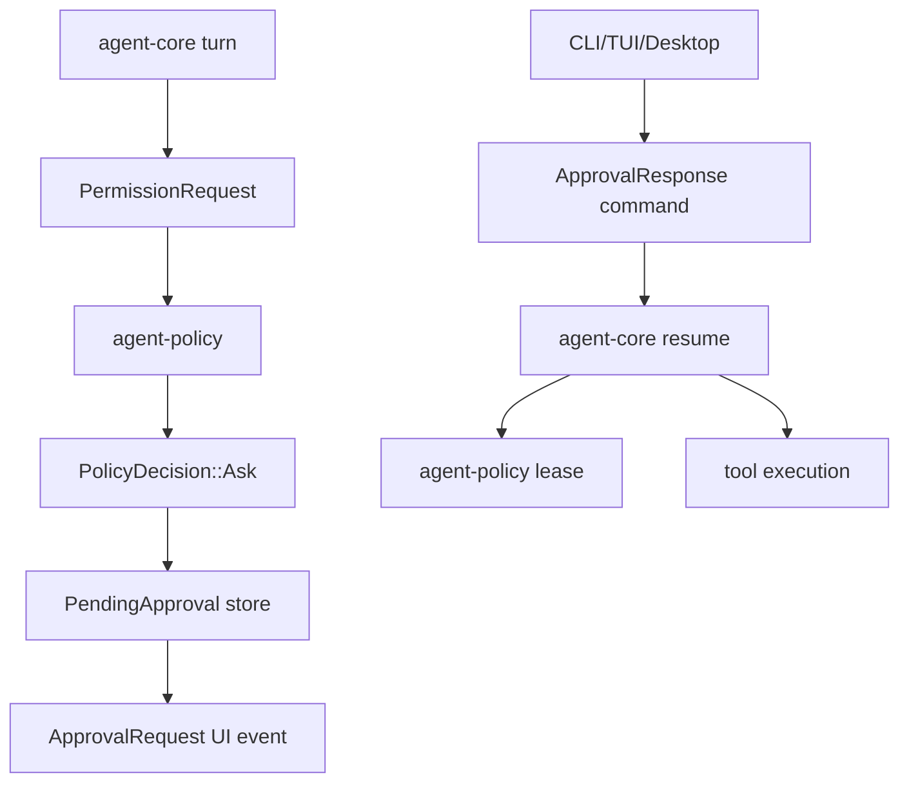

# M19-00 Interactive Approval Technical Design Spec

## Purpose

Define the architecture for durable interactive approvals before M19 implementation begins. M19 turns policy `ask` decisions into resumable runtime states that CLI, TUI, and Desktop can resolve consistently.

## Product Context

M02 introduced `allow`, `deny`, and `ask` decisions. M18 can pause when a tool requires approval, but users need real approval prompts, previews, leases, denial reasons, audit records, and recovery behavior for file edits, shell commands, Git actions, MCP tools, plugins, and background tasks.

## Scope

This design governs:

- pending approval record model
- approval request and response UI bridge schemas
- permission lease scope and expiration
- tool preview payloads
- CLI approval prompt behavior
- turn suspension, resume, and recovery
- audit requirements for approvals and denials

Owned by implementation slices:

- `M19-01-pending-approval-contracts`
- `M19-02-ui-approval-bridge`
- `M19-03-tool-preview-payloads`
- `M19-04-cli-approval-prompt`
- `M19-05-approval-resume-recovery`

## Architecture

`agent-policy` owns permission decisions and lease data. `agent-core` owns pending approval lifecycle and suspended turn state. `agent-ui-bridge` defines approval events and response commands. `agent-cli` implements the first prompt UI; `agent-tui` and Desktop consume the same bridge contracts later.



Dependency rules:

- `agent-policy` does not depend on UI or storage.
- `agent-core` maps policy `ask` into durable runtime state.
- UI clients cannot approve actions without a pending request id.
- Tool executors do not self-prompt for approval.

## Approval Data Model

`PendingApproval` contains:

- request id and correlation id
- workspace, conversation, turn, task, actor, and optional agent ids
- capability action and resource scope
- preview payload
- requested lease scope and duration
- status: pending, approved, denied, expired, cancelled, consumed
- created, expires, and resolved timestamps
- resume token or checkpoint reference

`ApprovalResponseCommand` contains:

- request id
- decision: allow or deny
- reason
- optional lease duration override within policy limits

Responses are accepted only for pending, unexpired records.

## Preview Payloads

Previews are UI-safe typed payloads:

- file edit: normalized path, diff summary, hunks, add/delete counts, content hash
- shell command: executable, args, cwd, env allowlist, timeout, sandbox profile
- Git: operation, branch/ref/path scope, diff or status summary
- MCP: server id, tool name, declared capability, input summary
- plugin: plugin id, tool/hook name, declared capability, input summary
- background task: schedule, quota, workspace, capability scope

Raw secrets and full oversized tool inputs are never included.

## Lease Rules

Approval creates a permission lease only when policy allows the requested scope. Lease scope is the intersection of:

- policy maximum
- approval request scope
- user response constraints
- task or subagent capability ceiling

Leases cannot broaden sandbox profiles. A lease permits a future policy decision; it does not execute tools by itself.

## Resume and Recovery

When approval is pending, the turn is suspended at a checkpoint. On approval, core reloads the suspended state, re-validates the lease, checks idempotency, and executes the tool. On denial, core records the denial and returns a model-visible observation when the loop can continue.

Crash recovery restores pending approvals and suspended checkpoints. Expired approvals remain auditable and cannot be consumed.

## CLI Behavior

CLI prompts display:

- action summary
- preview details
- policy reason
- requested scope and duration
- explicit allow/deny choices

Batch mode can fail on `ask` unless configured with an approval strategy. JSON mode emits approval frames and waits only when the caller supports command input.

## Security and Privacy

Approval UX is an interaction boundary, not a sandbox bypass. Approved tools still run inside sandbox constraints. Previews redact secrets and normalize paths. Stale, duplicate, or tampered request ids are rejected. Audit records include request, response, lease, actor, reason, and correlation ids.

## Testing Strategy

Required coverage:

- pending approval state transitions
- UI bridge approval request/response serialization
- preview redaction and normalization tests
- CLI approval fixture tests
- lease scope intersection tests
- resume after approval and denial tests
- stale, expired, and duplicate response rejection tests
- audit replay tests proving denied actions did not execute

Workspace gates use:

```bash
cargo xtask check
```

## Acceptance Criteria

- `ask` decisions produce durable pending approvals.
- CLI can approve or deny side-effecting actions.
- Approved actions resume safely and denied actions do not execute.
- TUI and Desktop have stable bridge contracts for approval panels.

## Completion Signal

M19 technical design is complete when this document and its plan exist, M19 milestone planning marks the design slice complete, and M19-01 can start without unresolved approval, lease, or resume decisions.
