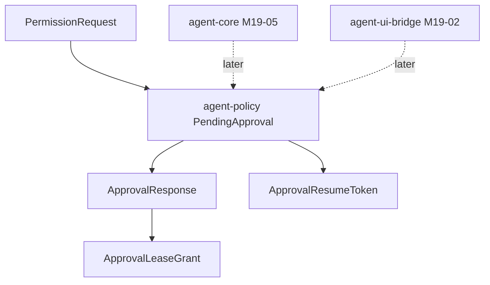

# M19-01 Pending Approval Contracts Spec

## Purpose

Define durable approval-domain contracts for policy `ask` decisions. This slice gives core, CLI, TUI, Desktop, background tasks, plugins, and MCP a shared typed record for pending approvals before any UI prompt or resume behavior is implemented.

## Product Context

M18 can stop on `PolicyDecision::Ask`, but the runtime needs a durable object that says what is waiting, who can resolve it, what scope can be leased, when it expires, and how a suspended turn can resume. M19-01 provides that policy-owned contract.

## Scope

This spec delivers:

- `PendingApproval` and `ApprovalStatus` contracts in `agent-policy`
- approval request id, response, decision, denial reason, and status transition rules
- approval lease scope and lease-duration intersection helpers
- UI-safe preview summary metadata, without rich tool-specific preview payloads
- resume token reference fields, without core recovery execution
- validation and serde shape tests

Owned by later specs:

- rich file, command, Git, MCP, plugin, and task preview payloads: M19-03
- UI bridge event and command envelopes: M19-02
- CLI prompt interaction: M19-04
- suspended turn persistence and resume execution: M19-05

## Architecture

`agent-policy` owns the approval domain contracts because approval records are policy outcomes, not UI state. `agent-types` owns durable approval ids. `agent-core` will persist and consume these contracts later. `agent-ui-bridge` will project them into UI-safe frames later.



Dependency rules:

- `agent-policy` may depend on `agent-types` for `ApprovalRequestId`, actor refs, timestamps, and checkpoints.
- `agent-policy` must not depend on `agent-core`, `agent-tool`, `agent-ui-bridge`, `agent-cli`, or storage.
- preview data in this slice is summary-only and secret-safe.

## File Layout

```text
crates/
  agent-types/
    src/
      ids.rs
      lib.rs
  agent-policy/
    src/
      approval.rs
      lib.rs
    tests/
      pending_approval.rs
```

## Public Contracts

```rust
pub struct PendingApproval {
    pub id: ApprovalRequestId,
    pub permission_request: PermissionRequest,
    pub preview: ApprovalPreviewSummary,
    pub lease_scope: ApprovalLeaseScope,
    pub resume_token: Option<ApprovalResumeToken>,
    pub status: ApprovalStatus,
    pub created_at: Timestamp,
    pub expires_at: Option<Timestamp>,
    pub resolved_at: Option<Timestamp>,
}

pub enum ApprovalStatus {
    Pending,
    Approved,
    Denied,
    Expired,
    Cancelled,
    Consumed,
}

pub enum ApprovalDecision {
    Allow,
    Deny,
}

pub struct ApprovalResponse {
    pub request_id: ApprovalRequestId,
    pub decision: ApprovalDecision,
    pub reason: String,
    pub lease_duration_seconds: Option<u64>,
    pub resolved_at: Timestamp,
}

pub struct ApprovalLeaseScope {
    pub actor: ActorRef,
    pub action: CapabilityAction,
    pub resource: ResourceScope,
    pub max_duration_seconds: Option<u64>,
}

pub struct ApprovalLeaseGrant {
    pub request_id: ApprovalRequestId,
    pub scope: ApprovalLeaseScope,
    pub duration_seconds: Option<u64>,
    pub issued_at: Timestamp,
}
```

`ApprovalPreviewSummary` contains only `kind`, `resource`, `summary`, `content_hash`, `truncated`, and `redacted` fields. Rich payloads come later.

## State and Failure Handling

- only `Pending` records accept responses
- `Allow` changes status to `Approved` and can produce an `ApprovalLeaseGrant`
- `Deny` changes status to `Denied` and never creates a lease
- `expire` changes `Pending` to `Expired`; expired records reject responses
- `cancel` changes `Pending` to `Cancelled`; cancelled records reject responses
- `consume` changes `Approved` to `Consumed`; non-approved records reject consumption
- requested lease duration is clamped to `max_duration_seconds`
- empty response reasons, empty preview summaries, empty resource labels, and invalid ids are rejected

## Security and Privacy

- contracts store secret-safe summaries only
- approval leases cannot broaden action, actor, or resource scope beyond the original request
- denied, expired, and cancelled records remain auditable
- resume tokens are opaque references, not executable authority

## Testing Strategy

- unit/integration tests for stable JSON shape
- transition tests for approve, deny, expire, cancel, and consume
- invalid transition tests for duplicate/stale responses
- lease duration clamping tests
- redaction/summary validation tests

## Acceptance Criteria

- `agent-policy` exports pending approval contracts.
- pending approvals serialize deterministically and do not expose raw tool input.
- status transitions enforce safe approval semantics.
- lease grants are scoped and duration-limited.

## Completion Signal

M19-01 is complete when `cargo test -p agent-policy --test pending_approval` passes and the contracts are exported from `agent-policy`.
