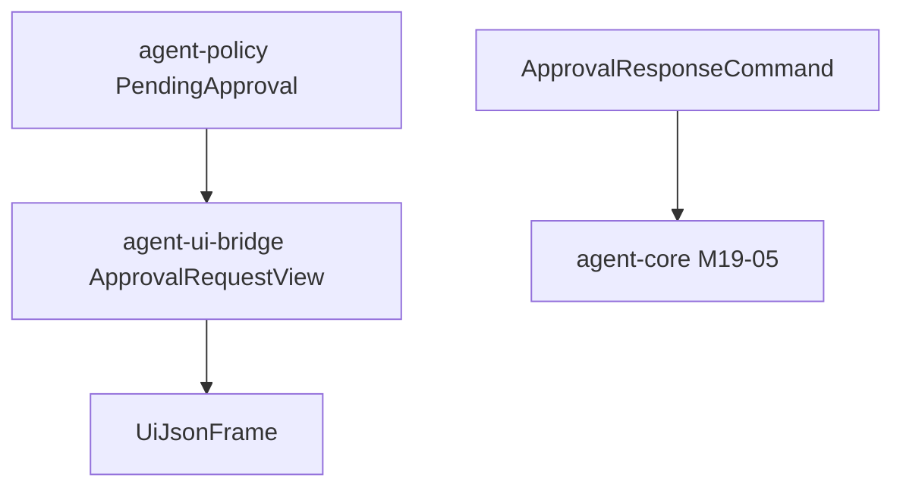

# M19-02 UI Approval Bridge Spec

## Purpose

Expose pending approvals and approval responses through stable UI bridge schemas that CLI, TUI, Desktop, and JSON clients can share.

## Product Context

M19-01 creates policy-owned approval records. Product surfaces need a UI-safe frame for displaying approval requests and a command envelope for allow/deny responses.

## Scope

This spec delivers:

- approval request UI event payloads in `agent-ui-bridge`
- approval response UI command payloads in `agent-ui-bridge`
- normalization from policy approval contracts into UI-safe payloads
- JSON frame and snapshot tests

Owned by other specs:

- durable core pending approval storage and resume: M19-05
- CLI prompt rendering and stdin interaction: M19-04
- rich tool preview payload production: M19-03

## Architecture

`agent-ui-bridge` owns wire contracts. It depends on `agent-policy` for approval contracts and `agent-types` for ids. It must not execute approvals or mutate runtime state.

## Public Contracts

- `UiApprovalRequest`
- `UiApprovalStatus`
- `UiApprovalPreviewSummary`
- `UiApprovalResponseCommand`
- `UiCommandPayload::ResolveApproval`
- `UiEventPayload::ApprovalRequested`
- `UiEventPayload::ApprovalResolved`

## State and Failure Handling

- bridge validation rejects empty request ids and empty response reasons
- UI status mirrors policy status without adding UI-only terminal states
- JSON mode emits line-delimited frames and never blocks for stdin
- bridge payloads omit hidden prompt content and raw tool inputs

## Security and Privacy

- only redacted summaries cross into UI payloads
- resource labels are normalized strings, not filesystem authority
- command payloads carry user intent only; core must re-validate pending state

## Testing Strategy

- serialization snapshot tests for request and response frames
- redaction tests for preview summaries
- command validation tests for empty request id and empty denial reason
- normalization tests from `PendingApproval`

## Acceptance Criteria

- UI clients can render pending approvals from bridge frames.
- UI clients can submit approval responses through typed bridge commands.
- bridge snapshots remain stable and secret-safe.

## Completion Signal

M19-02 is complete when `cargo test -p agent-ui-bridge approval` passes and JSON snapshots include approval request and response examples.
