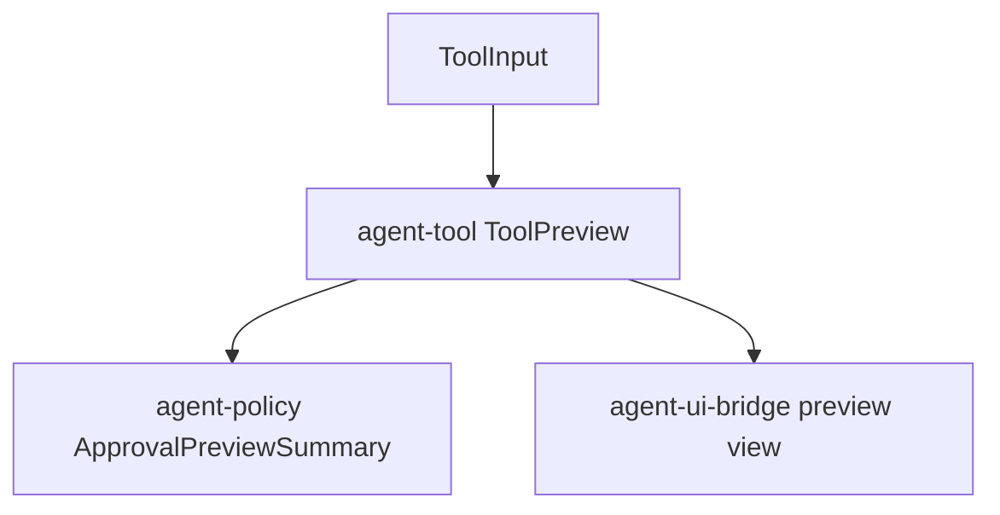

# M19-03 Tool Preview Payloads Spec

## Purpose

Create typed, secret-safe preview payloads for side-effecting actions so users can approve concrete file, command, Git, MCP, plugin, and background task operations with enough context.

## Product Context

Approval without preview is unsafe. M19-03 turns tool inputs into bounded summaries that can be displayed in CLI, TUI, Desktop, and audit traces.

## Scope

This spec delivers:

- `ToolPreview` payload enum in `agent-tool`
- file edit diff preview summaries
- shell command preview summaries
- Git operation preview summaries
- MCP and plugin preview summaries
- background task preview summaries
- redaction, truncation, and hashing rules

Owned by other specs:

- pending approval record lifecycle: M19-01
- UI bridge projection: M19-02
- CLI rendering and approval prompt: M19-04

## Architecture

`agent-tool` owns tool preview generation because it already owns built-in tool input schemas and workspace confinement helpers. Extension previews later flow through the same enum.

## Public Contracts

- `ToolPreview`
- `FileEditPreview`
- `CommandPreview`
- `GitPreview`
- `McpPreview`
- `PluginPreview`
- `BackgroundTaskPreview`
- `PreviewRedactionReport`

## State and Failure Handling

- preview generation does not mutate files or execute commands
- unsupported tools return generic preview summaries with hashed input
- oversized previews are truncated with byte and line counts
- preview failures are recoverable and produce deny-safe diagnostics

## Security and Privacy

- environment values, secret refs, hidden prompt content, and raw plugin output are redacted
- paths are normalized and workspace-confined
- previews are consent aids, not permission grants

## Testing Strategy

- diff preview tests for add, modify, delete, and unsafe path rejection
- command preview tests for env allowlist and timeout display
- Git preview tests for status/diff scopes
- MCP/plugin preview redaction tests
- generic preview fallback tests

## Acceptance Criteria

- file edit and shell command approvals have useful previews.
- extension previews carry source metadata and redacted inputs.
- preview generation is side-effect free.

## Completion Signal

M19-03 is complete when `cargo test -p agent-tool preview` passes and M19-01 approval records can carry preview summaries derived from typed tool previews.
