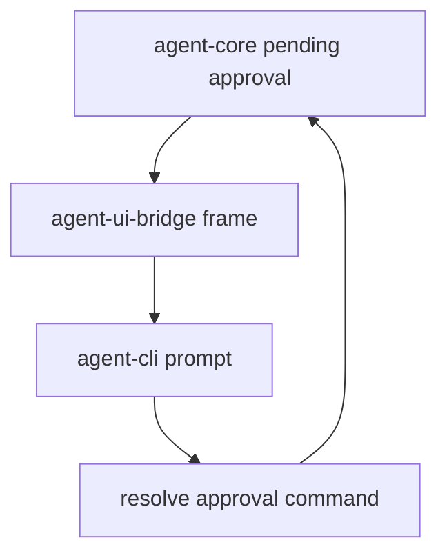

# M19-04 CLI Approval Prompt Spec

## Purpose

Add the first interactive approval UX in `agent-cli`, allowing terminal users to approve or deny pending side-effecting actions.

## Product Context

M19 approval contracts and preview payloads need a user-facing loop before TUI and Desktop panels exist. CLI approval prompts make local coding workflows safe and usable.

## Scope

This spec delivers:

- plain terminal approval prompt rendering
- allow, deny, and abort input handling
- batch and JSON mode behavior for pending approvals
- deterministic fixture tests for stdin/stdout prompt flows

Owned by other specs:

- UI bridge schemas: M19-02
- core suspended turn resume: M19-05
- full-screen TUI panels: M20
- Desktop modals: M21

## Architecture

`agent-cli` owns terminal interaction. It consumes approval bridge frames and sends approval response commands. It must not create leases directly or bypass core resume validation.

## CLI Behavior

- interactive TTY mode renders preview, scope, reason, and choices
- `allow` submits an allow response with optional duration
- `deny` requires or supplies a denial reason
- batch mode fails clearly on approval-required unless a strategy is configured
- JSON mode emits approval frames and expects commands from the caller

## State and Failure Handling

- EOF during prompt cancels or denies according to configured strategy
- invalid input re-prompts in interactive mode
- stale approval response diagnostics come from core
- prompt rendering never mutates runtime state before explicit choice

## Security and Privacy

- raw secrets and hidden content are not printed
- prompt displays normalized resource and sandbox information
- approving in CLI does not broaden lease scope beyond policy limits

## Testing Strategy

- parser tests for allow, deny, abort, and invalid input
- fixture prompt tests for text output
- JSON mode tests proving no blocking prompt
- batch mode tests for approval-required failure

## Acceptance Criteria

- CLI users can approve or deny a pending file edit or command action.
- non-interactive modes remain script-safe.
- approval input produces typed bridge commands.

## Completion Signal

M19-04 is complete when CLI approval fixture tests pass and local approval flows can drive M19-05 resume behavior.
