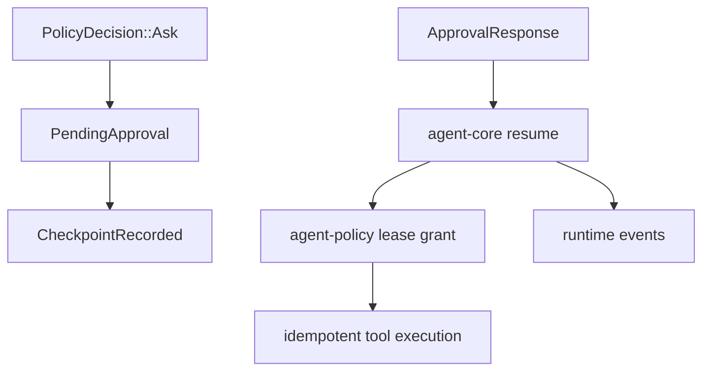

# M19-05 Approval Resume and Recovery Spec

## Purpose

Persist pending approvals, suspend turns safely, and resume or reject side-effecting tool execution after user approval, denial, expiration, or crash recovery.

## Product Context

Approvals must survive process restarts and cannot execute tools merely because a UI said yes. Core must re-load the suspended state, re-check lease validity, preserve idempotency, and audit the result.

## Scope

This spec delivers:

- core pending approval store integration
- runtime events for approval requested, resolved, expired, cancelled, and consumed
- suspended turn checkpoint references
- resume after approval and denial
- crash recovery listing for pending approvals
- audit replay tests proving denied/expired actions did not execute

Owned by other specs:

- policy approval contracts: M19-01
- UI bridge command/event schemas: M19-02
- preview generation: M19-03
- CLI prompt: M19-04

## Architecture

`agent-core` owns suspended turn orchestration and persists durable runtime events. `agent-policy` validates approval state transitions and lease grants. `agent-storage` persists event/checkpoint state.

## State and Failure Handling

- `ask` creates a pending approval and checkpoint before suspending
- approval response loads pending state by id and rejects stale ids
- approval creates a scoped lease and executes through normal tool loop
- denial records an observation when the model loop can continue
- expiration and cancellation never execute tools
- crash recovery lists pending approvals and suspended checkpoints
- idempotency prevents duplicate side effects after repeated resume

## Security and Privacy

- core re-validates all approval responses against stored pending records
- approval leases are capability ceilings, not tool execution commands
- audit events record request, response, actor, reason, lease scope, and correlation ids
- tool inputs remain redacted in UI-facing traces

## Testing Strategy

- core integration tests for ask -> pending -> approve -> execute
- ask -> pending -> deny -> no execution tests
- stale/expired/duplicate response rejection tests
- crash recovery tests over persisted events/checkpoints
- idempotency replay tests for approved side effects

## Acceptance Criteria

- side-effecting tools can pause and resume after approval.
- denied, expired, and duplicate approvals do not execute tools.
- pending approvals survive restart and are inspectable.
- approval events are replayable and auditable.

## Completion Signal

M19-05 is complete when comprehensive turn tests cover approval, denial, expiration, and replay-safe resume.
