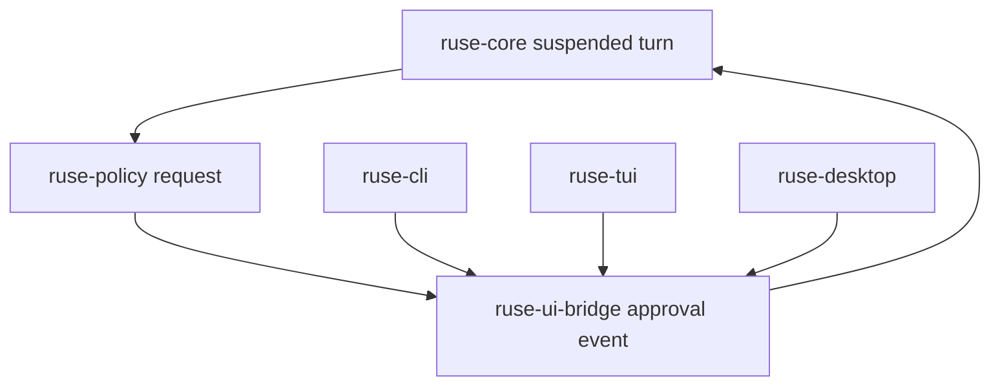

# M19 Interactive Approval and Safe Local Actions Spec

## Purpose

Make side-effecting actions safe and ergonomic by adding interactive approval flows for file edits, shell commands, Git actions, MCP tools, network access, and background work. M19 turns policy `ask` decisions into durable pending approvals that CLI, TUI, and Desktop can resolve.

## Product Context

M02 and M03 introduced policy decisions and local tools, but `ask` currently stops execution without a full interactive round trip. Real coding agents need approval prompts, diff previews, lease scopes, deny reasons, resume behavior, and audit trails across all UI forms.

## Scope

This milestone delivers:

- durable pending permission request records
- UI bridge commands and events for approval requests and responses
- CLI inline approval prompts for batch and plain REPL modes
- approval lease creation, expiration, and revocation
- diff preview and command preview payloads
- resume behavior after approval or denial
- policy simulation and dry-run command support

Owned by later milestones:

- full TUI approval panels
- Desktop modal UX
- advanced organization policy management

## Architecture

`ruse-policy` owns decisions and leases. `ruse-core` converts `ask` decisions into suspended turn states and emits approval events. UI clients respond through `ruse-ui-bridge`. `ruse-tool` provides preview payloads for edit, shell, Git, MCP, and plugin tools.

## Key Contracts

- `PendingApproval`
- `ApprovalRequestEvent`
- `ApprovalResponseCommand`
- `PermissionLeaseScope`
- `ToolPreview`
- `DiffPreview`
- `CommandPreview`
- `ApprovalResumeToken`

Contract rules:

- approval responses reference a pending request id
- approved leases are scoped by actor, workspace, capability, resource, and duration
- denial reason is stored and optionally returned as a model observation
- pending approvals survive process restart

## State and Failure Handling

- approval timeout moves the turn to `WaitingApproval` or `Failed` according to task policy
- stale approval responses are rejected
- denied actions do not execute and produce audit records
- resumed turns re-check lease validity before executing side effects
- crash recovery restores pending approvals from storage

## Security and Privacy

- previews must show enough information for consent without exposing raw secrets
- command approvals include executable, args, cwd, env allowlist, timeout, and sandbox profile
- file edit approvals include normalized paths and diff summaries
- approval leases never expand sandbox boundaries implicitly

## Testing Strategy

- state machine tests for ask, wait, approve, deny, expire, and resume
- CLI approval fixture tests
- UI bridge snapshot tests for approval events and responses
- policy lease scope tests
- audit replay tests proving denied actions did not execute

## Acceptance Criteria

- A side-effecting tool can pause for approval and resume after user consent.
- CLI users can approve or deny file edit and command previews.
- Approval decisions are durable, auditable, scoped, and replayable.
- Denied or expired approvals never execute the underlying tool.

## Completion Signal

M19 is complete when approval flow works in core and CLI, and TUI/Desktop can consume the same bridge contracts in later milestones.
