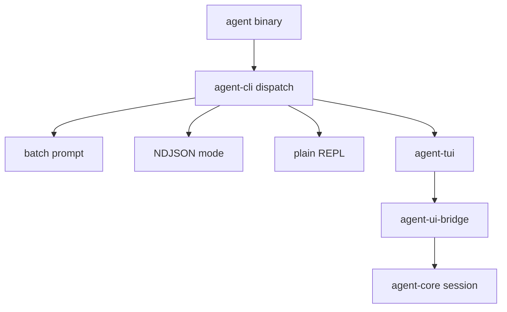

# M20-00 Terminal UX and TUI Technical Design Spec

## Purpose

Define the terminal product architecture before M20 implementation begins. M20 makes `agent` the installed command and makes the default interactive terminal experience a Ratatui-powered REPL while preserving batch, JSON, and plain REPL modes.

## Product Context

The user-facing goal is simple: open any terminal, type `agent`, and enter an agent REPL. Engineering-wise, the TUI must stay separate from runtime business logic and batch/JSON CLI behavior. This design establishes `agent-cli` as the entrypoint and `agent-tui` as the full-screen terminal application.

## Scope

This design governs:

- binary naming and mode dispatch
- TTY detection and fallback behavior
- `agent-tui` crate ownership
- Ratatui, Crossterm, and `tui-textarea` usage
- terminal lifecycle and cleanup
- TUI app state, panels, and runtime bridge client
- rendering and input testing strategy

Owned by implementation slices:

- `M20-01-agent-binary-entrypoint`
- `M20-02-ratatui-shell`
- `M20-03-tui-composer-repl`
- `M20-04-streaming-transcript`
- `M20-05-approval-diff-panels`
- `M20-06-trace-task-panels`
- `M20-07-plain-repl-fallback`

## Architecture

`agent-cli` owns the binary, command-line parsing, TTY detection, and mode dispatch. `agent-tui` owns full-screen terminal state, rendering, input handling, and terminal cleanup. Runtime communication goes through `agent-ui-bridge`; neither CLI nor TUI directly executes models, tools, storage, policy, or plugins.



Dependency rules:

- `agent-cli` may depend on `agent-tui`.
- `agent-tui` may depend on `agent-ui-bridge`, `agent-types`, Ratatui, Crossterm, and `tui-textarea`.
- `agent-tui` must not depend on `agent-model`, `agent-tool`, `agent-policy`, or `agent-storage` directly.
- `agent-core` must not depend on `agent-tui`.

## Command Model

Target user commands:

```bash
agent
agent tui
agent repl --plain
agent --prompt "hello"
agent --json --prompt "hello"
agent --config-check
agent --version
```

Rules:

- `agent` with no args enters TUI only when stdin and stdout are TTYs.
- `agent tui` requires terminal capabilities and fails with a clear diagnostic when unavailable.
- non-TTY no-arg invocation prints help and exits non-zero.
- batch and JSON modes remain script-safe and never enter raw terminal mode.
- package crate can remain `agent-cli`, but `[[bin]] name = "agent"` is the installed binary target.

## TUI State Model

`agent-tui` uses a pure app state that can be tested without a real terminal:

- `TuiApp`: top-level app state and event reducer
- `TuiScreen`: chat, trace, tasks, settings, help
- `TranscriptState`: user messages, model deltas, tool calls, observations, final responses
- `ComposerState`: multiline input, history, slash commands, submit state
- `ApprovalPanelState`: pending approvals and focused action
- `DiffPanelState`: diff preview and file navigation
- `TracePanelState`: ordered runtime events and filters
- `TaskPanelState`: background task summaries
- `StatusBarState`: provider, model, workspace, mode, connection, permission state

Rendering reads state. Input handlers transform state and produce bridge commands.

## Terminal Lifecycle

`TerminalModeGuard` owns raw mode, alternate screen, mouse capture if enabled, and panic/cancel cleanup. The guard must restore terminal state on normal exit, error, and unwind where supported.

Resize events trigger layout recomputation and redraw. Rendering must tolerate narrow terminals by hiding secondary panels before truncating critical prompt/composer state.

## Runtime Bridge Client

TUI does not call runtime crates directly. It owns a `TuiRuntimeClient` abstraction that can be backed by:

- in-process UI bridge channel for local runs
- fixture event stream for tests
- future external runtime process transport

The client receives `UiJsonFrame` or typed UI events and sends `UiCommandEnvelope` commands.

## Rendering Strategy

Initial layout:

- transcript main pane
- composer bottom pane
- status bar
- optional right panel for approvals, diffs, trace, or tasks

Keyboard model:

- Enter submits single-line input when not in multiline mode
- Shift+Enter or configured key inserts newline
- slash commands route through command parser
- explicit focus required for approval allow/deny actions
- Esc returns focus or exits through confirmation when work is pending

Exact key bindings can be refined in slice specs, but side-effecting actions must be explicit.

## Security and Privacy

TUI renders only UI-safe data. It never displays hidden prompt content, raw secrets, raw tool input marked sensitive, or unredacted logs. Approval and diff panels show normalized resources and sandbox profiles. Clipboard support, if added, must copy redacted text only.

## Testing Strategy

Required coverage:

- CLI dispatch tests for no args, explicit TUI, plain REPL, batch, JSON, help, and version
- pure reducer tests for composer, transcript, focus, panels, and slash commands
- terminal guard tests with fixture backend
- Ratatui buffer snapshot tests for layout states
- bridge fixture tests for streamed deltas, approvals, diffs, trace, and tasks

Workspace gates use:

```bash
cargo xtask check
```

## Acceptance Criteria

- `agent` is the installed binary name.
- `agent` in an interactive terminal opens TUI REPL.
- `agent --json --prompt` remains NDJSON and script-safe.
- `agent-tui` is isolated from runtime business logic.
- Terminal state is restored after exit or error.

## Completion Signal

M20 technical design is complete when this document and its plan exist, M20 milestone planning marks the design slice complete, and M20-01 can start without unresolved binary, crate, TTY, or TUI ownership decisions.
