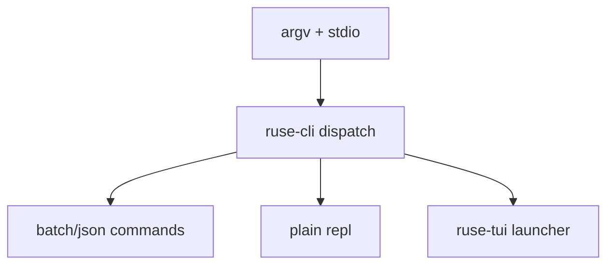

# M20-01 Agent Binary Entrypoint Spec

## Purpose

Make `agent` the installed command while preserving existing script-safe CLI behavior.

## Product Context

M20 starts the terminal product experience. Users should type `agent` in any interactive terminal and reach the TUI REPL, while automation can continue using batch and JSON modes.

## Scope

This spec delivers:

- `agent` binary target backed by `ruse-cli`
- explicit command parsing for `tui`, `repl --plain`, `--prompt`, `--json`, `--config-check`, and `--version`
- TTY dispatch contract that selects TUI only for interactive stdin/stdout
- non-TTY no-arg failure with clear help text

Owned by other specs:

- Ratatui app loop: M20-02
- composer behavior: M20-03
- full plain REPL loop: M20-07

## Architecture

`ruse-cli` owns binary naming and mode dispatch. It may call into `ruse-tui` only through a narrow launcher trait or function. Runtime work stays in core crates and existing JSON/batch paths remain unchanged.



## Public Contracts

```rust
pub enum InteractiveMode {
    Auto,
    Tui,
    Plain,
}

pub struct StdioProfile {
    pub stdin_tty: bool,
    pub stdout_tty: bool,
}

pub enum CliCommand {
    TuiShell,
    PlainRepl,
    BatchPrompt { prompt: String },
}
```

## State and Failure Handling

- `agent` with no args and TTY stdio dispatches to TUI.
- `agent` with no args and non-TTY stdio prints help and exits non-zero.
- `agent --json --prompt` never enters TUI or raw mode.
- `agent tui` fails clearly if terminal capabilities are unavailable.

## Security and Privacy

No secrets or prompts are logged during mode dispatch. JSON mode preserves redaction behavior from M17-M19.

## Testing Strategy

- CLI parser tests for `tui`, `repl --plain`, no args, batch, JSON, help, and version.
- binary smoke tests for `agent` and legacy `ruse-cli` aliases when both are present.
- non-TTY dispatch tests using injected `StdioProfile`.

## Acceptance Criteria

- `cargo run -p ruse-cli --bin agent -- --version` works.
- existing `ruse-cli` tests continue to pass.
- `agent --json --prompt "hello"` emits NDJSON and does not launch TUI.

## Completion Signal

M20-01 is complete when binary dispatch tests pass and M20-02 can call a stable `ruse-tui` launcher boundary.
