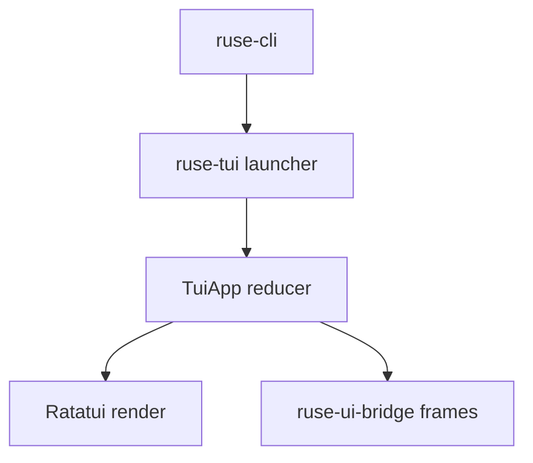

# M20-02 Ratatui Shell Spec

## Purpose

Create the `ruse-tui` crate with a safe full-screen terminal shell, pure app state, and deterministic rendering tests.

## Product Context

After M20-01 routes interactive terminal sessions toward TUI, M20-02 provides the minimal full-screen app frame that later slices fill with composer, transcript, approvals, trace, and tasks.

## Scope

This spec delivers:

- `ruse-tui` crate in the workspace
- `TuiApp` state and reducer skeleton
- `TerminalModeGuard` for raw mode and alternate screen cleanup
- base layout with transcript pane, composer placeholder, status bar, and optional side panel
- Ratatui buffer snapshot tests

Owned by other specs:

- multiline composer: M20-03
- streaming transcript: M20-04
- approval, diff, trace, and task panels: M20-05 and M20-06

## Architecture

`ruse-tui` depends on `ruse-ui-bridge`, `ruse-types`, Ratatui, Crossterm, and `tui-textarea`. It must not depend on `ruse-core`, `ruse-model`, `ruse-tool`, `ruse-policy`, or storage crates.



## Public Contracts

```rust
pub struct TuiApp {
    pub screen: TuiScreen,
    pub status: StatusBarState,
}

pub enum TuiAction {
    Tick,
    QuitRequested,
    Resize { width: u16, height: u16 },
}

pub fn render_app(frame: &mut ratatui::Frame<'_>, app: &TuiApp);
```

## State and Failure Handling

- app state is pure and testable without a real terminal
- terminal guard restores raw mode and alternate screen on normal exit and error
- narrow layouts hide optional side panels before truncating the composer area

## Security and Privacy

The shell renders only UI-safe state. It does not read config secrets or raw runtime data.

## Testing Strategy

- reducer tests for quit, resize, and screen switching
- terminal guard fixture tests that validate cleanup calls
- Ratatui buffer snapshot tests for normal and narrow layouts
- dependency check that `ruse-tui` does not import runtime business crates

## Acceptance Criteria

- `ruse-tui` builds as a workspace crate.
- a minimal TUI screen renders nonblank content in tests.
- terminal cleanup is covered by tests.

## Completion Signal

M20-02 is complete when `ruse-cli` can call the `ruse-tui` launcher boundary and TUI shell tests pass.
