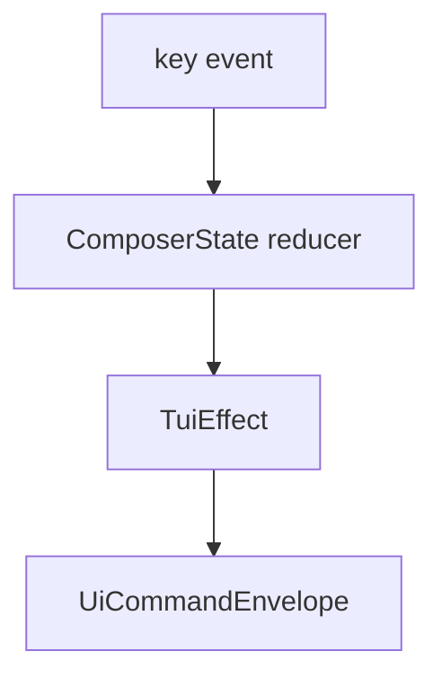

# M20-03 TUI Composer REPL Spec

## Purpose

Add the interactive composer and REPL input model to `agent-tui`.

## Product Context

The shell from M20-02 needs a usable input surface. Users must be able to type prompts, use multiline input, navigate history, and run slash commands without leaving the TUI.

## Scope

This spec delivers:

- `ComposerState` for text, mode, history, and submission status
- key handling for Enter, multiline newline, history navigation, and Escape
- slash command routing for help, status, trace, tasks, settings, clear, and quit
- bridge command creation for prompt submission

Owned by other specs:

- transcript rendering: M20-04
- approval action keys: M20-05
- trace/task panels: M20-06
- plain REPL fallback: M20-07

## Architecture

Composer logic remains pure and emits `TuiEffect` values. Effects are later executed by the app loop or bridge client.



## Public Contracts

```rust
pub struct ComposerState {
    pub text: String,
    pub multiline: bool,
    pub history: Vec<String>,
}

pub enum ComposerEffect {
    SubmitPrompt(String),
    RunSlashCommand(SlashCommand),
    None,
}
```

## State and Failure Handling

- empty prompt submission is ignored with a status diagnostic
- invalid slash commands render a local diagnostic and do not reach runtime
- history navigation never panics on empty history
- Escape clears focus before requesting app exit

## Security and Privacy

Composer history is in-memory for this slice. Persisted history and clipboard behavior are out of scope.

## Testing Strategy

- reducer tests for single-line submit, multiline newline, history, and empty submit
- slash command parser tests
- bridge command tests for submitted prompts
- render tests proving composer text fits fixed layout

## Acceptance Criteria

- users can submit prompts from TUI state
- slash commands are parsed deterministically
- composer tests pass without a real terminal

## Completion Signal

M20-03 is complete when composer reducer tests pass and M20-04 can consume submitted prompt and transcript events.
