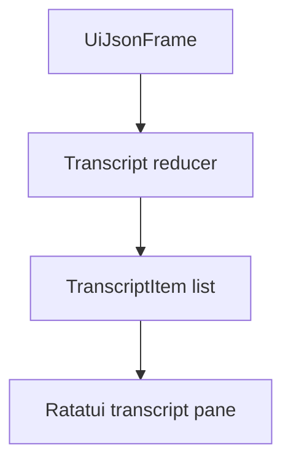

# M20-04 Streaming Transcript Spec

## Purpose

Render live model, tool, approval, and final-response events into a TUI transcript.

## Product Context

The TUI must make agent work feel alive and inspectable. Users need streamed deltas, tool calls, observations, waiting states, and final responses in one readable timeline.

## Scope

This spec delivers:

- `TranscriptState` and reducer over `UiJsonFrame`/`UiEventPayload`
- streaming model delta aggregation
- transcript items for user messages, tool calls, tool results, approvals, diagnostics, and final responses
- render tests for active stream, completed response, and error states

Owned by other specs:

- approval side panel actions: M20-05
- trace/task detail panels: M20-06
- runtime process transport: later milestones

## Architecture

`agent-tui` consumes UI-safe bridge frames. It never normalizes raw runtime events itself.



## Public Contracts

```rust
pub enum TranscriptItemKind {
    User,
    Model,
    ToolCall,
    ToolResult,
    Approval,
    Diagnostic,
}

pub struct TranscriptState {
    pub items: Vec<TranscriptItem>,
}
```

## State and Failure Handling

- model deltas append to the active model item
- final response closes the active model item
- malformed or error frames render diagnostics rather than panicking
- transcript item count is bounded by a configurable in-memory limit

## Security and Privacy

Only UI bridge payloads are rendered. Redacted approval and tool summaries remain redacted.

## Testing Strategy

- reducer tests for model deltas, final responses, tools, approvals, and diagnostics
- buffer tests for transcript scrolling and narrow widths
- snapshot tests for redacted approval payloads

## Acceptance Criteria

- streamed deltas render before final response
- tool and approval events appear in transcript order
- diagnostics are visible and do not crash rendering

## Completion Signal

M20-04 is complete when transcript reducer/render tests pass and M20-05 can select approval/diff items from transcript state.
