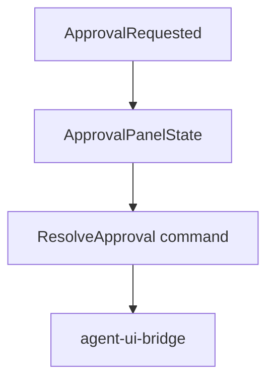

# M20-05 Approval and Diff Panels Spec

## Purpose

Add side panels for pending approvals and diff previews in the TUI.

## Product Context

M19 created approval contracts and CLI prompts. TUI users need an explicit, reviewable approval surface with enough context to make safe decisions without leaving the terminal.

## Scope

This spec delivers:

- `ApprovalPanelState` for pending approval list, focus, and selected action
- diff preview state for file edit summaries
- keyboard actions for allow, deny, abort, next, previous, and focus return
- bridge command creation for `ResolveApproval`

Owned by other specs:

- approval core resume: M19-05
- Desktop modals: M21
- trace/task panels: M20-06

## Architecture

Approval and diff panels consume UI-safe approval payloads from `agent-ui-bridge`. They emit `UiCommand::ResolveApproval` envelopes and never create leases or execute tools.



## Public Contracts

```rust
pub struct ApprovalPanelState {
    pub pending: Vec<UiApprovalRequest>,
    pub focused_index: Option<usize>,
}

pub enum ApprovalAction {
    Allow,
    Deny { reason: String },
    Abort,
}
```

## State and Failure Handling

- no focused approval means allow/deny keys produce a local diagnostic
- deny requires a non-empty reason
- stale approvals are removed when resolved/expired/consumed events arrive
- diff panel truncates large previews and indicates truncation

## Security and Privacy

Panels render only redacted previews. Hidden prompt content, raw secrets, and raw tool inputs are never displayed.

## Testing Strategy

- reducer tests for approval add, resolve, focus, allow, deny, and abort
- command conversion tests for `ResolveApproval`
- render tests for pending approval, redacted preview, and diff truncation

## Acceptance Criteria

- TUI can show pending approvals.
- allow/deny actions emit typed bridge commands.
- diff previews are readable and secret-safe.

## Completion Signal

M20-05 is complete when approval/diff panel tests pass and panels integrate with transcript-selected approvals.
