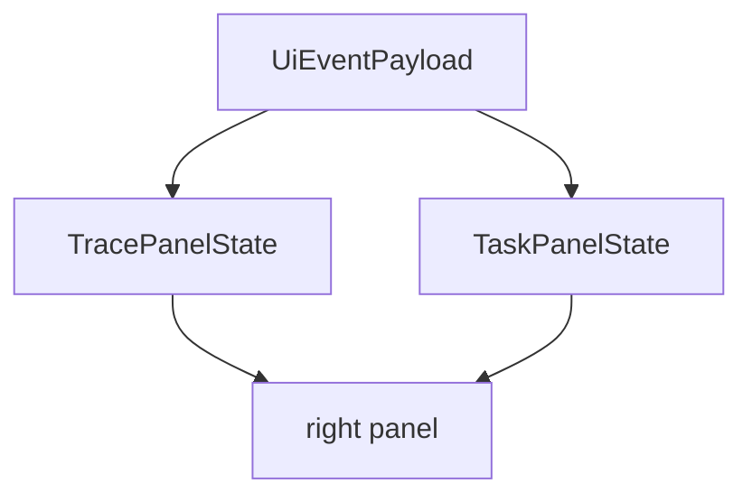

# M20-06 Trace and Task Panels Spec

## Purpose

Add TUI panels for runtime trace timelines and background task summaries.

## Product Context

Agents need inspectability during long or complex work. The terminal UX should let users see what happened, what is running, and what requires attention without switching tools.

## Scope

This spec delivers:

- `TracePanelState` with filters and ordered event summaries
- `TaskPanelState` with task notifications and status summaries
- slash command integration for `/trace` and `/tasks`
- render tests for timeline, filters, empty states, and task notifications

Owned by other specs:

- scheduler UX depth: M24
- Desktop task dashboard: M21/M24
- trace replay debug console: later milestone

## Architecture

Panels consume `UiEventPayload::Progress`, `TaskNotification`, diagnostics, tool events, and checkpoint events from the transcript/bridge stream. They do not query storage directly in this slice.



## Public Contracts

```rust
pub struct TracePanelState {
    pub entries: Vec<TracePanelEntry>,
    pub filter: TraceFilter,
}

pub struct TaskPanelState {
    pub notifications: Vec<TaskPanelNotification>,
}
```

## State and Failure Handling

- empty trace/task panels render useful empty states
- filters never remove diagnostics unless explicitly configured
- task notifications are bounded and newest-visible
- malformed payloads create diagnostics rather than panics

## Security and Privacy

Trace and task panels render UI-safe summaries only. Raw tool input and secret-like values remain redacted.

## Testing Strategy

- reducer tests for trace entry ordering and filters
- reducer tests for task notification accumulation
- render tests for empty, populated, and narrow panels
- slash command tests for opening trace/task panels

## Acceptance Criteria

- `/trace` opens trace panel.
- `/tasks` opens task panel.
- panels render runtime progress and task notifications without direct storage access.

## Completion Signal

M20-06 is complete when trace/task reducer and render tests pass and M20-07 can provide plain fallback equivalents.
