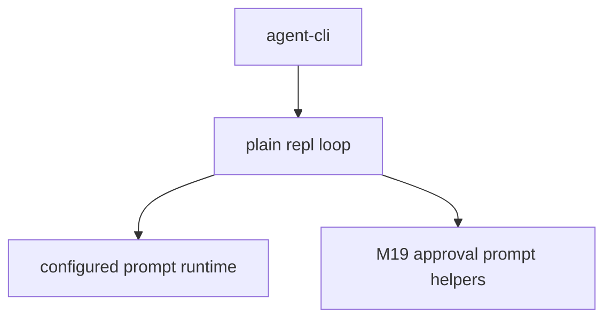

# M20-07 Plain REPL Fallback Spec

## Purpose

Provide a non-full-screen plain REPL fallback for constrained terminals and explicit `agent repl --plain` usage.

## Product Context

Some terminals, scripts, and remote shells should not enter raw mode. Users still need an interactive agent loop with readable prompts, streamed text, approval prompts, and slash commands.

## Scope

This spec delivers:

- plain REPL command dispatch
- line-oriented prompt loop
- slash commands shared with TUI where practical
- approval prompt reuse from M19-04
- script-safe behavior for non-TTY no-arg invocation

Owned by other specs:

- full-screen TUI: M20-02 through M20-06
- Desktop GUI: M21
- background agent UX: M24

## Architecture

`agent-cli` owns the plain REPL loop and reuses existing CLI renderers and approval helpers. It does not depend on Ratatui.



## Public Contracts

```rust
pub enum PlainReplEvent {
    PromptSubmitted(String),
    SlashCommand(String),
    Exit,
}

pub fn render_plain_repl_prompt() -> &'static str;
```

## State and Failure Handling

- EOF exits cleanly
- Ctrl+C or interrupt exits without corrupting terminal state
- empty lines are ignored
- runtime errors print diagnostics and keep the REPL alive unless terminal
- JSON and batch modes never enter plain REPL implicitly

## Security and Privacy

Plain REPL reuses existing redaction for prompt runtime, JSON, config diagnostics, and approval previews.

## Testing Strategy

- parser tests for `agent repl --plain`
- fixture loop tests for prompt, slash command, empty line, EOF, and error recovery
- tests proving JSON/batch modes do not enter plain REPL
- approval prompt reuse tests

## Acceptance Criteria

- `agent repl --plain` runs a line-oriented REPL.
- constrained terminal fallback does not enter raw mode.
- plain REPL can submit prompts and exit cleanly.

## Completion Signal

M20-07 is complete when plain REPL tests pass and M20 can be marked complete after workspace gates.
