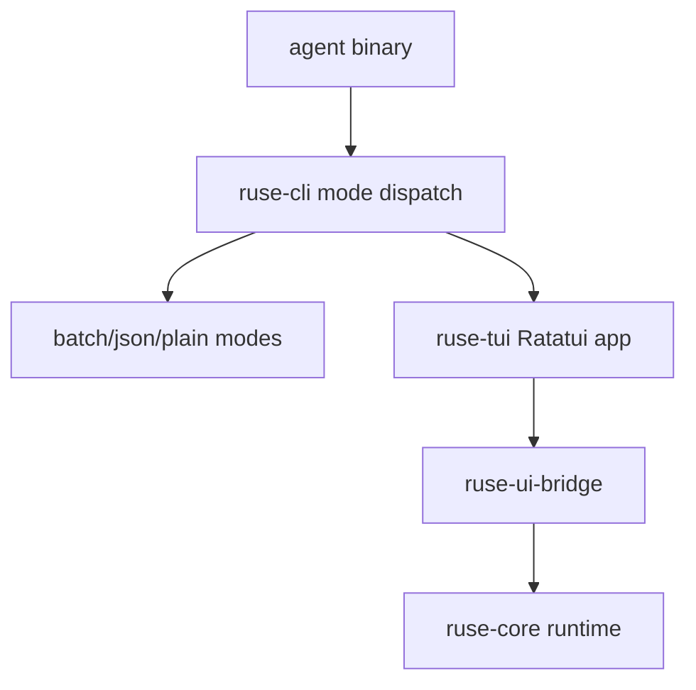

# M20 Terminal UX and TUI REPL Spec

## Purpose

Make `agent` feel like a real terminal product. M20 introduces the installed `agent` command, defaults interactive TTY sessions into a full-screen Ratatui REPL, and keeps batch, JSON, and plain REPL modes available for scripts and constrained terminals.

## Product Context

The target product should be usable by opening any terminal and typing `agent`. The terminal REPL should be powered by TUI, not a minimal line loop. Users need streaming transcript, multi-line prompt editing, slash commands, approval panels, diff review, trace panels, and task status without leaving the terminal.

## Scope

This milestone delivers:

- binary name `agent` while keeping the package crate `ruse-cli`
- `agent` default TTY behavior that enters TUI REPL
- explicit `agent tui`, `agent repl --plain`, batch, JSON, config, and version modes
- new `ruse-tui` crate using Ratatui, Crossterm, and `tui-textarea`
- transcript, composer, status bar, approval panel, diff panel, trace panel, and task panel state models
- UI bridge client loop for rendering runtime events and sending commands
- terminal cleanup, panic restore, resize handling, and fallback behavior

Owned by later milestones:

- Desktop GUI
- advanced keyboard customization
- plugin marketplace UI

## Architecture

`ruse-cli` stays the thin entrypoint for argument parsing, TTY detection, and mode dispatch. `ruse-tui` owns Ratatui rendering, input handling, terminal lifecycle, and UI state. Both communicate with runtime through `ruse-ui-bridge`; neither owns model, tool, storage, or policy logic.

## Key Contracts

- `TuiApp`
- `TuiRuntimeClient`
- `TuiScreen`
- `TranscriptState`
- `ComposerState`
- `ApprovalPanelState`
- `DiffPanelState`
- `TracePanelState`
- `TaskPanelState`
- `TerminalModeGuard`

Contract rules:

- `agent` with no args enters TUI only when stdin and stdout are TTYs
- non-TTY no-arg use prints help and exits non-zero with a clear diagnostic
- `agent --json --prompt` remains machine-readable NDJSON
- terminal raw mode is restored on normal exit, panic, and cancellation
- TUI stores UI state separately from runtime state

## State and Failure Handling

- unsupported terminal capabilities fall back to plain REPL when possible
- resize events trigger full redraw without losing composer contents
- runtime disconnection shows recoverable status and preserves transcript
- approval responses are disabled after request expiration
- interrupted sessions restore terminal state before exit

## Security and Privacy

- TUI never renders hidden prompt layers or raw secrets
- copied text and logs use UI-safe event payloads
- command and diff panels display normalized resources and sandbox profiles
- keyboard shortcuts for side effects require focused explicit action

## Testing Strategy

- pure state tests for screen navigation, transcript updates, composer behavior, and panel focus
- snapshot tests for rendered widgets using stable terminal buffers
- CLI mode tests for default TTY, explicit TUI, plain REPL, batch, and JSON paths
- terminal guard tests for cleanup behavior
- bridge fixture tests for streaming deltas and approvals

## Acceptance Criteria

- Installing the package exposes an `agent` command.
- Typing `agent` in an interactive terminal opens the TUI REPL.
- Batch and JSON modes remain script-safe.
- TUI renders streamed model output, approvals, diffs, trace events, and task status from UI bridge data.

## Completion Signal

M20 is complete when the terminal product is usable for a local coding turn and workspace verification covers TUI state, CLI dispatch, and bridge rendering.
