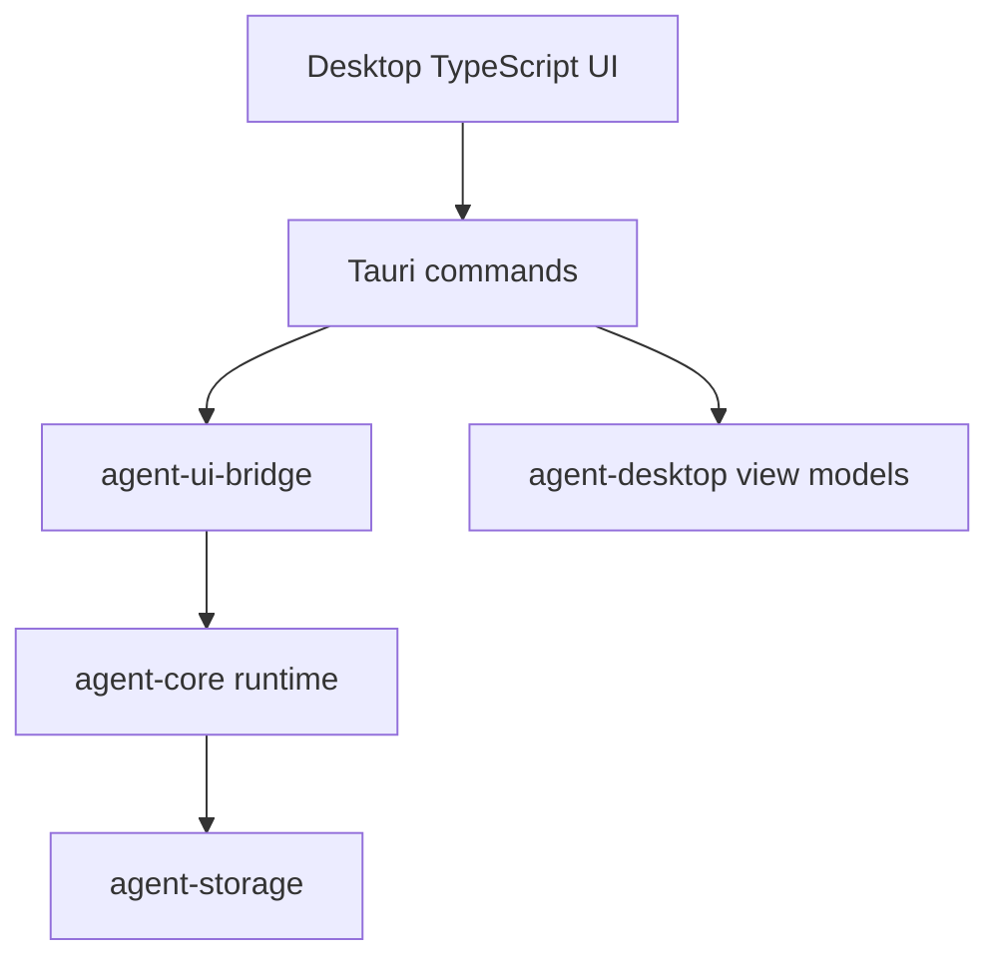

# M21-00 Desktop GUI Technical Design Spec

## Purpose

Define the architecture for a runnable Desktop MVP before M21 implementation begins. M21 turns the existing `agent-desktop` presentation contracts into a Tauri 2 application that shares runtime events, commands, approvals, diffs, traces, and settings with CLI and TUI.

## Product Context

M10 created Desktop view-model contracts but no GUI application. M20 establishes terminal UX. M21 adds the visual product surface needed for users who prefer task dashboards, permission dialogs, diff review, trace inspection, and settings management.

## Scope

This design governs:

- Tauri app structure and command boundary
- Desktop frontend state model
- runtime bridge session management
- conversation, task, approval, diff, trace, and settings views
- secret-safe settings behavior
- app startup, disconnect, and recovery states
- Desktop smoke testing strategy

Owned by implementation slices:

- `M21-01-tauri-shell`
- `M21-02-desktop-bridge-session`
- `M21-03-conversation-task-ui`
- `M21-04-approval-diff-ui`
- `M21-05-trace-settings-ui`

## Architecture

The Desktop app has three layers:

1. TypeScript frontend: views, local UI state, routing, rendering, input.
2. Tauri Rust command layer: typed commands, bridge session, platform integration.
3. Shared runtime crates: `agent-ui-bridge`, `agent-desktop`, `agent-core`, storage, config, policy.



Dependency rules:

- frontend never calls model, tool, storage, or secret APIs directly
- Tauri commands expose a narrow typed allowlist
- `agent-desktop` remains view-model contracts and does not own runtime orchestration
- shared runtime behavior stays in core crates

## Application Layout

Initial app shell:

- left rail: conversations, tasks, workspaces
- main area: transcript and composer
- right panel: approval, diff, trace, settings, or task detail
- status bar: provider/model, workspace, runtime connection, pending approvals

The frontend state is derived from UI bridge frames plus view-model snapshots. Optimistic UI is allowed for local navigation but not for runtime side effects.

## Runtime Bridge Session

Desktop creates a `DesktopRuntimeSession` on app startup or workspace open. The session owns:

- client metadata
- workspace id
- active conversation id
- event subscription
- command submit path
- reconnect/backoff state

Tauri commands:

- `start_session`
- `stop_session`
- `send_ui_command`
- `load_config_snapshot`
- `list_conversations`
- `load_trace`
- `resolve_approval`

Exact command names can be adjusted in slice specs, but all payloads must be typed and serializable.

## Settings and Secrets

Desktop settings include model provider config, policy defaults, memory settings, MCP/plugin enablement, UI preferences, and update channel. Raw secrets are never stored in frontend state or Tauri config. Secret entry writes to the configured secret backend and stores only a secret reference.

Settings changes validate through core config contracts before persistence. Invalid settings produce diagnostics and do not mutate active runtime state.

## Error and Recovery States

Desktop must represent:

- runtime not started
- connecting
- connected
- disconnected, reconnecting
- blocked by invalid config
- waiting for approval
- task running in background
- failed command with recoverable diagnostic

Pending approvals and task states survive app restart when backed by storage.

## Security and Privacy

Tauri command allowlist must be narrow. Frontend receives only UI-safe payloads. Logs, traces, diff previews, and settings snapshots redact secrets. File dialogs select workspace paths but do not automatically grant broad filesystem permissions.

## Testing Strategy

Required coverage:

- Rust command tests for bridge session lifecycle
- `agent-desktop` view-model tests remain green
- frontend component tests for conversation, task, approval, diff, trace, and settings views
- Playwright smoke test for app launch and primary navigation
- serialization snapshot tests for Tauri command payloads
- secret redaction tests for settings views

Workspace gates use:

```bash
cargo xtask check
```

Frontend verification is defined in M21 slice plans because package manager setup depends on the chosen frontend scaffold.

## Acceptance Criteria

- Desktop app launches locally.
- It can start a runtime bridge session and render conversation/task state.
- It can display approval and diff payloads from shared contracts.
- Settings validation is secret-safe.
- App errors are visible and recoverable.

## Completion Signal

M21 technical design is complete when this document and its plan exist, M21 milestone planning marks the design slice complete, and M21-01 can start without unresolved Tauri, bridge, or settings-boundary decisions.
