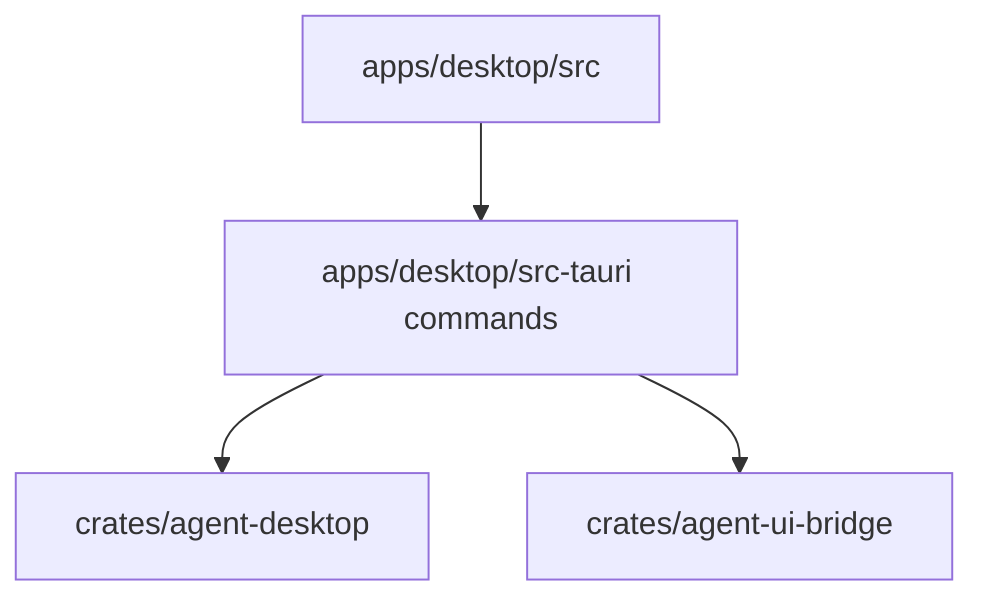

# M21-01 Tauri Shell Spec

## Purpose

Create the runnable Desktop application shell for `agent` without starting runtime work or touching model, tool, storage, or secret APIs from the frontend.

## Product Context

M20 made the terminal product usable. M21 starts the visual Desktop product by adding a Tauri 2 shell that can launch, render the base layout, expose safe bootstrap diagnostics, and provide a stable home for later bridge, conversation, approval, trace, and settings slices.

## Scope

This spec delivers:

- `apps/desktop/` Tauri 2 + TypeScript/Vite application scaffold
- Rust Tauri command crate under `apps/desktop/src-tauri`
- frontend app shell with left rail, main transcript/composer area, right panel, and status bar
- startup/bootstrap diagnostics that are safe to show in the frontend
- local Rust and frontend smoke tests for shell launch state

Owned by other specs:

- runtime bridge sessions: M21-02
- real conversation/task data: M21-03
- approvals/diffs: M21-04
- trace/settings content: M21-05
- release bundles and updater: M25

## Architecture

`apps/desktop` owns GUI presentation and the Tauri command boundary. `crates/agent-desktop` remains reusable view-model contracts. Runtime logic stays in shared Rust crates and is not implemented in the frontend.



Dependency rules:

- frontend can call only Tauri commands defined by this app
- command payloads are typed and serializable
- app startup returns summaries and diagnostics only
- raw secrets, raw prompts, and raw tool inputs never enter bootstrap state

## File Layout

```text
apps/
  desktop/
    package.json
    index.html
    vite.config.ts
    tsconfig.json
    src/
      main.tsx
      App.tsx
      app.css
      api.ts
      types.ts
      __tests__/
        app-shell.test.tsx
    src-tauri/
      Cargo.toml
      tauri.conf.json
      src/
        lib.rs
        main.rs
        commands.rs
        state.rs
        bootstrap.rs
        tests/
          bootstrap.rs
```

## Public Contracts

```rust
pub struct DesktopBootstrap {
    pub app_name: String,
    pub app_version: String,
    pub runtime_state: DesktopRuntimeState,
    pub route: DesktopRoute,
    pub diagnostics: Vec<DesktopBootstrapDiagnostic>,
}

pub enum DesktopRuntimeState {
    NotStarted,
    Connecting,
    Connected,
    Disconnected,
    Blocked,
}

pub struct DesktopBootstrapDiagnostic {
    pub severity: String,
    pub code: String,
    pub message: String,
}

#[tauri::command]
pub async fn desktop_bootstrap(state: tauri::State<'_, DesktopAppState>) -> Result<DesktopBootstrap, DesktopCommandError>;
```

Frontend types mirror these payloads in `apps/desktop/src/types.ts`.

## State and Failure Handling

- shell starts in `not_started` runtime state
- failed bootstrap command renders a recoverable diagnostic panel
- frontend navigation can switch local routes but cannot trigger runtime side effects
- unsupported route ids fall back to conversation route with a diagnostic

## Security and Privacy

- Tauri command allowlist contains only bootstrap commands in this slice
- frontend state stores no secrets
- diagnostics redact secret-like keys before serialization
- file dialogs and workspace selection are not introduced in this slice

## Testing Strategy

- Rust tests validate bootstrap payloads and redacted diagnostics
- TypeScript component tests render the shell regions and error state
- smoke command verifies the frontend build can compile
- `cargo xtask check` remains green for Rust workspace

## Acceptance Criteria

- Desktop app scaffold exists under `apps/desktop`.
- Bootstrap command returns typed, secret-safe app state.
- Shell renders left rail, main workspace area, right panel, and status bar.
- No frontend code imports model, tool, storage, or secret crates.

## Completion Signal

M21-01 is complete when Rust bootstrap tests, frontend shell tests, frontend build, and `cargo xtask check` pass.
