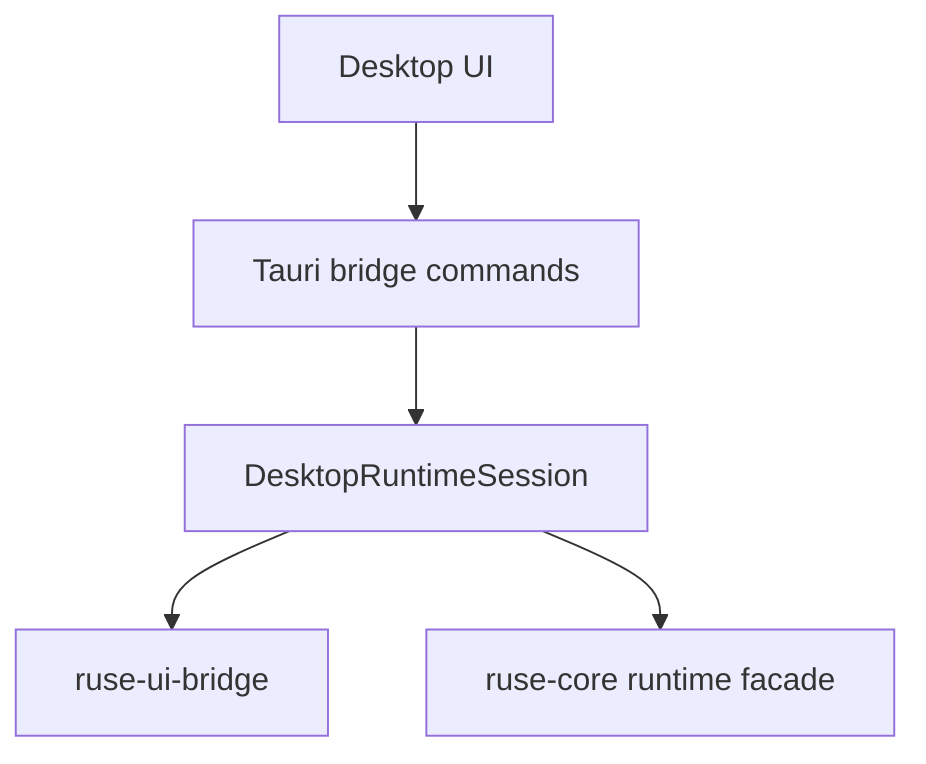

# M21-02 Desktop Bridge Session Spec

## Purpose

Connect the Desktop shell to the shared UI bridge through a typed session boundary without allowing the frontend to call runtime internals directly.

## Product Context

M21-01 creates a runnable shell. M21-02 makes that shell useful by adding a local runtime session facade that can start, stop, submit UI commands, and deliver UI-safe frames to the frontend.

## Scope

This spec delivers:

- `DesktopRuntimeSession` state in the Tauri command layer
- typed `start_session`, `stop_session`, `send_ui_command`, and `drain_ui_frames` commands
- connection state transitions for connecting, connected, disconnected, and blocked
- UI-safe error mapping and reconnect metadata
- tests for session lifecycle, command validation, and frame draining

Owned by other specs:

- shell layout: M21-01
- conversation/task views: M21-03
- approval-specific commands: M21-04
- trace/settings commands: M21-05

## Architecture

The Tauri command layer owns session orchestration. `ruse-ui-bridge` owns command/event schemas. `ruse-core` remains behind the bridge-facing command layer and is not referenced by frontend code.



## File Layout

```text
apps/desktop/src/
  api.ts
  bridge.ts
  types.ts
  __tests__/bridge-session.test.ts
apps/desktop/src-tauri/src/
  bridge.rs
  commands.rs
  state.rs
  tests/bridge_session.rs
```

## Public Contracts

```rust
pub struct DesktopStartSessionRequest {
    pub workspace_path: Option<String>,
    pub client_version: String,
}

pub struct DesktopSessionSnapshot {
    pub session_id: String,
    pub workspace_id: String,
    pub conversation_id: String,
    pub state: DesktopRuntimeState,
    pub pending_frame_count: usize,
}

pub enum DesktopBridgeCommand {
    StartTurn(UiCommandEnvelope),
    ResolveApproval(UiCommandEnvelope),
}
```

Tauri commands:

- `start_session(request) -> DesktopSessionSnapshot`
- `stop_session() -> DesktopSessionSnapshot`
- `send_ui_command(envelope) -> DesktopCommandAck`
- `drain_ui_frames(max_count) -> Vec<UiJsonFrame>`

## State and Failure Handling

- starting an already connected session returns the existing session snapshot
- stopping a disconnected session is idempotent
- invalid UI commands are rejected before reaching runtime code
- recoverable runtime errors become UI-safe diagnostics
- frame queues are bounded and report dropped-frame diagnostics

## Security and Privacy

- frontend receives only `UiJsonFrame` payloads
- secret-like diagnostics are redacted before enqueueing frames
- workspace path is optional and does not grant broad file permissions
- session state cannot mutate config or policies directly

## Testing Strategy

- Rust tests cover start, duplicate start, stop, command validation, frame drain limits, and redaction
- TypeScript tests cover API client serialization and reconnect UI state
- snapshot tests pin command and frame payload shapes

## Acceptance Criteria

- Desktop can create a bridge session from the shell.
- Typed UI commands can be validated and acknowledged.
- UI frames can be drained without direct storage access.
- Connection errors are visible and recoverable.

## Completion Signal

M21-02 is complete when bridge session Rust tests, frontend bridge tests, and `cargo xtask check` pass.
