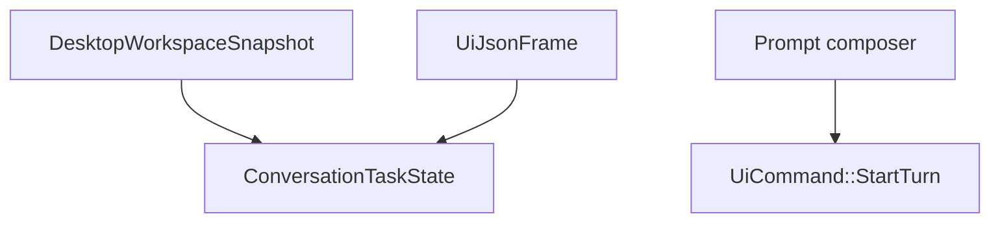

# M21-03 Conversation and Task UI Spec

## Purpose

Render conversation and task dashboard views in Desktop from UI-safe snapshots and bridge frames.

## Product Context

M21-02 connects the shell to the bridge. Users now need a visual way to inspect conversations, submit prompts, and track active tasks without dropping into CLI/TUI.

## Scope

This spec delivers:

- conversation list, transcript, and composer view
- task list and task detail panel
- `load_workspace_snapshot` command returning `DesktopWorkspaceSnapshot`
- frontend reducers for conversation/task frames
- empty, loading, disconnected, and error states

Owned by other specs:

- bridge lifecycle: M21-02
- approval and diff review: M21-04
- trace/settings views: M21-05
- background task authoring depth: M24

## Architecture

`agent-desktop` owns conversation/task view-model contracts. Tauri commands load snapshots and pass UI bridge frames. Frontend reducers derive screen state and send prompt submissions as `UiCommand::StartTurn`.



## File Layout

```text
apps/desktop/src/
  state/conversation.ts
  state/tasks.ts
  components/ConversationList.tsx
  components/TranscriptView.tsx
  components/Composer.tsx
  components/TaskList.tsx
  components/TaskDetail.tsx
  __tests__/conversation-task-ui.test.tsx
apps/desktop/src-tauri/src/
  workspace_snapshot.rs
  tests/workspace_snapshot.rs
```

## Public Contracts

```rust
#[tauri::command]
pub async fn load_workspace_snapshot(state: tauri::State<'_, DesktopAppState>) -> Result<DesktopWorkspaceSnapshot, DesktopCommandError>;
```

Frontend state:

```ts
export interface ConversationTaskState {
  conversations: DesktopConversationItem[];
  tasks: DesktopTaskItem[];
  transcript: UiEventPayload[];
  activeConversationId: string | null;
  activeTaskId: string | null;
  composerText: string;
}
```

## State and Failure Handling

- empty workspaces render empty lists and an enabled composer
- disconnected sessions disable prompt submission and keep existing snapshot visible
- failed prompt submission renders a recoverable diagnostic
- task lists sort active states before terminal states

## Security and Privacy

- transcript renders UI-safe summaries only
- composer content is sent through `UiCommandEnvelope`; frontend does not call model providers
- task details do not show raw tool input or raw command output

## Testing Strategy

- Rust tests verify workspace snapshot serialization and validation
- frontend tests render empty and populated conversation/task states
- reducer tests cover user message, model delta, final response, task notification, and diagnostic frames
- command tests verify composer submits `StartTurn`

## Acceptance Criteria

- Desktop renders conversation list, transcript, composer, task list, and task detail.
- Prompt submission produces a typed bridge command.
- Task notifications update task UI state without direct scheduler access.

## Completion Signal

M21-03 is complete when conversation/task Rust tests, frontend reducer/component tests, and `cargo xtask check` pass.
