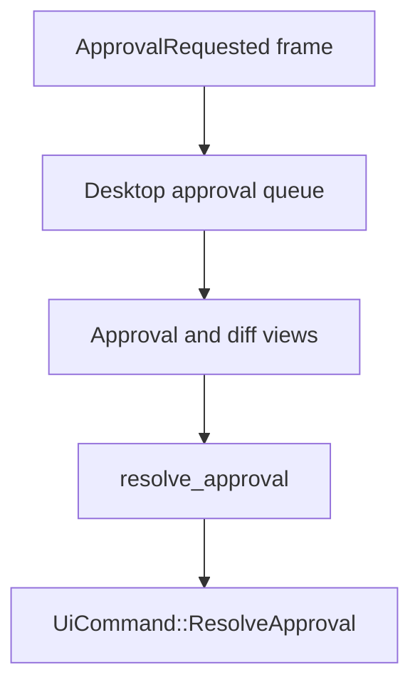

# M21-04 Approval and Diff UI Spec

## Purpose

Provide Desktop approval and diff review surfaces using the shared M19/M20 approval and preview contracts.

## Product Context

CLI and TUI can already review approvals. Desktop users need equivalent safe review controls with clearer layout, explicit decisions, and diff previews.

## Scope

This spec delivers:

- approval queue and approval detail view
- diff preview panel for file-edit approval previews
- `resolve_approval` Desktop command using `UiCommand::ResolveApproval`
- decision states for allow, deny, pending, resolved, expired, and consumed approvals
- redaction/truncation indicators in UI

Owned by other specs:

- pending approval core and recovery: M19
- TUI approval panels: M20-05
- Desktop bridge session: M21-02

## Architecture

Approval frames enter through `agent-ui-bridge`. Frontend keeps a UI-only approval queue. Decisions are sent back through typed Tauri commands; core remains responsible for lease creation, approval validation, and resume.



## File Layout

```text
apps/desktop/src/
  state/approvals.ts
  components/ApprovalQueue.tsx
  components/ApprovalDetail.tsx
  components/DiffPreview.tsx
  __tests__/approval-diff-ui.test.tsx
apps/desktop/src-tauri/src/
  approval_commands.rs
  tests/approval_commands.rs
```

## Public Contracts

```rust
pub struct DesktopResolveApprovalRequest {
    pub request_id: String,
    pub decision: UiApprovalDecision,
    pub reason: String,
    pub lease_duration_seconds: Option<u64>,
}

#[tauri::command]
pub async fn resolve_approval(request: DesktopResolveApprovalRequest, state: tauri::State<'_, DesktopAppState>) -> Result<DesktopCommandAck, DesktopCommandError>;
```

Frontend state:

```ts
export interface ApprovalUiState {
  pending: UiApprovalRequest[];
  selectedRequestId: string | null;
  lastDecisionStatus: string | null;
}
```

## State and Failure Handling

- duplicate approval request ids update the existing pending item
- resolved, expired, cancelled, and consumed approvals leave the pending queue
- deny requires a non-empty reason
- invalid request ids produce local validation errors before sending commands
- diff previews preserve truncation and redaction metadata

## Security and Privacy

- UI renders only `UiApprovalPreviewSummary`
- redacted previews are marked clearly and never expanded client-side
- raw command input, raw file patches, and secrets are not persisted in frontend state
- decisions are audited by runtime through the existing approval path

## Testing Strategy

- Rust tests validate `DesktopResolveApprovalRequest` conversion to bridge command
- frontend reducer tests cover add, update, resolve, expire, and consume flows
- component tests cover allow, deny, empty reason, redacted preview, and truncated diff
- snapshot tests confirm no secret-like values appear in approval UI output

## Acceptance Criteria

- Desktop displays pending approvals and selected approval details.
- File-edit approvals show a readable diff preview summary.
- Allow and deny decisions emit typed bridge commands.
- Redacted/truncated previews remain safe.

## Completion Signal

M21-04 is complete when approval command tests, frontend approval/diff tests, and `cargo xtask check` pass.
