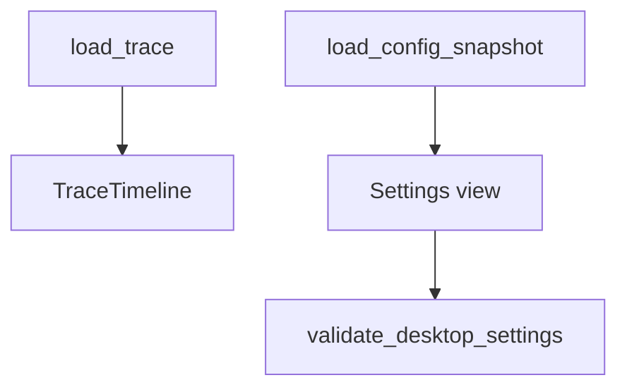

# M21-05 Trace and Settings UI Spec

## Purpose

Add Desktop trace inspection and secret-safe settings views to complete the Desktop MVP surface.

## Product Context

M21-03 and M21-04 cover daily agent interaction. Users also need trace visibility and configuration inspection before Desktop can be considered a useful product shell.

## Scope

This spec delivers:

- trace timeline view backed by `ruse-desktop` trace contracts
- config/settings view backed by UI-safe config snapshots
- `load_trace` and `load_config_snapshot` Desktop commands
- settings validation diagnostics without raw secret values
- final Desktop smoke navigation across conversation, tasks, approvals, trace, and settings

Owned by other specs:

- durable settings mutation and keychain storage: M25
- memory settings depth: M23
- plugin/MCP settings depth: M22
- background agent UX depth: M24

## Architecture

The trace view consumes `TraceTimeline` and bridge trace frames. The settings view consumes `DesktopConfigSnapshot` and `DesktopSettings` validation results. Mutating durable settings is deferred to M25; M21-05 validates and displays safe snapshots only.



## File Layout

```text
apps/desktop/src/
  state/trace.ts
  state/settings.ts
  components/TraceTimeline.tsx
  components/SettingsView.tsx
  __tests__/trace-settings-ui.test.tsx
  __tests__/desktop-smoke.test.tsx
apps/desktop/src-tauri/src/
  trace_commands.rs
  settings_commands.rs
  tests/trace_settings_commands.rs
```

## Public Contracts

```rust
#[tauri::command]
pub async fn load_trace(conversation_id: String, state: tauri::State<'_, DesktopAppState>) -> Result<TraceTimeline, DesktopCommandError>;

#[tauri::command]
pub async fn load_config_snapshot(state: tauri::State<'_, DesktopAppState>) -> Result<DesktopConfigSnapshot, DesktopCommandError>;

#[tauri::command]
pub async fn validate_settings(settings: DesktopSettings) -> Result<Vec<DesktopBootstrapDiagnostic>, DesktopCommandError>;
```

## State and Failure Handling

- empty trace renders an empty state
- duplicate or invalid trace entries return recoverable diagnostics
- settings validation errors do not mutate stored config
- disconnected runtime still allows viewing cached config snapshot

## Security and Privacy

- traces redact secret-like values using `ruse-desktop` trace sanitization
- settings snapshots store secret refs and redacted diagnostics only
- raw secrets never enter frontend local storage
- export/update/signing flows are out of scope for M21

## Testing Strategy

- Rust command tests cover empty trace, populated trace, config snapshot, invalid settings, and redaction
- frontend tests cover trace severity rendering, settings validation, and secret redaction
- Desktop smoke test covers route navigation and primary empty states
- final M21 verification includes Rust and frontend commands

## Acceptance Criteria

- Desktop renders trace timeline and settings views.
- Settings diagnostics are useful and secret-safe.
- Navigation across all M21 MVP routes works in a local smoke test.
- M21 can be marked complete after workspace and frontend verification pass.

## Completion Signal

M21-05 is complete when trace/settings tests, Desktop smoke tests, and `cargo xtask check` pass.
